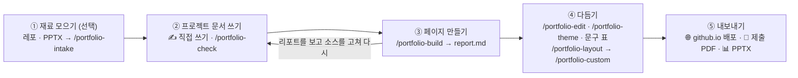

# 포트폴리오 자동 작성 템플릿 (Claude Code)

내가 쓴 **프로젝트 문서 · 스크린샷 · 소스코드**를 Claude가 읽고 조합해서,
「[유니티 개발자 취업·기술 문서 작성 가이드 v2](https://koohoo-dev.github.io/edu-lecture-portfolio-guide/)」 기준에 맞는
**포트폴리오 웹페이지 세 가지**(포트폴리오 문서 · 발표 덱 · 프로젝트 상세 문서)와 **점검 리포트**를 만들어 줍니다.
결과물은 설치·빌드 과정 없이 GitHub Pages로 바로 배포되고, 제출용 PDF로도 저장할 수 있습니다. 발표 덱은 PowerPoint 파일(PPTX)로 저장해 직접 고쳐 쓸 수도 있습니다.

**처음이라면** → [전체 흐름](docs/2-workflow.md) — 재료 모으기부터 제출까지 단계별로 안내합니다.

**예시 보기** → https://krkoohoo.github.io/portfolio-template/
(이 레포에 들어 있는 샘플 프로필과 선배 수강생 작품 3편으로 만든 페이지입니다.)

> **이 템플릿이 대신 해 주지 않는 것**: 프로젝트 문서를 *써 주는 것*. Claude는 여러분이 쓴 내용을 **정리·점검**할 뿐,
> 없는 사실을 지어내거나 문서를 고쳐 쓰지 않습니다. 프로젝트 문서의 목적은 *"내가 만든 것을 설명할 줄 안다"* 를 보여주는 것이니까요.

## 문서

| 문서 | 내용 |
|---|---|
| [전체 흐름](docs/2-workflow.md) | 재료에서 제출까지 단계마다 무엇을 하고, 끝났는지 어떻게 확인하는지 |
| [프로젝트 문서 쓰는 법](docs/3-writing.md) | 프로젝트 폴더에 넣는 것, 뼈대와 모듈, 페이지가 잘 나오게 쓰는 요령, 샘플 |
| 도구 — [재료 모으기](docs/tools/intake.md) · [점검받기](docs/tools/check.md) · [페이지 만들기](docs/tools/build.md) · [장면 고치기](docs/tools/edit.md) · [디자인 바꾸기](docs/tools/design.md) · [내보내기](docs/tools/export.md) · [템플릿 업데이트](docs/tools/update.md) | 명령마다 언제 쓰나 · 바뀌는 것 · 되돌리기 |
| [문제 해결](docs/troubleshooting.md) | 증상별 원인과 해결 |
| [참고](docs/reference.md) | 세 페이지 자세히, 폴더 구조, 스킬 구성, 기준 문서 |

---

## 무엇이 만들어지나요

| 결과 | 주소 | 무엇인가요 | 어디에 쓰나요 |
|---|---|---|---|
| **포트폴리오 문서** | `index.html` | 아래로 읽는 한 페이지. 자기소개 → 기술 스택 → 프로젝트마다 소개·기능 소개 → 한눈에 보기 → 연락처 | 지원서에 넣는 링크, **제출용 PDF**(A4) |
| **발표 덱** | `project.html?p=<폴더 이름>` | 프로젝트 문서를 바탕으로 한 16:9 발표 슬라이드. 프로젝트마다 하나 | 면접·발표, 프로젝트별 PDF, PowerPoint에서 고쳐 쓰는 **PPTX** |
| **프로젝트 상세 문서** | `doc.html?p=<폴더 이름>` | 프로젝트 문서 전문을 읽기 좋게 보여 주는 긴 문서 | 더 깊이 읽고 싶은 사람에게 |
| **점검 리포트** | `report.md` (내 PC에만) | 가이드 기준으로 프로젝트 문서를 점검한 결과(필수 · 권장 · 참고) | 프로젝트 문서를 고칠 때 |

- 세 페이지는 서로 링크로 이어집니다. 포트폴리오 문서의 기능마다 **[발표 덱에서 보기]** 버튼이 그 기능을 다루는 발표 장면으로 바로 갑니다.
- 기본 모양은 **어두운 바탕 + 강조색 그러데이션**입니다(인쇄·PDF는 흰 종이). 색·모양·문구는 [디자인 바꾸기](docs/tools/design.md#디자인-바꾸기)로 바꿀 수 있습니다.
- 휴대폰에서도 볼 수 있습니다(좁은 화면에서는 배치가 한 단으로 바뀌고, 발표 덱은 밀어서 넘깁니다).

## 도구 한눈에

도구는 세 종류입니다. **명령**은 레포 폴더에서 Claude Code를 열고 입력하고(목록에 안 보이면 Claude Code를 새로 시작), **버튼**은 페이지에 있으며, **파일**은 직접 고칩니다.
✋ 표시가 있는 명령은 **직접 입력했을 때만** 실행되고, 나머지는 "포트폴리오 만들어 줘"처럼 말로 부탁해도 됩니다. 도구 이름을 누르면 설명으로 갑니다.

| 단계 | 하고 싶은 일 | 도구 | 바뀌는 것 |
|---|---|---|---|
| 재료 | GitHub 레포에서 프로젝트 문서 재료 모으기 | ✋ [`/portfolio-intake <레포 주소>`](docs/tools/intake.md#github-레포에서-가져오기) 명령 | `src/<폴더>/_intake/`·`code/` |
| | PowerPoint 발표 자료(PPTX) 가져오기 | ✋ [`/portfolio-intake <발표.pptx>`](docs/tools/intake.md#발표-자료pptx에서-가져오기) 명령 | `src/<폴더>/_intake/발표자료.md`·`pptx/` |
| 쓰기 | 쓰는 중에 가이드 기준으로 점검받기 | [`/portfolio-check`](docs/tools/check.md#쓰는-중에-점검받기) 명령 | `report.md` |
| 만들기 | 세 페이지의 데이터 만들기·다시 만들기 | [`/portfolio-build`](docs/tools/build.md#포트폴리오-데이터-만들기) 명령 | `data/`, `report.md` |
| | 만든 페이지 열어 보기 | ["미리보기 띄워줘"](docs/tools/build.md#미리보기) 또는 로컬 서버 | — |
| 다듬기 | 발표 덱 장면 하나만 바꾸기 | [`/portfolio-edit`](docs/tools/edit.md#발표-덱-장면-고치기) 명령 | `src/<폴더>/deck-edits.json`, `data/projects/<폴더>.json` |
| | 강조색 바꾸기 | [`profile.md`의 강조색](docs/tools/build.md#profilemd-채우기) 파일 → 다시 만들기 | `profile.md` |
| | 절 이름·버튼 문구 바꾸기 | [`theme/strings.tsv`](docs/tools/design.md#문구-바꾸기) 파일 | 그 파일 (다시 만들 필요 없음) |
| | 다른 사이트 느낌으로(색·모양·영문 글꼴) | [`/portfolio-theme`](docs/tools/design.md#다른-사이트-느낌으로-바꾸기) 명령 | `theme/theme.css` |
| | 다른 사이트의 배치(단 나눔·카드 격자) 따라 하기 | [`/portfolio-layout`](docs/tools/design.md#다른-사이트-배치-따라-하기) 명령 → ✋ `/portfolio-custom` | `theme/layout.json` → `custom/index.html` |
| | 배치까지 새 디자인 | ✋ [`/portfolio-custom`](docs/tools/design.md#나만의-디자인-새로-만들기) 명령 | `custom/index.html` |
| 내보내기 | 인터넷에 공개 | [commit · push + GitHub Pages](docs/tools/export.md#배포하기) | — |
| | 제출용 PDF(A4) | 포트폴리오 문서의 [\[PDF로 저장\]](docs/tools/export.md#pdf로-제출하기) 버튼 | PDF 파일 |
| | 발표 자료 PDF · PowerPoint | 발표 덱의 [\[PDF로 저장\]](docs/tools/export.md#pdf로-제출하기) · [\[PPTX로 저장\]](docs/tools/export.md#발표-덱을-pptx로-저장하기) 버튼 | PDF · `.pptx` 파일 |
| 유지 | 템플릿의 새 기능 받기 | ✋ [`/portfolio-update`](docs/tools/update.md#템플릿-업데이트-받기) 명령 | 렌더러·명령·기준 + 업데이트 커밋 1개 |

말로 부탁하면 되는 것도 있습니다.

- "미리보기 띄워줘"
- "미리보기 배치 점검 결과 알려 줘" — 발표 덱 아래 띠의 빨간 숫자가 무엇인지 장면마다 알려 줍니다
- "문구 표 점검해 줘" — `theme/strings.tsv`에서 칸이 어긋났거나 너무 긴 줄을 줄 번호와 함께 알려 줍니다
- "충돌 해결 도와줘" — 템플릿을 받다가 git 충돌이 났을 때

## 준비물

| 준비물 | 비고 |
|---|---|
| GitHub 계정 | 무료 플랜은 **공개(Public) 레포**에서만 Pages가 동작합니다 |
| Git | `/portfolio-intake`·`/portfolio-update`도 Git을 씁니다 |
| [Claude Code](https://claude.com/claude-code) | **이 레포 폴더를 열고** 써야 `/portfolio-…` 명령이 보입니다 |
| Python 3.8 이상 (권장) | 미리보기 서버, 빌드 중 검사, 테마 점검, 발표 자료(.pptx) 재료 꺼내기에 씁니다. 발표 덱 장면 고치기(`/portfolio-edit`)에는 **꼭 필요**합니다 |
| Windows PC의 Chrome 또는 Edge | 제출용 PDF 저장이 보장되는 환경입니다 |

## 빠른 시작

처음 한 번은 아래 순서대로 하면 됩니다. 단계마다 자세한 설명은 링크를 보세요.

1. 이 레포를 **Fork**해서 내 PC에 clone합니다.
   - clone하자마자 [미리보기](docs/tools/build.md#미리보기)를 열면 샘플로 만든 결과를 바로 볼 수 있습니다. 어떤 모양이 나오는지 먼저 보세요.
2. `src/`의 샘플 프로젝트 4개를 지우고, 내 프로젝트 폴더(예: `src/1-my-game/`)에 `프로젝트문서.md`와 `images/`를 넣습니다. → [프로젝트 문서 쓰는 법](docs/3-writing.md#프로젝트-문서와-소스-넣기)
   - 프로젝트 문서가 아직 없다면 [`/portfolio-intake`](docs/tools/intake.md#재료-모으기)로 GitHub 레포나 발표 자료(.pptx)에서 재료부터 뽑고, 쓰는 중에는 [`/portfolio-check`](docs/tools/check.md#쓰는-중에-점검받기)로 점검받습니다.
3. `profile.md`의 예시 값(홍길동 등)을 내 정보로 바꿉니다. → [profile.md 채우기](docs/tools/build.md#profilemd-채우기)
4. 레포 폴더에서 Claude Code를 열고 `/portfolio-build`를 입력합니다. → [포트폴리오 만들기](docs/tools/build.md#포트폴리오-만들기)
5. `report.md`를 읽고 **원본(`src/`·`profile.md`)을 고친 뒤** 다시 `/portfolio-build` — 만족할 때까지 되풀이합니다.
6. 미리보기로 확인하고 commit · push → GitHub **Settings → Pages**에서 `main` / `(root)`로 배포합니다. → [미리보기](docs/tools/build.md#미리보기) · [배포하기](docs/tools/export.md#배포하기)
7. 배포된 주소에서 **[PDF로 저장]** 버튼으로 제출용 PDF를 만듭니다. → [PDF로 제출하기](docs/tools/export.md#pdf로-제출하기)

---

기준 가이드: 「유니티 개발자 취업·기술 문서 작성 가이드 v2」 — 김재훈 (Jay / KooHoo) · https://koohoo-dev.github.io/edu-lecture-portfolio-guide/
