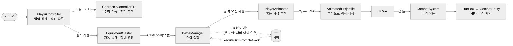
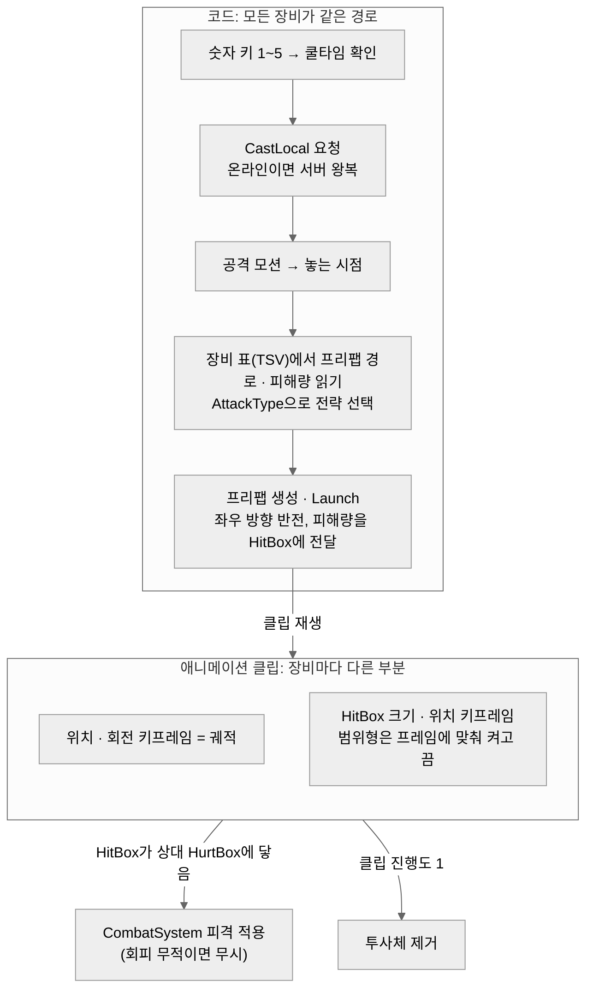
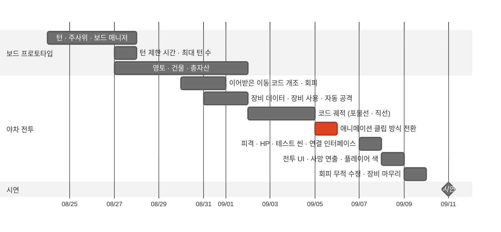
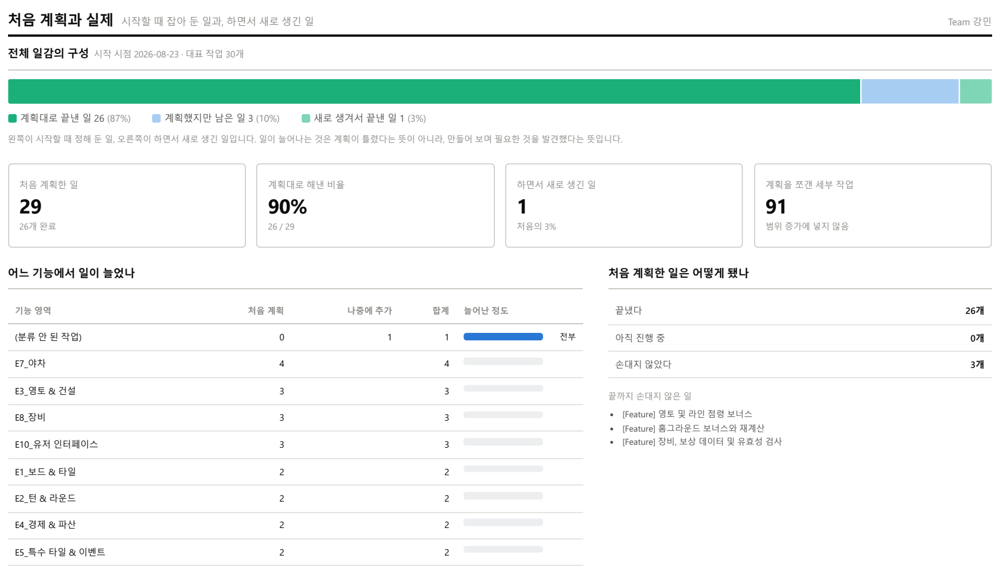

# 이그드라실 — 야차(1:1 실시간 대전) 기술 문서

> 팀 프로젝트 · **팀장** · 야차 전투 클라이언트 담당

---

## 0. 한 장 요약

**이그드라실**은 부루마블식 자산 경쟁과 1:1 실시간 대전 **'야차'**를 결합한 2~4인 온라인 보드게임입니다. **보드게임에 실시간 대전을 붙인다**는 기본 아이디어를 제가 냈고, 3인 팀의 **팀장**으로 일정과 범위를 관리했으며, 개발에서는 **야차 전투의 클라이언트**(캐릭터 조작·회피·자동 공격·장비 스킬·피격 판정·전투 UI)를 맡았습니다.

| 항목 | 내용 |
|---|---|
| 기간 · 인원 | 2026.08.20 ~ 2026.09.11 (약 3주) · 3인 (시작 4인, 1인 중도 이탈) |
| 내 역할 | 팀장(일정·범위 관리), 게임 기본 아이디어 제안(보드게임 + 실시간 대전), 야차 전투 클라이언트 전체 |
| 환경 | Unity 6 (C#), UniTask, ChatGPT(정해 둔 구조의 코드 작성 보조, 6.5) |
| 링크 | [GitHub (팀 레포)](https://github.com/KooHoo-Dev/3rd-TeamProject-KM) · 시연 영상: https://youtu.be/CQVLYCzNcjQ |

**핵심 기술 3가지**

| # | 기술 | 한 줄 설명 | 문서 위치 |
|---|---|---|---|
| 1 | **애니메이션 기반 장비 스킬** | 장비마다 다른 궤적을 코드 공식 대신 애니메이션 클립으로 만들어, 장비 10종을 완성했습니다 | 4장 |
| 2 | **공격 모션과 투사체 생성 시점 동기화** | 투사체를 입력 순간이 아니라 공격 모션의 '놓는 프레임'에 생성해, 모든 화면에서 같은 연출로 보이게 했습니다 | 3.3 |
| 3 | **네트워크 연결을 고려한 실행 경로 분리** | 스킬을 "요청"과 "실행"으로 나눠, 로컬 테스트와 온라인 전투가 같은 실행 코드를 쓰도록 했습니다 | 5.2 |

---

## 1. 프로젝트 개요

### 1.1 무엇을 만들었나 (What)

야차는 보드에서 상대 영토에 도착했을 때 걸 수 있는 **30초 1:1 횡스크롤 대전**입니다. 이기면 상대 영토를 빼앗고, 지면 통행료를 한 번 더 냅니다. 두 플레이어는 각자의 화면에서 자기 캐릭터를 조작하고, 나머지 플레이어는 관전합니다.


### 1.2 기획: 왜 보드게임에 실시간 대전을 붙였나

저는 부루마블 같은 보드게임에서 승부가 **주사위 운만으로 결정되는 것**이 아쉬웠습니다. 상대가 먼저 산 땅은 그 칸에 걸릴 때마다 통행료를 낼 뿐, 플레이어가 직접 할 수 있는 일이 없습니다. 그래서 **플레이어의 손이 승부에 개입하는 실시간 대전을 보드게임에 붙이자**는 기본 아이디어를 냈고, 상대 영토에 도착하면 싸워서 그 땅을 빼앗을 수 있게 한 것이 야차의 출발점입니다. 세부 규칙은 팀 회의로 함께 정해 「컨셉 & 시스템 기획서」로 정리했습니다. 기획서의 한 줄 컨셉은 다음과 같습니다.

> 부루마블 방식의 자산 경쟁을 벌이며, 실시간 액션 대전인 '야차'로 영토를 빼앗고 지키는 캐주얼 파티 게임

**보드와 야차를 잇는 고리**

야차가 보드와 따로 노는 미니게임이 되지 않도록, 보드에서 쌓은 것이 야차에 영향을 미치고 야차의 결과가 다시 보드에 영향을 주도록 하였습니다.

| 방향 | 고리 | 내용 |
|---|---|---|
| 보드 → 야차 | 진입 | 상대 영토에 도착해 통행료를 낸 뒤, 도착한 플레이어가 야차를 신청 |
| 보드 → 야차 | 장비 | 상점·보물창고·황금카드로 모은 장비(최대 5개)가 그대로 야차의 스킬 슬롯 1~5가 됨 |
| 야차 → 보드 | 영토 | 공격자가 이기면 영토와 건물을 넘겨받고, 지면 통행료를 한 번 더 냄 |
| 야차 → 보드 | 장비 내구도 | 야차가 끝나면 양쪽 장비의 내구도가 1씩 줄고, 0이 되면 파괴됨. 다시 보드에서 모아야 함 |
| 야차 → 보드 | 승리 보상 | 공격·방어와 관계없이 이긴 쪽이 영토 가치만큼 골드를 받음 |

그래서 보드에서는 "땅을 살지, 장비를 모을지", 상대 영토에서는 "통행료만 내고 지나갈지, 싸울지"를 고르게 됩니다. 내구도는 **실제로 전투를 치렀을 때만** 줄어들기 때문에, 결투를 받으면 이기든 지든 장비가 닳습니다. 그래서 방어자는 영토를 지킬지와 함께 "장비를 소모해도 괜찮은지"를 따져 수락과 거절을 고르게 되고, 공격자는 장비 내구도를 소모해 이 영토를 뺏을지, 이 장비로 영토를 빼앗을수 있을지를 고민하게 됩니다. 결투 신청·결과 정산과 서버 판정은 서버 담당 팀원이 구현했습니다.

### 1.3 야차에서 무엇에 집중했나

레퍼런스는 **「아처 오브 갓」**이었습니다. 좌우로만 움직이며 멈춰 있을 때 자동으로 활을 쏘고, 상대 공격은 회피로 피하는 대전 게임입니다. 보드게임 사이사이에 들어가는 짧은 대전이므로, 저는 다음 두 가지에 집중했습니다.

| 집중한 것 | 내용 |
|---|---|
| **짧고 단순한 조작** | 이동·회피·장비 사용 세 가지만으로 30초 안에 승부가 나도록 설계 |
| **마감 안에 장비를 완성** | 장비 10종의 서로 다른 궤적을 남은 기간 안에 구현하고, 눈으로 보며 조정할 수 있는 방식 선택 |

> 이 문서는 **보드와 야차를 잇는 기획(1.2)**, **조작(3장)**, 핵심인 **장비 스킬(4장)**, **판정과 온라인 연결 준비(5장)**, 그리고 **팀장으로서의 일정·협업(6장)**을 다룹니다. 결투의 서버 흐름과 온라인 연동은 서버 담당 팀원이 맡았으므로, 이 문서에서는 제가 넘겨준 지점까지만 설명합니다.

### 1.4 팀 구성과 내 역할

| 담당 | 역할                                                                   |
|---|----------------------------------------------------------------------|
| **나 (팀장)** | 일정·범위 관리, 전투 클라이언트, 초반 턴·영토 프로토타입 |
| 서버 담당 팀원 | 보드 규칙 전체, 서버, 결투의 서버 흐름과 전투 온라인 연동                                   |
| UI 담당 팀원 | UI·연출, 장비 인벤토리, 전투 시작 연출                                             |
| (중도 이탈 팀원) | 전투 초기 기반 코드 (이동 충돌, 타이머, 자동 공격 프로토타입)                                |

**내가 작성한 범위** (git blame 기준, 현재 코드)

| 영역 | 주요 클래스 |
|---|---|
| 조작 | `PlayerController`(입력·장비 슬롯), `CharacterController2D`(회피·쿨타임), `PlayerAnimator`(공격·사망 모션 타이밍) |
| 공격 | `EquipmentCaster`(자동 공격·장비 사용), `BattleManager`(스킬 요청·실행), `IAttackStrategy` |
| 투사체 | `AnimatedProjectile`, `ProjectileVisualMotion`, 장비별 투사체 프리팹·애니메이션 클립 |
| 판정 | `HitBox`, `HurtBox`, `CombatEntity`, `PlayerEntity` |

### 1.5 야차 규칙과 기획서 대비

**야차 규칙**

| 구분 | 규칙                                              |
|---|-------------------------------------------------|
| 시작 | HP 50, 제한 시간 30초                                |
| 이동 | 좌우 이동만 (점프 없음)                                  |
| 기본 공격 | **멈춰 있으면 1.3초마다 자동 발사**, 피해 5. 움직이는 동안은 발사하지 않음 |
| 회피 | Space. 0.35초 동안 무적 + 이동 가속. 쿨타임 1.5초            |
| 장비 | 숫자 1~5로 슬롯의 장비 사용. 장비마다 쿨타임·피해량이 다름             |
| 피해 배율 | 시작 10초 후부터 5초마다 +1 → 시간이 갈수록 데미지가 커짐            |
| 종료 | HP 0, 시간 종료 시 남은 HP 비교 (같으면 공격자 패배)             |

**장비 10종** (`equipments.tsv`)

| 궤적 | 장비 |
|---|---|
| 직선 (Straight) | 투척 단검, 투척 도끼, 투창, 얼음 파편, 황금 창 |
| 포물선 (Parabola) | 투석탄, 화염구 |
| 범위 (Area) | 화살비, 낙뢰, 운석 낙하 |

**기획서 → 구현: 야차**

기획서는 야차의 조작과 방향을 정했고, 구체적인 동작과 수치는 구현 단계에서 정해졌습니다. 제가 구현한 부분은 다음과 같습니다.

| 기획서 | 구현 | 문서 |
|---|---|---|
| 좌우 이동 · Space 회피 · 숫자 1~5 장비. 점프와 수동 조준 없음 | 레퍼런스를 「아처 오브 갓」으로 바꾼 결정이 기획서에 반영된 것. 이어받은 코드에서 중력·접지 검사를 제거 | 2.3 |
| 바라보는 방향은 전투 시작 때 고정, 기본 공격은 그 방향으로 자동 발사 | 시작할 때 방향을 지정하고(`SetFacingDirection`), 멈춰 있을 때 1.3초마다 발사 | 3.1 |
| 회피는 쿨타임과 짧은 무적 | 무적 0.35초 · 쿨타임 1.5초. 무적이 판정에 연결되지 않았던 문제를 시연 전에 수정 | 3.2 · 3.4 |
| 장비는 직선 · 포물선 · 범위 방식으로 발동, 10종 (일반 5 · 희귀 3 · 전설 2) | 10종을 궤적 3종(직선 5 · 포물선 2 · 범위 3)으로 나눠 **애니메이션 클립으로 구현** | 4장 |
| 전투 후반부터 일정 주기로 양측 피해 배율 증가, 수치는 테스트 후 확정 | 10초 후부터 5초마다 +1 | 위 규칙 표 |
| 제한 시간 30초로 먼저 구현, 테스트 후 20~30초로 조정 | 30초 유지 | 위 규칙 표 |

**기획에서 바뀌거나 빠진 것**

| 기획서 | 결과 |
|---|---|
| 방어자가 기권하면 패배 | 팀 회의에서 "방어자에게 너무 가혹하다"는 의견이 나와 **확률로 거절**하는 방식으로 변경 (서버 담당 팀원 구현) |
| 영토 전투 보너스 (땅 점령 · 한 줄 독점 · 건물 방어 보너스) | 구현하지 못함. 핵심 규칙을 먼저 완성하는 쪽을 우선 (6.3) |
| 야차 맵 방해 요소 | 기획 단계부터 확장 요소로 미룸 |

> 보드 쪽 기획 변경(칸 수, 급매, 감옥 등)은 서버 담당 팀원이 구현하면서 조정했으므로, 이 문서에서는 다루지 않습니다.

---

## 2. 전체 구조

### 2.1 아키텍처



입력은 `PlayerController` 한 곳으로만 들어옵니다. 이동과 회피는 `CharacterController2D`가, 공격은 `EquipmentCaster` → `BattleManager` 순으로 처리합니다. 점선 부분(서버 왕복)은 서버 담당 팀원이 연결했고, 저는 그 연결 지점(요청 이벤트와 실행 함수)을 만들어 넘겼습니다(5.2).

### 2.2 클래스 역할

| 클래스 | 하는 일 | 하지 않는 일 |
|---|---|---|
| `PlayerController` | 이동 입력, 회피 입력, 1~5 장비 슬롯 입력과 쿨타임 갱신, 행동 잠금 상태 보관 | 이동량 계산, 투사체 생성 |
| `CharacterController2D` | BoxCast 기반 수평 이동, 회피 중 가속·무적, 회피 쿨타임 | 입력 해석 |
| `EquipmentCaster` | 멈춰 있을 때 자동 공격, 장비 사용 요청, 바라보는 방향과 발사 위치 관리 | 스킬을 직접 실행 (`BattleManager`에 요청) |
| `BattleManager` | 스킬 요청에 `CastId` 부여, 중복 실행 방지, 공격 모션 재생 후 투사체 생성 | 피해 계산 |
| `PlayerAnimator` | 공격·사망 모션 재생, **놓는 시점**에 콜백 호출, 모션 중 행동 잠금 | 공격 대상·피해 판단 |
| `AnimatedProjectile` | 발사 방향 반전, `HitBox` 초기화, 클립이 끝나면 제거 | 궤적 계산 (클립이 담당) |
| `HitBox` / `HurtBox` | 공격 판정 / 피격 판정. 한 투사체는 한 번만 타격 | HP 계산 |

### 2.3 고민과 선택: 이동에 점프와 중력을 넣을 것인가

> **결정 대상**: 이어받은 이동 코드에는 중력·접지 검사가 있었습니다. 야차에서도 그대로 쓸 것인가?

| | [A] 중력·점프 유지 | [B] 수평 이동만 ✓ |
|---|---|---|
| 방식 | Rigidbody 중력과 접지 검사로 상하 이동까지 처리 | 중력·접지 검사를 지우고 X축 이동과 충돌만 처리 |
| 장점 | 점프 회피 등 조작의 폭이 넓음 | 코드가 단순해짐. 위치 정보가 X 하나뿐 |
| 단점 | 상하 이동까지 맞춰야 할 상태가 늘어남 | 피하는 수단이 회피 하나로 제한됨 |

**[최종 결정]** [B]를 선택했습니다(`27d994b`). 점프를 뺀 것은 레퍼런스를 바꾼 결과였습니다. 처음에는 한 번 맞으면 끝나는 대전 게임 「니드호그」를 참고하려 했는데, **한 방에 승부가 나는 규칙에서는 보드에서 얻은 장비를 스킬로 붙일 자리가 거의 없었습니다.** 그래서 스킬이 있는 「아처 오브 갓」으로 레퍼런스를 바꿨고, 평평한 바닥에서 좌우로만 움직이는 이 게임의 방식을 따르면서 중력과 접지 검사는 쓰이지 않는 코드가 됐습니다. 같은 커밋에서 회피의 코루틴도 UniTask로 바꿔 취소 토큰으로 관리하게 했습니다.

**[얻은 것]** 나중에 온라인으로 연결할 때 **가로 위치(X) 하나만** 서버로 보내면 됐습니다. 상대 캐릭터는 받은 X 값을 향해 보간 이동만 하면 됩니다.

---

## 3. 시스템 ① 조작: 이동 · 자동 공격 · 회피

### 3.1 고민과 선택: 공격 버튼 vs 자동 공격

> **결정 대상**: 기본 공격을 플레이어가 직접 누르게 할 것인가, 자동으로 나가게 할 것인가?

| | [A] 공격 버튼 | [B] 멈춰 있으면 자동 공격 ✓ |
|---|---|---|
| 방식 | 키를 누를 때마다 발사 | 이동하지 않는 동안 1.3초마다 자동 발사 |
| 장점 | 공격 타이밍을 플레이어가 완전히 통제 | 조작 키가 줄어듦. "움직일 것인가, 멈춰서 쏠 것인가"라는 선택이 생김 |
| 단점 | 이동·회피·장비·공격까지 신경 쓸 키가 많아짐 | 공격 타이밍을 직접 고를 수 없음 |

**[최종 결정]** 팀장으로서 [B]로 정했습니다. 레퍼런스인 「아처 오브 갓」이 자동 공격 방식이었고, 야차의 재미도 **위치를 잡고 피하는 판단**에 두고 싶었기 때문입니다.

이 규칙 때문에 이동과 공격이 서로 맞바꾸는 관계가 됩니다. 움직이는 동안에는 공격 시각을 계속 뒤로 미뤄, 멈추자마자 바로 쏘지 못하게 했습니다.

```csharp
// EquipmentCaster.cs — 멈춰 있을 때만 자동 공격
private async UniTaskVoid AutoAttackRoutine(CancellationToken token)
{
    while (true)
    {
        bool canAttack = isLocalPlayer
                         && CombatSystem.Instance.IsCombatActive
                         && !playerController.IsMoving          // 이동 중이면 공격하지 않음
                         && !playerController.IsCastingSkill    // 장비 사용 중이면 공격하지 않음
                         && !playerController.IsActionLocked;   // 공격·사망 모션 중이면 공격하지 않음

        if (canAttack && Time.time >= nextAttackTime)
        {
            BattleManager.Instance.CastLocal(new SkillCastMessage
                { CasterId = myEntity.OwnerId, IsBasicAttack = true });
            nextAttackTime = Time.time + basicAttackInterval;    // 1.3초
        }

        // (Why) 움직이는 동안 다음 공격 시각을 계속 미룸 → 멈춘 직후 0.1초는 쏘지 않음
        if (playerController.IsMoving)
            nextAttackTime = Mathf.Max(nextAttackTime, Time.time + 0.1f);

        await UniTask.Yield(PlayerLoopTiming.Update, cancellationToken: token);
    }
}
```

자동 공격 루프는 **내가 조작하는 캐릭터에서만** 돕니다(`SetLocalPlayer`). 상대 캐릭터의 공격은 서버에서 온 메시지로만 실행됩니다.

### 3.2 회피

| 항목 | 값 | 설명 |
|---|---|---|
| 무적 시간 | 0.35초 | 이 동안 피격 판정을 무시 (전투 씬 설정값) |
| 이동 | 기본 속도 + 2 | 입력 방향으로 가속. 방향 입력이 없으면 제자리 무적 |
| 쿨타임 | 1.5초 | 회피를 **시작한 시점**부터 계산 |
| 공격 모션 중 | 사용 가능 | 공격 중에도 회피로 끊고 피할 수 있음 |

### 3.3 고민과 선택: 투사체를 언제 만들 것인가

> **결정 대상**: 공격 요청이 들어왔을 때 투사체를 바로 만들 것인가, 캐릭터의 공격 모션에 맞춰 만들 것인가?

| | [A] 요청 즉시 생성 | [B] 공격 모션의 '놓는 시점'에 생성 ✓ |
|---|---|---|
| 방식 | 요청을 받은 프레임에 투사체 생성 | 공격 모션을 재생하고, 진행도 65% 지점에서 투사체 생성 |
| 장점 | 입력 반응이 가장 빠름 | 활시위를 놓는 순간 화살이 나가 보임. 모든 화면이 같은 모션을 거쳐 같은 모습으로 발사 |
| 단점 | 모션과 투사체가 따로 놀아 어색함 | 입력부터 발사까지 지연이 생김. 모션이 끊기는 경우를 처리해야 함 |

**[최종 결정]** [B]를 선택했습니다. 캐릭터 리소스를 전투 씬에 적용하면서(09-08) 모션과 투사체가 맞지 않는 것이 눈에 띄었고, 온라인에서는 각 클라이언트가 같은 메시지를 받아 각자 모션을 재생하므로 **발사 시점을 모션 기준으로 정하면 모든 화면에서 같은 연출**이 나옵니다.

```csharp
// BattleManager.cs — 모션을 재생하고, 놓는 시점에 투사체 생성
private void ExecuteSkill(SkillCastMessage msg)
{
    // (Why) 같은 요청이 두 번 도착해도 한 번만 실행 (목록은 전투를 시작할 때 비움)
    if (!string.IsNullOrEmpty(msg.CastId) && !executedCastIds.Add(msg.CastId)) return;
    ...
    // 공격 모션이 있으면 놓는 시점에 생성, 없으면(모션 없는 캐릭터·테스트 더미) 즉시 생성
    if (playerAnimator != null && playerAnimator.PlayAttack(() => SpawnSkill(msg)))
        return;

    SpawnSkill(msg);
}
```

```csharp
// PlayerAnimator.cs — 진행도가 놓는 시점(0.65)을 넘으면 콜백 호출
private void UpdateAttackTiming()
{
    AnimatorStateInfo state = animator.GetCurrentAnimatorStateInfo(0);
    if (state.IsName(attackStateName))
    {
        attackStateEntered = true;
        if (!attackReleased && state.normalizedTime >= attackReleaseNormalizedTime)
            ReleaseAttack();                                   // 투사체 생성
        if (state.normalizedTime >= 1f) FinishAttack();
        return;
    }
    if (attackStateEntered) FinishAttack();                    // 다른 상태로 빠져나감
}

private void FinishAttack()
{
    ReleaseAttack();                                           // 아직 발사 전이면 여기서 발사
    isAttackPlaying = false;
    playerController?.SetActionLocked(false);
}
```

**왜 Animation Event가 아니라 진행도 확인인가.** 발사 시점은 클립에 Animation Event를 넣는 대신, 매 프레임 공격 상태의 진행도(`normalizedTime`)를 확인하는 방식으로 잡았습니다. 두 방식을 비교해서 고른 것은 아니고, 수업에서 배운 방식을 그대로 썼습니다. 돌아보면 두 방식은 이렇게 다릅니다. Animation Event는 그 프레임에 닿기 전에 다른 상태로 넘어가면 호출되지 않는 반면, 진행도 확인 방식은 상태를 빠져나간 것도 알 수 있습니다. 또 발사 시점을 클립을 고치지 않고 인스펙터 값(0.65) 하나로 조정할 수 있습니다. 대신 매 프레임 상태를 확인해야 하고, 코드의 상태 이름(`"Attack"`)이 Animator의 상태 이름과 정확히 같아야 합니다.

**예외 처리**

| 상황 | 처리 |
|---|---|
| 공격 중에 사망 | 대기 중인 발사 콜백을 버리고 사망 모션을 최우선 재생 |
| Animator에 `Attack` 파라미터가 없음 | 시작할 때 파라미터 존재 여부를 캐싱해 두고, 없으면 즉시 생성으로 대체 |
| 공격 모션 중 이동 입력 | 행동 잠금으로 이동 입력을 0으로 막음 (회피는 허용) |

**처리하지 못한 경우.** 아래 두 경우는 당시 생각하지 못했고, 지금 코드에서는 투사체가 모션과 맞지 않게 나갑니다(7.3).

| 상황 | 지금 코드의 동작 |
|---|---|
| 공격 모션이 놓는 시점 전에 다른 상태로 넘어감 | 빠져나가는 순간 `FinishAttack` → `ReleaseAttack`이 호출되어, 모션 없이 그 자리에서 발사 |
| 공격 모션 중에 다른 발사 요청이 들어옴 (예: 자동 공격 모션 도중 장비 사용) | `PlayAttack`이 `false`를 돌려주고, 모션 없이 즉시 생성 |

**[감수한 대가]** 입력부터 발사까지 모션 길이의 65%만큼 지연이 생깁니다. 대신 자동 공격 간격(1.3초)이 이 지연보다 충분히 길어 플레이에 걸리지 않는다고 판단했습니다.

### 3.4 트러블슈팅: 회피했는데도 맞는 문제

| 단계 | 내용 |
|---|---|
| 증상 | 회피 중인데도 투사체에 맞아 HP가 깎임. 시연 이틀 전(09-09) 테스트에서 발견 |
| 원인 | 회피 중 무적 플래그(`IsInvincible`)는 이동 컨트롤러에 있었지만, **피격을 적용하는 쪽에서 이 값을 확인하지 않았음**. 무적이 "상태로만" 존재하고 판정에 연결되지 않았던 것 |
| 해결 ① | `CombatEntity`가 이동 컨트롤러의 무적 상태를 노출하고, 피격 적용(`TryApplyLocalHit`) 직전에 확인하도록 연결 (`b2272da`) |
| 새 문제 | 무적이 실제로 동작하자, 회피를 연타하면 **무적이 끊기지 않는** 문제가 드러남. 기존 회피는 진행 중일 때만 막고 쿨타임이 없었음 |
| 해결 ② | 회피 쿨타임 1.5초 추가, 무적 시간을 0.2초에서 늘림(현재 전투 씬 0.35초). 공격 모션 중에도 회피할 수 있게 행동 잠금 검사에서 제외 (`d5152b8`) |
| 결과 | 회피 무적이 피격 판정에 실제로 적용되어, 회피 중에는 투사체가 몸을 통과해도 HP가 줄지 않게 됨. 쿨타임이 생겨 연타로 무적을 이어 가는 문제도 사라짐 |
| 배운 점 | 상태 플래그를 만드는 것과 그 플래그를 **판정에 연결하는 것**은 별개의 작업입니다. 기능을 만들면 "실제로 효과가 나는지"를 확인하는 테스트까지가 한 작업이라는 것을 배웠습니다. 또 하나를 고치면 그동안 그 버그에 가려져 있던 문제(무한 무적)가 드러날 수 있다는 것도 체감했습니다 |

```csharp
// CombatSystem.TryApplyLocalHit — 피해 적용 직전에 무적 확인 (해결 ①에서 추가한 한 줄)
if (!TryGetEntity(targetId, out CombatEntity entity)) return false;
if (entity.IsInvincible) return false;
entity.TakeDamage(damage);
```

```csharp
// CharacterController2D.cs — 해결 ②: 회피 쿨타임
public async UniTaskVoid Dodge(float direction)
{
    // 회피 동작 중이거나 쿨타임이면 사용 불가
    if (IsInvincible || Time.time < nextDodgeTime) return;

    nextDodgeTime = Time.time + dodgeCooldown;   // (Why) 시작 시점 기준 → 무적이 끝난 뒤 약 1.15초 공백
    IsInvincible = true;
    ...
}
```

---

## 4. 시스템 ② 장비 스킬 ★

### 4.1 개요

보드에서 얻은 장비는 야차에서 **스킬**이 됩니다. 장비 데이터(`equipments.tsv`)에는 이름·등급·궤적 종류·피해량·쿨타임·투사체 프리팹 경로가 있고, 숫자 키 1~5로 슬롯의 장비를 사용합니다.

| 단계 | 처리 | 담당 클래스 |
|---|---|---|
| 입력 | 슬롯의 장비가 쿨타임이 아니면 사용 | `PlayerController` |
| 요청 | 장비 ID를 담은 `SkillCastMessage` 생성 | `EquipmentCaster` |
| 실행 | `CastId` 중복 확인 → 공격 모션 → 놓는 시점에 생성 | `BattleManager` |
| 투사체 | 프리팹의 애니메이션 클립이 궤적과 히트박스를 함께 움직임 | `AnimatedProjectile`, `HitBox` |

### 4.2 흐름



장비가 달라도 왼쪽 위 코드 경로는 같습니다. 장비마다 다른 궤적과 판정 범위는 **클립 안의 키프레임**에만 있어서, 새 장비는 표 한 줄과 프리팹 · 클립으로 추가되고 코드 경로는 바뀌지 않습니다.

### 4.3 고민과 선택: 궤적을 코드로 계산할 것인가, 애니메이션 클립으로 만들 것인가

> **결정 대상**: 직선·포물선·범위처럼 장비마다 다른 궤적을 어떻게 구현할 것인가?

처음에는 궤적을 **코드로 계산**했습니다. 09-02에 포물선 투사체(`ParabolaProjectile`)를, 09-04에 직선 투사체(`StraightProjectile`)를 만들었습니다. 포물선은 목표 위치와 정점 높이로부터 중력 공식을 풀어 초기 속도를 구하는 방식이었습니다. 직선·포물선·범위 세 가지 발사 코드는 ChatGPT에 맡겨 작성했습니다(6.5).

그런데 장비는 10종이고, **같은 "직선"이라도 장비마다 원하는 움직임이 달랐습니다.** 코드 방식에서 막힌 지점은 다음과 같았습니다.

| 막힌 지점 | 내용                                                                  |
|---|---------------------------------------------------------------------|
| 포물선 착지 | 공식으로 초기 속도를 구해도 투사체가 목표 지점에 정확히 떨어지지 않아 수치를 반복해서 조정                 |
| 장비별 움직임 | 투척 도끼는 회전하며 날아가야 하고, 황금 창은 직선으로 날아갑니다. 장비마다 이런 움직임을 공식으로 따로 표현해야 했음 |
| 범위 공격 | 화살비·낙뢰·운석을 코드로 어떻게 만들지 방향을 잡지 못해 아직 만들지 못한 상태                       |
| 판정 시점 | 히트박스가 켜지는 시점이 눈에 보이는 궤적과 맞지 않음                                      |

장비마다 공식을 따로 만들고 수치를 조정해도 **원하는 모양이 잘 나오지 않았습니다.**

그래서 궤적을 코드로 계산하지 않고, 애니메이션 클립으로 직접 그리는 방식으로 바꿨습니다.

| | [A] 코드 + 데이터로 궤적 계산 | [B] 애니메이션 클립으로 궤적과 판정 ✓ |
|---|---|---|
| 방식 | TSV의 사거리·속도·범위 값으로 코드가 궤적을 계산 | 투사체 프리팹의 애니메이션 클립이 이동 경로를 그리고, 히트박스의 위치·크기도 같은 클립에서 움직임. 범위형은 특정 프레임에서 히트박스를 켜고 끔 |
| 장점 | 장비를 TSV 한 줄로 추가·조정 가능 | **궤적을 눈으로 보며 바로 수정.** 회전·낙하처럼 공식으로 표현하기 번거로운 움직임도 키프레임으로 해결 |
| 단점 | 궤적마다 공식과 판정 시점을 맞추고 디버깅해야 함. 원하는 모양이 나오기까지 오래 걸림 | 장비마다 클립 제작 필요. TSV의 사거리·속도 값과 실제 동작이 분리됨 |

**[최종 결정]** [B]를 선택했습니다(09-05, `4c97521`에서 `StraightProjectile`·`ParabolaProjectile` 삭제, `AnimatedProjectile` 추가). 남은 기간은 일주일 정도였고, 그 안에 10종을 **원하는 모양으로** 완성하는 것이 확장성보다 중요했습니다. 클립 방식은 위 네 가지를 한 번에 풀었습니다. 착지 지점과 회전·낙하는 키프레임으로 직접 정하고, 히트박스도 같은 클립 안에서 투사체와 함께 움직이고 범위형은 공격이 떨어지는 프레임에만 켜지므로, 눈에 보이는 궤적과 판정이 어긋날 일이 없었습니다.

**[얻은 것]** 09-05에 직선·포물선·범위의 기본 클립을 만든 뒤, 09-08에 **장비 10종의 투사체 프리팹과 클립을 한 번에** 만들었고, 시연 직전(09-09)에는 황금 창·화염구·운석 낙하를 다시 손봤습니다. 궤적 조정이 코드 수정이 아니라 **Animation 창에서 키프레임을 옮기는 작업**이 되어 반복이 빨랐습니다.

**[감수한 대가]** 4.5에서 정리합니다.

### 4.4 핵심 구현: 클립 하나로 양방향 · 회전까지

애니메이션 방식으로 바꾸면서 생긴 문제는 **클립은 한 방향(오른쪽 기준)으로만 만든다**는 점이었습니다. 왼쪽 플레이어가 쏘면 같은 클립이 반대로 재생되어야 하고, 회전하는 투사체는 반전된 상태에서도 자연스럽게 돌아야 했습니다.

**① 발사 방향: 루트의 X 스케일만 반전**

```csharp
// AnimatedProjectile.cs
public void Launch(float direction, int damageAmount, string attackerId, string castId)
{
    // (Why) 클립의 이동·회전 키는 그대로 두고, 루트 X축만 뒤집어 왼쪽 발사를 표현
    Vector3 scale = transform.localScale;
    scale.x = Mathf.Abs(scale.x) * (direction < 0f ? -1f : 1f);
    transform.localScale = scale;

    GetComponentInChildren<HitBox>()?.Init(damageAmount, attackerId, castId);
}

private void Update()
{
    // (Why) 궤적이 곧 클립이므로, 클립이 끝나면 투사체의 수명도 끝
    if (animator.GetCurrentAnimatorStateInfo(0).normalizedTime >= 1.0f)
        Destroy(gameObject);
}
```

**② 외형 회전: 이동 클립과 분리**

이동 클립에 회전 키까지 넣으면 장비마다 이동과 회전을 함께 맞춰야 합니다. 그래서 외형(스프라이트) 오브젝트에 `ProjectileVisualMotion`을 붙여, **이동은 클립이, 회전은 이 컴포넌트가** 맡도록 나눴습니다. 클립이 회전 값을 덮어쓰지 않도록 `LateUpdate`에서 적용합니다.

```csharp
// ProjectileVisualMotion.cs — 이동 애니메이션과 투사체 외형의 회전을 분리
private void LateUpdate()
{
    switch (mode)
    {
        case MotionMode.Spin:              // 투척 도끼: 초당 720도 회전
            spinAngle = Mathf.Repeat(spinAngle + angularSpeed * Time.deltaTime, 360f);
            transform.localRotation = initialLocalRotation * Quaternion.Euler(0f, 0f, spinAngle);
            break;

        case MotionMode.FixedWorldAngle:   // 황금 창: 반전과 관계없이 월드 기준 -90도(수직 낙하)
            transform.rotation = Quaternion.Euler(0f, 0f, fixedWorldAngle);
            break;
    }
}
```

| 장비 | 모드 | 값 |
|---|---|---|
| 투척 도끼 | Spin | 720 °/s |
| 황금 창 | FixedWorldAngle | −90° |
| 얼음 파편 | FixedWorldAngle | 0° |
| 그 외 | 없음 | 클립의 모양 그대로 |

**③ 판정: 한 투사체는 한 번만**

`HitBox`는 첫 타격 후 콜라이더를 꺼서, 관통하거나 범위가 넓은 클립에서도 한 번만 피해를 줍니다. 자기 자신에게는 맞지 않습니다.

```csharp
// HitBox.cs
private void OnTriggerEnter2D(Collider2D collision)
{
    if (hasHit) return;

    HurtBox target = CombatSystem.Instance.GetHurtBoxOrNull(collision);
    if (target == null || target.Owner.OwnerId == attackerId) return; // 자기 공격 무시

    if (!CombatSystem.Instance.TryApplyLocalHit(target.Owner.OwnerId, damage, castId)) return;

    hasHit = true;
    GetComponent<Collider2D>().enabled = false;                           // (Why) 다중 타격 방지
}
```

### 4.5 감수한 대가와 남은 흔적

| 항목 | 내용 |
|---|---|
| TSV 값과 실제 동작의 분리 | 피해량·쿨타임·프리팹 경로는 TSV에서 읽지만, **사거리·속도·범위는 클립이 정합니다.** TSV 값은 장비 설명 문구에만 쓰여, 설명과 실제 동작이 어긋날 수 있습니다 |
| 장비 추가 비용 | 장비 하나를 늘리려면 TSV 한 줄이 아니라 프리팹과 클립을 새로 만들어야 합니다. 시연에서 야차 반응이 좋아 장비를 더 늘리고 싶었지만 기간 안에 하지 못했습니다 |
| 하는 일이 같은 전략 클래스 | `BattleManager`는 지금도 장비의 `AttackType`에 따라 `StraightAttackStrategy`·`ParabolaAttackStrategy`·`AreaAttackStrategy` 중 하나를 골라 실행합니다. 그런데 클립 방식으로 바꾼 뒤에는 **세 클래스 모두 "프리팹을 만들고 Launch"로 같은 코드**(로그 한 줄만 다름)가 되어, 어떤 전략이 골라져도 결과가 같습니다. 궤적 차이가 코드에서 데이터(클립)로 옮겨 갔는데 구조는 정리하지 못한 것입니다 |

---

## 5. 시스템 ③ 판정 · 테스트 · 온라인 연결 준비

### 5.1 이어받은 코드를 야차에 맞게 바꾸기

야차의 첫 기반 코드는 중도 이탈한 팀원이 08-27에 올린 것이었습니다(이동 충돌 컨트롤러, 30초 타이머, 자동 공격 프로토타입, 화살, 테스트용 더미). 저는 이 코드를 이어받아 작업했고, 최종 코드에서는 다음과 같이 남거나 바뀌었습니다.

| 이어받은 코드 | 최종 상태 |
|---|---|
| `CharacterController2D` (BoxCast 충돌) | **충돌 처리 핵심은 유지.** 중력·접지 제거(2.3), 회피를 UniTask로 교체, 쿨타임 추가(3.4) |
| `Timer` (30초 카운트다운) | 유지 |
| `AutoAttacker` | 삭제 → `EquipmentCaster`의 자동 공격으로 통합 (09-01) |
| `Arrow` (충돌 판정 화살) | 삭제 (09-03) → 최종적으로 `AnimatedProjectile` + `HitBox` |
| `Dummy` (테스트 대상) | 삭제 → 실제 플레이어 두 명을 쓰는 `PlayerEntity` + `HurtBox` (09-07) |

### 5.2 고민과 선택: 스킬 실행 경로를 어떻게 나눌 것인가

> **결정 대상**: 지금은 로컬에서만 도는 전투를, 나중에 서버 담당이 온라인으로 연결하기 쉽게 하려면 어떤 형태로 넘겨야 하는가?

| | [A] 입력 즉시 실행 | [B] "요청"과 "실행"을 분리 ✓ |
|---|---|---|
| 방식 | 키를 누르면 그 자리에서 투사체 생성 | 입력은 `CastLocal`(요청)만 하고, 실제 생성은 `ExecuteSkill`(실행)이 함. 서버에서 온 요청은 `ExecuteSkillFromNetwork`로 같은 실행 함수에 들어옴 |
| 장점 | 단순함 | 서버를 붙일 때 **요청과 실행 사이에 서버 왕복만 끼우면 됨.** 로컬 테스트와 온라인이 같은 실행 코드를 씀 |
| 단점 | 온라인 연결 시 입력부터 생성까지 다시 나눠야 함 | 같은 요청이 두 번 들어올 수 있어 중복 방지가 필요 |

**[최종 결정]** [B]를 선택했습니다(09-07, `862c2bd` "전투 클라이언트 로직, 네트워크 연결 인터페이스"). 요청마다 고유한 `CastId`를 붙이고, 실행할 때 이미 실행한 ID면 무시하게 했습니다. 이 구조는 서버 담당 팀원의 네트워크 코드를 읽고 제가 정했고, 정한 구조대로 코드를 작성하는 일은 ChatGPT에 맡겼습니다(6.5).

```csharp
// BattleManager.cs — ★ 표시 줄은 온라인 연결 때(09-08) 서버 담당 팀원이 추가
public void CastLocal(SkillCastMessage msg)                 // 요청: 입력한 클라이언트에서만
{
    if (string.IsNullOrEmpty(msg.CombatId)) msg.CombatId = CombatSystem.Instance.CombatId;
    if (string.IsNullOrEmpty(msg.CastId))   msg.CastId = Guid.NewGuid().ToString("N"); // (Why) 요청마다 고유 ID → 중복 실행 방지의 기준

    if (CombatSystem.Instance.IsTestCombat) { ExecuteSkill(msg); return; } // ★ 테스트 모드: 바로 실행
    OnSkillCastRequested?.Invoke(msg);                      // 연결 지점으로 만든 요청 이벤트 (현재 구독자 없음, 7.3)
    RoomClient.Instance.RequestSkillCast(msg);              // ★ 온라인: 서버로
}

public void ExecuteSkillFromNetwork(SkillCastMessage msg) => ExecuteSkill(msg); // 서버에서 온 요청
```

**[얻은 것]** 서버 담당 팀원은 다음 날(09-08) `RequestSkillCast`와 `ExecuteSkillFromNetwork` 사이에 서버 중계를 연결했습니다. 온라인에서도 **입력한 사람을 포함한 모든 클라이언트가 서버에서 돌아온 메시지로 같은 실행 경로**를 타므로, 3.3의 "놓는 시점 발사"가 모든 화면에서 똑같이 동작합니다.

> 피격과 HP를 어느 클라이언트가 계산할지(맞은 쪽이 계산해 보고)는 온라인 연결 과정에서 서버 담당 팀원이 정했습니다. 제 초기 코드는 때린 쪽이 피격 정보(`HitRequestPacket`)를 보내는 형태를 가정하고 있었는데, 회피 무적처럼 **맞은 쪽만 정확히 아는 상태**가 있어 맞은 쪽 판정이 더 맞는 구조였습니다.

### 5.3 네트워크 없이 도는 전투 테스트 씬

온라인으로 전투를 확인하려면 방을 만들고, 보드를 진행하고, 상대 영토에 도착해 결투를 신청해야 합니다. 장비 하나의 궤적을 고칠 때마다 이 과정을 거칠 수는 없어서, **전투 씬만 단독으로 실행하는 테스트 환경**을 만들었습니다(09-07, `e848c38`).

| 구성 | 역할 |
|---|---|
| `CombatTestSetup` | 서버의 결투 배정 정보가 없으면 하드코딩된 ID로 두 플레이어를 초기화하고 테스트 전투 시작. 인스펙터에서 **오른쪽 플레이어로 조작**도 선택 가능 |
| `TestInventoryFiller` | 원하는 장비를 슬롯에 바로 채움 |

```csharp
// CombatTestSetup.cs — 서버 배정이 있으면 그대로, 없으면 테스트 모드
private void Start()
{
    CombatSystem combatSystem = CombatSystem.Instance;

    if (combatSystem.HasCombatAssignment)              // 보드에서 넘어온 실제 결투
    {
        SetupPlayers(combatSystem.AttackerId, combatSystem.DefenderId,
                     combatSystem.LocalPlayerId, combatSystem.StartHp);
        return;
    }

    // (Why) 전투 씬만 열어도 바로 싸워 볼 수 있게 → 장비 궤적 수정 후 즉시 확인
    string testLocalPlayerId = playAsRightPlayer ? remoteId : localId;
    SetupPlayers(localId, remoteId, testLocalPlayerId, startHp);
    combatSystem.StartTestCombat(localId, remoteId, testLocalPlayerId, startHp).Forget();
}
```

이 테스트 씬(`TestCombat.unity`) 덕분에 09-08에 장비 10종의 클립을 만들면서 바로바로 확인할 수 있었습니다. 이후 서버 담당 팀원이 온라인 연결 과정에서 "배정이 없으면 테스트 전투" 분기를 실제 전투 씬의 구성 코드(`CombatSceneSetup`)와 `IsTestCombat`으로 통합해, 지금은 실제 전투 씬도 단독으로 실행하면 테스트 모드로 동작합니다.

### 5.4 전투 UI와 결과 연출

| 요소 | 내용 |
|---|---|
| HUD | 남은 시간, 피해 배율, 좌우 HP 바, 장비 슬롯 아이콘과 쿨타임 |
| 플레이어 구분 | 대전 안에서 플레이어마다 색 지정, 내 캐릭터 위 커서 표시 |
| 결과 | 패자는 사망 모션 재생, 끝나면 **승자 닉네임** 패널 표시 |

`CombatUI`는 `CombatSystem`의 값을 읽어 표시만 하고, 전투 상태를 바꾸지 않습니다.

---

## 6. 팀장으로서: 일정과 협업

### 6.1 내 작업의 흐름



### 6.2 고민과 선택: 보드 작업을 넘기고 전투로 옮기다

> **결정 대상**: 서버 연결을 기다려야 하는 보드 작업을 계속 붙잡을 것인가, 다른 파트로 옮길 것인가?

초반(08-24 ~ 09-01)에는 턴·주사위·보드 매니저와 영토·건물·총자산 계산을 만들었습니다. 그런데 서버 담당 팀원이 이 코드를 네트워크와 연결하는 시점에 **턴 진행의 기준이 서버로 옮겨 가면서 코드가 크게 수정**됐고, 보드 쪽 작업은 서버 기능이 나와야 진행할 수 있는 상태가 됐습니다.

| | [A] 보드 작업 유지 | [B] 보드를 서버 담당에게 넘기고 전투로 이동 ✓ |
|---|---|---|
| 장점 | 내가 만든 코드를 끝까지 책임짐 | 기다리는 시간 없이 아무도 맡지 않은 전투를 진행 |
| 단점 | 서버 기능이 나올 때까지 대기. 두 사람이 같은 코드를 동시에 고치게 됨 | 내가 만든 보드 코드는 다른 사람 손에서 바뀜 |

**[최종 결정]** [B]를 선택했습니다. 중도 이탈로 **전투 파트가 비어 있었고**, 보드는 서버와 함께 움직여야 해서 서버 담당이 맡는 쪽이 효율적이었습니다. 팀장으로서 "기다리는 사람"이 생기지 않게 일을 다시 나눈 결정이었습니다.

**[얻은 것]** 보드 규칙과 서버는 한 사람이 일관되게 설계했고, 저는 08-30부터 전투로 옮겨 시연 전에 야차를 완성할 수 있었습니다.

### 6.3 일정 관리 방식

| 항목 | 방식 |
|---|---|
| 도구 | **Asana**로 작업 관리. 목표일은 상위 작업 일부(121개 중 13개)에만 넣음 |
| 소통 | 평일에 매일 같은 공간에서 작업했기 때문에, 정기 회의 대신 **그날그날 직접 진행 상황을 공유** |
| 일정 조정 | 데드라인을 넘기면 **뒤의 일정을 조금씩 당기거나 미루고, 필요하면 기능을 버림** |

솔직히 말하면 일정이 계획대로 흘러가지는 않았습니다. 그래서 일정표를 그대로 지키기보다, **데드라인을 넘긴 작업이 생기면 무엇을 버릴지 팀이 함께 빨리 정하는 쪽**으로 운영했습니다. 아래 항목은 매일 진행 상황을 공유하면서 팀 논의로 정한 것들입니다.

**범위에서 뺀 것들**

| 뺀 것 | 이유 |
|---|---|
| 보드 턴 제한 시간 | 제가 프로토타입(08-27)에서 만들었지만, 상점·구매 팝업·연출처럼 시간이 멈춰야 하는 구간을 하나하나 설계해야 해서 제외 |
| 결투 거절 시 코인 토스 연출 | 확률 판정만 남기고 연출은 제외 |
| 장비 종류 확장 | 클립 방식(4.3)이라 장비 하나에 프리팹·클립 제작이 필요해 10종에서 멈춤 |
| 재접속 | 일정상 제외 |
| 영토 전투 보너스 (땅 점령 · 한 줄 독점 · 건물 방어) | 기획서에 있었지만, 핵심 규칙을 먼저 완성하는 쪽을 우선해 제외 (1.5) |
| 최대 라운드 33 → 20 → 25 | 시연 시간이 팀당 1시간에서 30분으로 줄어 20으로 줄였다가, 너무 짧다는 의견으로 25로 재조정 |

**Asana 기록으로 본 일정** (프로젝트가 끝난 뒤 Asana 기록에서 뽑은 리포트 기준)

| 항목 | 기록 |
|---|---|
| 처음 계획한 대표 작업 | 29개 중 26개 완료(90%). 하면서 새로 생긴 대표 작업은 1개(1차 빌드)뿐 |
| 손대지 않은 대표 작업 3개 | 영토 및 라인 점령 보너스, 홈그라운드 보너스와 재계산(위 표의 "영토 전투 보너스"), 장비·보상 데이터 유효성 검사 |
| 야차 대표 작업 | 목표일이 있던 3개 모두 목표일 9/3을 넘겨 9/9~9/10에 완료 |



범위를 늘리지 않고 넘치면 빼는 방식으로 운영했다는 것이 기록에도 남아 있습니다. 다만 작업 상태는 마지막에 한꺼번에 정리해서, 날짜별 진행은 기록으로 보여 주지 못합니다(6.6).

### 6.4 협업에서 생긴 문제와 대응

| 문제 | 대응 |
|---|---|
| 개발 초반(08-27) 팀원 1명이 인수인계 없이 이탈. 맡고 있던 전투 파트가 비게 됨 | 이탈 사실을 강사님과 제가 먼저 알게 되어 바로 팀에 공지. 역할은 각자 잘하는 쪽으로 다시 나눔: 구현력이 가장 좋은 팀원은 핵심 시스템(보드·서버)을 계속 맡고, 미적 감각이 있는 팀원은 UI·이펙트를 맡음. 비어 있던 전투는 제가 맡겠다고 하고, 남은 기반 코드는 직접 읽어 가며 이어받음(5.1). 보드 작업을 정리하고 전투로 옮긴 과정은 6.2 |
| 팀원 브랜치를 main에 병합할 때 충돌이 대량 발생 | main 병합 주기가 정해져 있지 않았던 것이 원인. 강사 피드백 후 **각자 작업 브랜치에 main을 주기적으로 병합**하는 규칙으로 변경 |
| UI 화면은 있는데 동작 코드가 연결되지 않는 경우가 반복됨 | UI 동작 코드를 누가 연결할지 정하지 않았던 것이 원인. 후반에는 새 UI가 필요한 기능을 늘리지 않는 쪽으로 범위를 조정 |

### 6.5 AI 활용 방식

개발에는 **ChatGPT**를 썼습니다. 기준은 하나였습니다. **무엇을 만들지와 구조는 제가 정하고, 정해진 구조를 코드로 옮기는 반복 작업만 맡긴다.** 플레이 감각을 결정하는 조정은 직접 했습니다.

| 작업 | 제가 한 것 | ChatGPT에 맡긴 것 |
|---|---|---|
| 스킬 실행 경로 (5.2) | 서버 담당 팀원의 네트워크 코드를 읽고, 입력은 "요청"만 하고 실행은 서버에서 돌아온 메시지로 하는 구조와 연결 지점을 정함 | 정한 구조대로 `CastLocal` · `ExecuteSkill` 등 코드 작성 |
| 발사 방식 3종 (4.3) | 투사체의 애니메이션 클립(궤적, 히트박스 위치·크기, 범위형의 히트박스 켜는 프레임), 이펙트 | 직선 · 포물선 · 범위 발사 코드 |

### 6.6 팀장으로서 아쉬운 점

폴더 구조, 병합 주기, UI 연결 책임 같은 **공용 규칙을 프로젝트 시작할 때 정하지 못했습니다.** 이 규칙들은 누구 한 명의 일이 아니라서, 팀장이 처음에 정해 두지 않으면 아무도 정하지 않는다는 것을 배웠습니다. 문제가 생긴 뒤에 규칙을 만들어 수습했지만, 그 사이 같은 일을 두 번 하거나 병합을 푸는 데 시간을 썼습니다.

**Asana를 실제 진행에 맞춰 갱신하지 못했습니다.** 목표일은 상위 작업 일부에만 넣었고, 작업 상태는 그때그때 옮기지 않고 마지막에 한꺼번에 정리했습니다. 그래서 기록상으로는 작업이 "검토" 단계에 평균 5.7일 머물고 완료가 9/7~9/9에 몰려 있어, 기록만 보고는 어느 작업이 실제로 늦어지고 있었는지 알 수 없습니다. 기록이 진행을 따라가지 못하면 일정 관리 도구가 일정 관리에 쓰이지 못한다는 것을 배웠습니다.

---

## 7. 결과 · 회고

### 7.1 결과

| 목표 (1.2 · 1.3) | 결과 |
|---|---|
| 보드와 야차 연결 | 보드에서 모은 장비가 야차의 스킬이 되고, 야차의 결과가 영토·장비 내구도로 보드에 돌아오는 순환을 구현. 방어자가 장비 내구도를 따져 수락을 망설이는 등, **보드의 선택이 야차로 이어짐** |
| 짧고 단순한 조작 | 이동·회피·장비 세 가지 조작과 자동 공격으로 30초 대전을 완성. 시연에서 **야차가 가장 좋은 반응**을 얻음 |
| 마감 안에 장비 완성 | 코드 궤적에서 애니메이션 클립 방식으로 전환해 **장비 10종(직선 5 · 포물선 2 · 범위 3)**을 시연 전에 완성 |

- **팀:** 4인에서 1인이 이탈한 상태로 3주 안에 보드 규칙·서버·야차·UI를 모두 갖춰 시연

### 7.2 이 프로젝트에서 다룬 게임 개발 기본기

| 기본 요소 | 이 프로젝트에서 | 위치 |
|---|---|---|
| 프레임 실행 순서 | Animator가 값을 쓴 뒤 `LateUpdate`에서 외형 회전을 덮어씀 | 4.4 |
| 프레임 독립 이동 · 충돌 | `Time.deltaTime` 기반 이동, 물리 엔진 대신 BoxCast로 직접 충돌 처리 | 2.3 · 5.1 |
| 판정 구조 | Hitbox / Hurtbox 분리, 회피 무적 시간 | 3.4 · 4.4 |
| 비동기와 수명 관리 | UniTask와 취소 토큰으로 자동 공격 · 회피 루프 관리 | 3.1 |
| 궤적을 에디터에서 조정 | 궤적을 코드 공식 대신 애니메이션 클립으로 만들어, 코드를 고치지 않고 에디터에서 바로 고치고 확인 | 4.3 |
| 테스트 환경 | 네트워크 없이 단독으로 도는 전투 씬 | 5.3 |
| 오브젝트 수명 | 투사체를 매번 생성 · 파괴. 투사체가 많아지면 오브젝트 풀로 바꿀 지점 | 7.3 |

### 7.3 기술 부채와 개선 계획

| 문제 | 원인 · 당시 판단 | 개선 계획 |
|---|---|---|
| 장비를 데이터로 늘릴 수 없음 | 마감 안에 완성하기 위해 클립 방식 선택 (4.3) | TSV의 사거리·속도·범위로 움직이는 공용 투사체를 두고, 클립은 회전·이펙트 같은 **외형에만** 사용 |
| 전략은 고르지만 세 전략의 동작이 같음 | `AttackType`으로 전략을 고르는 구조는 코드 궤적 시절 그대로인데, 궤적이 클립으로 옮겨 간 뒤 전략 안의 코드를 정리하지 못함 (4.5) | 전략 패턴을 걷어내고 프리팹 생성 함수 하나로 통합. 궤적별 차이가 다시 코드로 필요해질 때 재도입 |
| 쓰이지 않는 `CombatFlow` | 결투 정산을 클라이언트에서 하려고 만들었으나, 정산이 서버로 옮겨 가면서 호출되지 않는 클래스로 남음 | 삭제 |
| 무적이 판정에 늦게 연결됨 | 기능을 만든 뒤 "실제로 효과가 나는지" 확인하는 절차가 없었음 (3.4) | 테스트 씬(5.3)에 회피 중 피격, 쿨타임 중 장비 사용 같은 **체크리스트**를 두고 기능 추가 때마다 확인 |
| 구독자 없는 `OnSkillCastRequested` 이벤트 | 온라인 연결 지점으로 이벤트를 만들었지만, 서버 담당 팀원이 `RoomClient.RequestSkillCast`를 직접 호출하는 방식으로 연결하면서 이벤트는 쓰이지 않게 됨 (5.2) | `RoomClient`가 이 이벤트를 구독하게 바꿔 `BattleManager`가 네트워크 클래스를 모르게 하거나, 이벤트를 삭제 |
| 투사체를 매번 생성 · 파괴 | 30초 대전에서 `Instantiate` · `Destroy`로 처리 | 장비 종류와 투사체 수가 늘면 오브젝트 풀로 전환 |
| 모션과 발사가 어긋나는 경우가 남음 | 공격 모션이 끊기거나 이미 공격 모션 중일 때를 생각하지 못함 (3.3) | 모션 중에 들어온 요청은 현재 모션이 끝난 뒤 이어서 재생하고, 끊긴 공격은 발사할지 취소할지 정해 한 가지로 처리 |
| 장비 사용 중 상태를 시간으로 고정 | 장비 사용 후 `IsCastingSkill`을 0.5초 고정 지연(`UniTask.Delay(500)`)으로 해제 | 공격 모션의 종료 콜백(3.3)으로 해제해 모션 길이와 맞춤 |

### 7.4 배운 점

- **확장성보다 "기간 안에 원하는 결과"가 우선일 때가 있습니다.** 장비 궤적을 데이터와 공식으로 일반화하려다 막혔고, 클립 방식으로 바꾸자 일주일 안에 10종을 완성했습니다. 다만 그 선택의 대가(장비 추가 비용, 남은 구조)를 문서로 남겨 두는 것까지가 선택이라고 생각합니다.
- **다른 사람이 이어받을 코드는 "끼워 넣을 자리"를 만들어 넘겨야 합니다.** 요청과 실행을 나눠 둔 덕분에 스킬의 서버 중계가 다음 날 바로 붙었습니다(5.2).
- **플래그를 만드는 것과 판정에 연결하는 것은 다른 작업입니다.** 회피 무적은 만들어져 있었지만 시연 이틀 전까지 실제로 동작하지 않았습니다(3.4).
- **팀장의 일은 일정표를 지키는 것보다, 비거나 막힌 곳을 빨리 찾아 일을 다시 나누는 것이었습니다.** 팀원 이탈 직후 역할을 다시 나누고 비어 있던 전투를 맡은 것(6.4), 서버를 기다리던 보드 작업을 넘긴 것(6.2)이 그랬습니다. 반대로 공용 규칙을 처음에 정하지 못한 것은 가장 아쉬운 점입니다.

---

## 부록: 전체 플레이 영상에서 잘라 낼 GIF 목록

| 파일 | 장면 | 길이 · 속도 | 꼭 보여야 하는 것 | 쓰는 곳 |
|---|---|---|---|---|
| `main.png` | 야차 대전 중 한 컷 | 정지 이미지 | 두 캐릭터, HP 바, 날아가는 투사체가 한 화면에 | 0장 |
| `yacha_battle.gif` | 결투 신청 → 전투 → 결과 → 보드 복귀 | 10~15초, 2배속 | 처음부터 끝까지의 흐름. 서버 담당 팀원 문서(3.7)도 같은 파일 이름을 쓰므로 같은 GIF를 함께 써도 됨 | 1.1 |
| `shop_equipment.gif` | 상점에서 장비 구매 → 슬롯에 들어감 | 3~5초, 1배속 | 산 장비가 인벤토리(야차의 스킬 슬롯)에 들어가는 것 | 1.2 |
| `duel_hesitate.gif` | 결투 신청을 받은 방어자가 망설이다 수락 | 5~8초, 망설이는 구간만 1.5배속 | 장비 내구도나 거절 확률이 화면에 보임 | 1.2 |
| `dodge.gif` | 투사체가 날아올 때 회피로 빠져나가는 장면 | 2~4초, 1배속 | 회피 중 투사체가 캐릭터를 통과해도 HP가 줄지 않음 | 3.2 |
| `attack_release.gif` (선택) | 멈춰 선 캐릭터의 자동 공격 2~3회 | 3초, 1배속 (가능하면 0.5배속) | 활시위를 놓는 순간 화살이 나감 (3.3, 핵심 기술 2) | 3.3 |
| `equipment_skills.gif` | 장비 여러 종을 연달아 사용 | 6~10초, 1배속 | 직선·포물선·범위를 하나 이상씩. 투척 도끼 회전, 황금 창 수직 낙하, 운석 낙하 | 4장 |
| `combat_ui.gif` | 전투 막바지 → 사망 모션 → 승자 패널 | 4~6초, 1배속 | 남은 시간·피해 배율·장비 쿨타임 HUD, 사망 모션, 승자 닉네임 | 5.4 |
