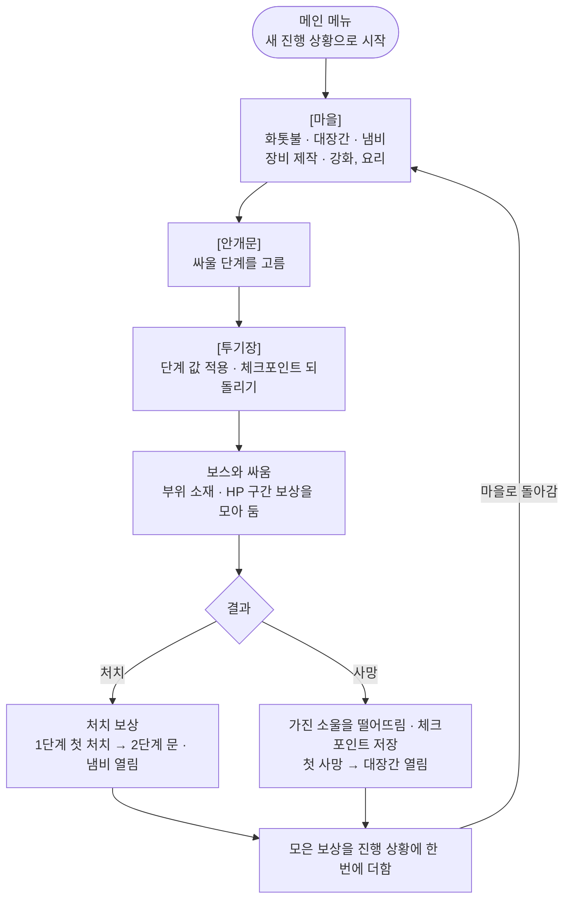
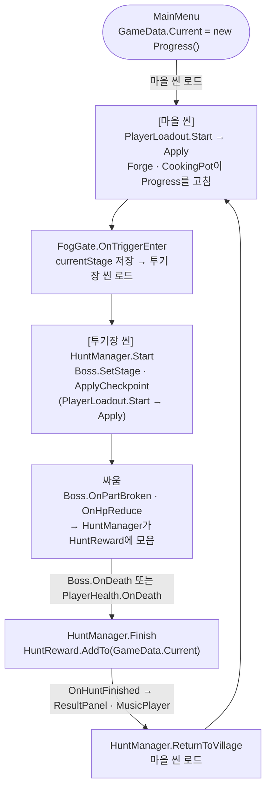
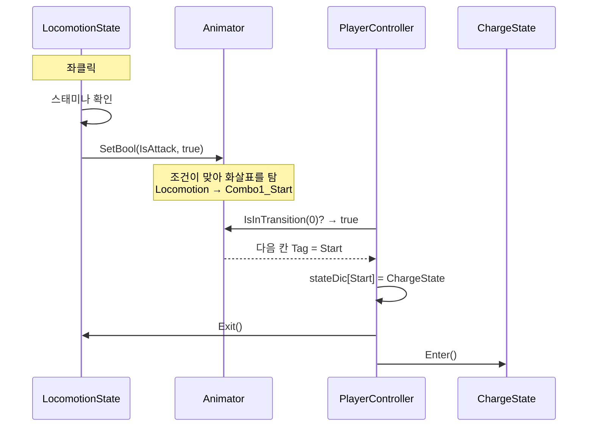
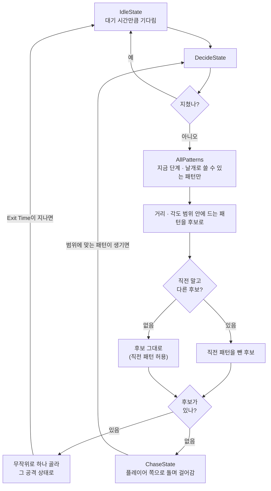
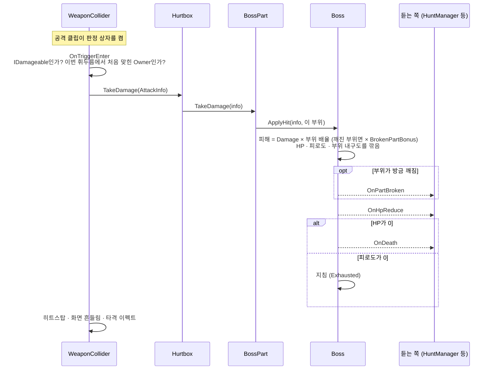
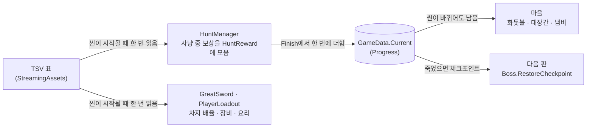
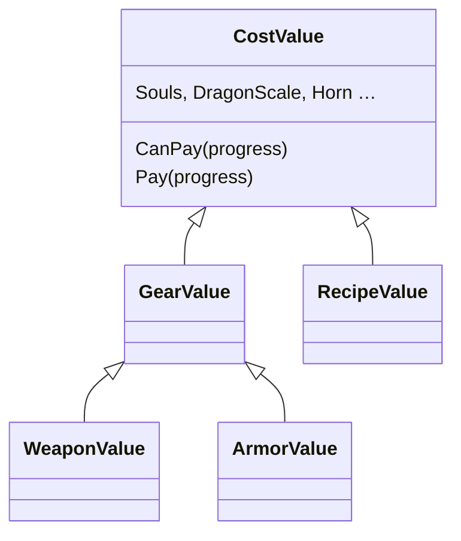

# Soul Knight 기술 문서

> **죽어도 다음 판의 준비가 남는 3D 보스 레이드 액션 — 애니메이터가 상태를 정하는 플레이어와, 거리 · 각도로 패턴을 고르는 보스**


| 항목 | 내용                                                                                                          |
|---|-------------------------------------------------------------------------------------------------------------|
| 장르 | 3D 보스 레이드 액션                                                                                                |
| 개발 기간 | 2026.10.21 ~ 2026.11.04 (2주)                                                                                |
| 개발 인원 | 1인                                                                                                          |
| 개발 환경 | Unity 6000.3.15f1 (URP), C#, Input System, UniTask, DOTween                                                 |
| 링크 | [GitHub](https://github.com/KooHoo-Dev/3rd_3D_1-3D-Project-Gryphon34) · 시연 영상: https://youtu.be/GR6967hMiNs |


---

## 0. 이 문서에 대해

### 만들고 싶었던 것

> **"지난 판에 나를 죽인 보스의 공격을, 다음 판엔 준비한 장비와 익힌 손으로 받아친다."**

기획서에 적은 플레이어 경험 목표입니다. 몬스터 헌터에서 **실력 + 준비**(부위 파괴, 보스 소재로 만드는 장비)를, 다크 소울에서 **잃을 것을 들고 싸우는 긴장**(소울 드랍)을 가져왔고,
레벨은 두지 않았습니다. 성장은 장비 · 인간성 · 요리로만 하고, 실력을 수치로 밀어붙이지 못하게 하기 위해서입니다.

이 목표를 세 가지로 나눠 노렸습니다.

| 노린 것 | 내용 | 그래서 정한 규칙 | 본문 |
|---|---|---|---|
| **조작감** | 몬스터 헌터의 대검을 참고한 **묵직함**: 느리지만 모아 친 한 방이 크게 들어가는 손맛 | 모든 타가 차지 공격. 칼을 드는 구간과 후딜은 느리게, 내려치기는 원래 속도. 맞으면 플레이어와 보스의 애니메이션만 잠깐 멈춤(히트스탑) | 6장 (결과) |
| **어렵지만 풀 수 있는 패턴** | 보스의 패턴을 보고 플레이어가 판단해서 대응할 수 있게 | 1단계는 옆 · 뒤에 안전지대가 없어 처음엔 죽지만 **3~4번 도전하면 깨는 벽**. 대신 예비동작은 확실히 보이게, 직격 한 방에 죽는 공격은 두지 않음 | 2장 |
| **다시 도전할 동기** | 사냥을 계속해서 하게 만드는 동기 | **모든 죽음은 다음 판의 준비가 된다.** 준 피해만큼의 소울과 얻은 소재는 죽어도 남고, 원하는 무기가 노릴 부위를 정해 줌 | 4장 · 5장 |

본문의 각 절에는 그 구현이 어느 기획에서 나왔는지를 **기획 의도**로 함께 적었습니다.

### 조작법

| 키 | 동작 |
|---|---|
| W A S D | 이동 |
| Shift (누르고 있기) | 달리기 |
| Space | 구르기 |
| Ctrl (누르고 있기) | 가드 |
| 좌클릭 | 공격 (누르고 있으면 차지) |

### 한 판의 흐름

플레이어는 마을에서 준비하고, 안개문을 지나 투기장에서 보스와 싸운 뒤, 이기든 지든 마을로 돌아옵니다. 이 흐름이 반복됩니다.



같은 흐름을 코드로 보면 아래와 같습니다. 씬이 바뀌면 그 씬의 오브젝트는 모두 사라지므로, 씬 사이의 값은 static인 `GameData.Current` 하나가 이어 줍니다.



투기장 안의 싸움은 1~3장, 사냥이 끝날 때 보상을 더하고 진행 상황을 남기는 것은 4장, 마을의 대장간과 냄비는 5장에서 다룹니다.

### AI와 함께 개발한 방식

이 프로젝트는 AI와 함께 개발했습니다. 나눈 기준은 하나입니다. **무엇을 만들지, 무엇이 맞는지는 내가 정하고, 그 사이의 구현이나 설명은 맡긴다.**

| 경우 | 맡긴 것 | 내가 한 것 | 본문 |
|---|---|---|---|
| 구조를 고민할 때 | 다른 구조의 제안 | 문제를 겪고 원인을 짚음, 구조를 고름 | 1장 상태는 애니메이터가 정한다 |
| 원인을 모를 때 | 원인 설명 | 값을 바꿔 가며 애니메이터 창으로 직접 확인, 규칙을 정함 | 2장 공격이 언제 끝났는지 |
| 같은 작업이 반복될 때 | 에디터 도구 구현 (콜라이더 복사 · Hurtbox 연결, 칼 궤적 굽기, 패턴 범위 기즈모) | 만들 것을 한 줄로 정함, 결과를 플레이로 검증해 버그를 찾음, 기즈모를 보며 범위 값을 직접 맞춤 | 2장 범위 값은 기즈모로 · 3장 궤적 굽기 · 반복 작업 · 맡긴 결과는 직접 확인한다 |

### 이 문서를 읽는 방법

이 문서는 시스템별로 장을 나눠, 각 시스템에서 내린 기술적인 선택과 겪은 문제를 그 자리에서 설명합니다.

| 장 | 다루는 것 |
|---|---|
| 1. 플레이어 | 상태를 애니메이터가 정하는 구조, 캐릭터를 누가 움직이나 (루트 모션, Rigidbody) |
| 2. 보스 | 코드가 상태를 정하는 구조, 거리 · 각도와 단계 · 날개로 공격 패턴 고르기, 애니메이션 신호로 공격 판정 켜고 끄기 |
| 3. 전투 판정 | 칼 궤적을 클립에 굽는 공격 판정, 부위별 피격과 결과 알리기 |
| 4. 데이터 | TSV 표로 둔 수치, 사냥이 끝나도 남는 진행 상황 |
| 5. 장비와 요리 | 제작 · 강화를 표의 줄로 처리, 공통 비용 클래스, 효과를 한 함수로 다시 정하기, 요리 열림 조건도 표로 |
| 6. 돌아보며 | 노린 것의 결과, 못 한 것과 배운 것 |

---

## 1. 플레이어 — 상태와 이동

### 상태는 애니메이터가 정한다

처음부터 이 구조였던 것은 아닙니다. 첫날에는 `PlayerAnimation`이 입력을 보고 `CrossFade`로 클립을 직접 재생했는데, 이동 쪽은 지금 공격 중인지 알 길이 없어서 **공격하면서 걸어가는** 문제가 생겼습니다.
입력 · 판단 · 재생이 한 파일에 섞여 있는 것이 원인이라고 보고, AI에게 상태를 나누는 다른 구조를 물었습니다. 그중 전환은 애니메이터가 하고 코드는 칸의 Tag를 따라가는 지금의 구조를 골랐습니다.

| | 처음: 코드가 직접 `CrossFade` | 지금: 애니메이터가 전환, 코드는 Tag를 따라감 (선택) |
|---|---|---|
| 좋은 점 | 화살표를 그릴 필요가 적음 | 이동 금지 · 차지 · 입력 구간 · 판정이 상태 클래스별로 나뉨. 공격 상태가 이동을 막을 수 있음 |
| 나쁜 점 | 입력 · 판단 · 재생이 한 파일. 공격 중인지 이동 쪽이 모름 | 화살표와 파라미터를 애니메이터에 다 그려야 함 |

지금의 구조에서 플레이어 상태(`LocomotionState`, `ChargeState` …)는 코드가 바꾸지 않습니다.
`PlayerController`가 매 프레임 애니메이터의 현재 칸 Tag를 읽고, 그 Tag에 맞는 상태의 `Enter` / `UpdateState` / `Exit`를 불러 줄 뿐입니다.

```csharp
// PlayerController.cs — Update에서 매 프레임 호출
// stateDic: Awake에서 "칸 Tag의 해시 → 상태 객체"로 등록해 둔 표 (예: "Attack" → AttackState)
private void UpdateAnimState()
{
    // ① 전환 중이면 넘어가고 있는 다음 칸, 아니면 지금 칸의 정보를 읽음
    AnimatorStateInfo stateInfo = Animator.IsInTransition(0)
        ? Animator.GetNextAnimatorStateInfo(0)
        : Animator.GetCurrentAnimatorStateInfo(0);

    // ② 그 칸의 Tag로 상태 객체를 찾음. 등록 안 된 Tag면 기본 상태(LocomotionState)
    if (stateDic.TryGetValue(stateInfo.tagHash, out PlayerStatesBase nextState) == false)
    {
        nextState = defaultState;
    }

    // ③ 상태가 바뀌었을 때만 나가고(Exit) 들어감(Enter) → 같은 상태면 Enter가 다시 불리지 않음
    if (currentState != nextState)
    {
        currentState?.Exit();
        currentState = nextState;
        currentState.Enter();
    }

    // ④ 지금 상태의 매 프레임 일. 진행률(normalizedTime) 등을 쓰도록 칸 정보를 넘김
    currentState.UpdateState(stateInfo);
}
```

애니메이터가 화살표를 타고 섞이는 중(`IsInTransition`)이면, 지금 칸이 아니라 넘어가고 있는 다음 칸의 Tag를 기준으로 상태를 바꿉니다.
이 구조를 처음 만들 때는 교안대로 지금 칸을 기준으로 했는데, 섞임이 끝날 때까지 이전 상태(이동)가 계속 돌아 **공격 버튼을 누른 뒤에도 잠깐 걸어갔습니다.** AI와 이야기하며 다음 칸 기준으로 바꿔, 화살표를 타기 시작한 순간부터 다음 상태로 넘깁니다.

③ 덕분에 Tag가 달라도 같은 상태 객체를 쓰면 상태가 끊기지 않습니다. 차지의 시작 칸(`Start`)과 유지 칸(`Charge`)은 Tag가 다르지만 둘 다 `ChargeState` 하나에 등록해 두어, 두 칸을 오가도 `Enter`가 한 번만 불리고 차지 시간이 이어집니다.

좌클릭 한 번이 공격 상태가 되기까지는 아래 순서를 거칩니다.



`LocomotionState`는 애니메이터의 `IsAttack`만 켤 뿐, 상태를 직접 바꾸지 않습니다.
애니메이터가 조건에 맞는 칸으로 넘어가기 시작하면, `UpdateAnimState`가 그 다음 칸의 Tag를 읽어 `ChargeState`로 들어갑니다.

이 구조가 맞았다는 것은 같은 프로젝트의 보스를 보면 드러납니다. 보스는 반대로 **코드가 상태를 정하는** 방식입니다.

| | 보스: 코드가 정함 | 플레이어: 애니메이터가 정함 |
|---|---|---|
| 방식 | 코드가 `ChangeState()`로 상태를 바꾸고, 애니메이터에는 트리거로 알림 | 애니메이터 전이가 칸을 바꾸고, 코드는 칸의 Tag를 읽어 따라감 |
| 좋은 점 | 상태가 언제 바뀌는지 코드에서 보임 | 상태의 기준이 애니메이터 하나라서, 코드와 애니메이션이 어긋날 수 없음 |
| 나쁜 점 | 코드와 애니메이터가 **각자 상태를 들고 있어서** 서로 다르게 알 수 있음 | Tag를 빠뜨린 칸은 에러 없이 기본 상태(`defaultState`)로 처리됨 |

보스에서 실제로 이 어긋남이 생겼습니다. 코드는 `IdleState`라고 알고 있는데 애니메이터는 걷기 칸에 머물러,
**화면 표시는 Idle인데 용은 계속 걸어가는** 버그였습니다. 코드와 애니메이터가 상태를 서로 다르게 알고 있었기 때문입니다.
플레이어처럼 애니메이터의 칸을 읽어 상태를 정했다면 이런 어긋남은 생길 수 없습니다.
반대로 플레이어 쪽의 약점인 Tag 누락 문제는 실제로 겪지 않았습니다.

### 캐릭터를 누가 움직이나

#### 코드가 방향을 정하고, 물리가 몸을 받친다

애니메이션 클립에는 자세뿐 아니라 몸 전체의 이동(앞으로 나가거나 바닥으로 내려가는 것)도 들어 있습니다.
이 프로젝트는 루트 모션을 끄고(`applyRootMotion = false`) 코드와 Dynamic Rigidbody로 움직입니다.

| | 애니메이션이 움직임 (루트 모션 켬) | 코드 + Dynamic Rigidbody (선택) |
|---|---|---|
| 방식 | 클립 속 이동만큼 오브젝트가 움직임 | 앞뒤·좌우는 코드가, 위아래와 충돌은 물리 엔진이 맡음 |
| 좋은 점 | 클립의 움직임과 실제 이동이 그대로 일치 | 이동 방향과 속도를 코드에서 정함. 중력과 충돌은 물리 엔진이 대신 처리 |
| 나쁜 점 | 이동 속도·방향을 코드에서 조절하기 어려움 | 클립 속 이동이 버려지므로, 클립마다 무엇을 버리고 무엇을 남길지 맞춰야 함 |


| 축 | 누가 움직이나 | 코드 |
|---|---|---|
| 앞뒤·좌우 (XZ) | 코드 | `ThirdPersonController`: `transform.position += transform.forward * (CurrentSpeed * Time.deltaTime)` |
| 위아래 (Y) | Rigidbody 중력 + 바닥 콜라이더 | 코드에는 Y를 바꾸는 줄이 없음 |
| 벽·보스와 부딪힘 | Rigidbody | 물리 엔진이 밀어냄 |

Dynamic Rigidbody는 중력과 충돌을 물리 엔진이 대신 해 주므로, 코드는 "어느 방향으로 얼마나 가는가"만 다루면 됩니다.
이 차이는 개발 중에 직접 겪었습니다. 씬의 플레이어가 Kinematic으로 켜져 있었을 때, **계단을 내려가도 높이(y)가 그대로**였습니다.
Kinematic은 물리가 오브젝트를 전혀 움직이지 않는 모드라 중력이 적용되지 않았고, 코드도 y를 바꾸지 않으므로 아무도 높이를 내려 주지 않았던 것입니다.
그래서 살아 있는 동안은 Dynamic으로 두고, **죽은 순간에만 Kinematic**으로 바꿨습니다(쓰러진 몸이 밀리거나 보스에게 끌려가지 않게).

#### 그 대가: 모션마다 몸이 뜨거나 바닥을 뚫음

루트 모션을 끈 대가는 구르기, 공격, 피격, 사망 모션에서 캐릭터가 공중에 뜨거나 바닥을 뚫는 문제로 돌아왔습니다.

Humanoid 클립은 Bake Into Pose를 하지 않으면 몸 전체의 이동을 클립에서 떼어 내 **루트 모션으로 빼냅니다.**
루트 모션을 끈 상태에서는 빼낸 이동이 그대로 버려지므로, 클립 안에서 몸이 내려가거나 올라가는 움직임이 사라집니다.

| 모션 | 버려진 움직임 | 결과 |
|---|---|---|
| 사망 | 쓰러지며 내려가는 Y | 서 있던 높이에서 자세만 누워 **공중에 뜸** |
| 넉다운 / 일어나기 | 내려가는 Y / 올라가는 Y | 넉다운은 **뜨고**, 일어날 때는 다리가 **바닥을 뚫음** |
| 구르기 | (루트 모션을 적용하는 모션) 위아래 Y까지 그대로 더해짐 | 구를 때 몸이 **들림** |

그래서 위아래(Y)는 클립 쪽에서, 앞뒤(XZ)는 코드 쪽에서 맡도록 나눴습니다.
- 클립: Root Transform Position (Y)를 **Bake Into Pose** → 위아래 이동을 떼어 내지 않고 자세에 남김. 루트 모션을 꺼도 몸이 바닥까지 내려옴
- 코드: 구르기만 루트 모션의 앞뒤 이동을 받고, Y는 버림 (점프가 없으니 위아래는 필요 없고, 안 버리면 구를 때 몸이 뜸)

루트 모션을 쓰지 않기로 했다면, **각 클립에 담긴 이동을 어떻게 다룰지**(자세에 넣을지, 코드가 받을지, 버릴지)를 클립마다 축별로 정해 두어야 합니다.
루트 모션을 끄는 것은 이동을 없애는 것이 아니라, 그 이동을 처리할 책임이 내 쪽으로 넘어오는 것이었습니다.

---

## 2. 보스 — 상태와 패턴

### 공격 → 대기 → 고르기 → 쫓아가기

보스는 1장의 플레이어와 반대로 **코드가 상태를 정합니다.** 상태마다 클래스가 있고, `Boss.ChangeState()`로 다음 상태를 정한 뒤 애니메이터에 트리거로 알립니다.
보스의 행동은 아래 상태들을 돌면서 반복됩니다.

| 순서 | 상태 | 하는 일 |
|---|---|---|
| 1 | 공격 상태 (`Attack` 계열) | 애니메이션 진행률이 Exit Time을 넘으면 → `IdleState` |
| 2 | `IdleState` | 대기 시간만큼 기다림 (공격 뒤면 그 공격의 `RecoveryTime`) → `DecideState` |
| 3 | `DecideState` | 플레이어와의 **거리와 각도**를 재서, 조건에 맞는 패턴을 후보로 모음 |
| 4-a | 후보가 있음 | 후보 중 하나를 골라 그 공격 상태로 → 1번 |
| 4-b | 후보가 없음 | `ChaseState`: 플레이어 쪽으로 돌며 걸어가다가, 맞는 패턴이 생기면 → `DecideState` |

### 공격이 언제 끝났는지 — 코드와 애니메이터가 따로 안다

보스의 공격 상태는 애니메이터의 진행률(`normalizedTime`)이 상태마다 정한 `exitTime`을 넘으면 끝나고 `IdleState`로 돌아갑니다.
그런데 애니메이터에도 공격 칸에서 Idle 칸으로 나가는 화살표가 따로 있고, 그 화살표에도 Exit Time이 있습니다.
**"공격이 끝났다"를 코드와 애니메이터가 각자 판단하는 것**입니다. 1장 비교 표에서 말한 보스 방식의 약점이 여기서 드러났습니다.

#### 처음: 값으로 맞추기

처음에는 `exitTime`을 "애니메이션이 끝나는 시간"으로 알고 0.99를 넣으려 했는데, 그러자 보스가 **공격 상태에 갇혔습니다.**
왜 갇히는지 AI에게 물었고, 답은 이랬습니다. 애니메이터의 화살표는 0.85에서 이미 Idle 칸으로 넘어가는데, 코드는 **"내 칸에서 진행률이 0.99를 넘었나"**를 봅니다. 그래서 칸이 먼저 바뀌어 버리면 그 순간을 영영 보지 못한다는 것이었습니다.

값을 바꿔 가며 직접 돌려 보고 애니메이터 창의 진행 막대를 보면서 두 Exit Time이 실제로 어떻게 어긋나는지 확인했습니다.
그래서 **`exitTime`은 화살표의 Exit Time보다 작게** 두는 규칙을 정했습니다(할퀴기는 0.8, 화살표는 0.85).

#### 다시: 플레이테스트에서 또 갇힘

11/02 플레이테스트에서 보스가 공격 상태(`TurnClawState`)에 멈춘 채 플레이어만 바라보는 버그가 나왔습니다.
이번에는 규칙을 지키고 있었지만, `exitTime` 0.92와 화살표 0.95 사이가 너무 좁았습니다. 프레임이 그 틈을 건너뛰면 다음 칸으로 넘어가 버려서, 같은 방식으로 끝을 놓쳤습니다.

멈췄을 때 Pause하고 애니메이터 창을 보면 원인 후보를 가를 수 있었습니다. 진행 막대가 할퀴기 칸에서 멈춰 있으면 히트스탑이 애니메이터를 멈춘 것이고, Idle 칸에 있으면 끝을 놓친 것입니다.

| 고치는 법 | 장점 | 단점 |
|---|---|---|
| 값 조정: `exitTime`과 화살표 사이를 넓힘 | 코드를 안 고침 | 공격마다 값을 맞춰야 하고, 또 좁아지면 다시 생김 |
| **조건 추가: 내 칸에 들어갔다가 빠져나가면 끝 (선택)** | 값을 안 맞춰도 되고, 틈을 놓쳐도 다음 칸에 들어간 순간 끝남 | 조건이 하나 늘어남 |

값을 맞추는 방식은 공격이 늘어날 때마다 같은 실수를 할 여지를 남깁니다. 그래서 두 번째에는 **어긋나도 결과가 맞게 나오는 구조**로 바꿨습니다.

### 거리와 각도로 패턴을 고른다

> **기획 의도** — 1단계는 "옆 · 뒤 안전지대가 없는 벽"입니다. 그래서 플레이어가 선 자리마다 나오는 패턴을 정했습니다.
> **앞**: 할퀴기 콤보 · 물기 · 점프 물기 · 브레스 · 불덩이 / **옆**: 한 발 할퀴기 · 철산고 / **뒤**: 뒤 돌아 할퀴기.
> 자리에 따라 패턴이 정해지므로, 플레이어는 예비동작뿐 아니라 **자기가 선 자리로도** 다음 공격을 읽을 수 있습니다. 같은 패턴은 두 번 연속 쓰지 않습니다.

코드에서는 이 "자리"를 거리와 각도로 나타냈습니다.
패턴마다 쓸 수 있는 거리(`minDistance ~ maxDistance`)와 각도(`minAngle ~ maxAngle`)를 인스펙터에 적어 두고,
`DecideState`가 지금 플레이어의 거리와 각도가 그 안에 드는 패턴만 후보로 모읍니다.

대기에서 공격 상태가 정해지기까지는 아래 순서를 거칩니다 (처음 발견할 때의 포효, 플레이어가 없을 때는 생략).



```csharp
// DecideState.cs (줄 일부 생략)
public override void Enter()
{
    // … (플레이어 없음 · 지쳤으면 IdleState로, 로그 생략)

    // ① 플레이어까지의 거리, 보스 정면에서 플레이어 쪽까지의 각도 (왼쪽 −, 오른쪽 +)
    GetInfo(out float distance, out float angle);
    List<Pattern> patternList = new List<Pattern>();     // 범위에 드는 후보
    List<Pattern> tempPatternList = new List<Pattern>(); // 그중 직전 패턴을 뺀 후보

    // ② 지금 나올 수 있는 패턴 중 거리 · 각도가 범위 안인 것만 후보로
    foreach (Pattern pattern in AllPatterns)
    {
        if (IsInRange(pattern, distance, angle)) patternList.Add(pattern);
    }

    // ③ 직전 패턴(lastState)을 뺀 목록을 따로 만듦
    foreach (Pattern pattern in patternList)
        if (pattern.PatternName != lastState) tempPatternList.Add(pattern);

    // ④ 뺀 목록이 비어 있지 않으면 그것을, 비었으면(직전 패턴뿐) 원래 후보를 씀
    List<Pattern> pickList = tempPatternList.Count >= 1 ? tempPatternList : patternList;

    if (pickList.Count >= 1)
    {
        // ⑤ 무작위로 하나. 정수 Random.Range는 끝 값을 빼므로 Count까지 넣어야 마지막 후보도 나옴
        int result = UnityEngine.Random.Range(0, pickList.Count);
        Pattern pattern = pickList[result];
        lastState = pattern.PatternName;   // 다음 고르기에서 뺄 수 있게 기억
        // … (도망 패턴 시간 초기화 생략)
        boss.ChangeState(pattern.PatternName);
    }
    // ⑥ 후보가 하나도 없으면 쫓아가기
    else boss.ChangeState(StateName.ChaseState);
}
```

후보가 여럿이면 그중 하나를 무작위로 뽑되, **직전에 쓴 패턴은 후보에서 뺍니다.** 빼지 않으면 같은 패턴만 계속 나올 수 있기 때문입니다.
다만 후보가 직전 패턴 하나뿐일 때는 빼지 않고 그대로 씁니다. 그것까지 빼면 후보가 비어 `ChaseState`로 가고,
`ChaseState`는 범위만 보고 다시 `DecideState`로 보내므로, 보스가 공격하지 않고 **계속 쫓아가기만** 할 수 있습니다.

### 범위 값은 기즈모로 보면서 맞춘다

처음에는 패턴마다 거리와 각도를 임의의 값으로 넣었는데, 실제로 해 보니 보스가 공격을 해도 **히트박스가 플레이어에 닿지 않았습니다.**
패턴의 범위는 그 공격을 **시작하는** 거리일 뿐이고, 실제로 플레이어를 맞히는 것은 히트박스가 닿는 범위입니다.
이 두 범위가 서로 달라서, 히트박스가 닿지 않는 거리에서도 공격을 시작했던 것입니다.

숫자만 보고는 어느 패턴의 범위가 어디까지인지 알 수 없어서, 모든 패턴의 범위를 바닥에 부채꼴 기즈모로 그려 눈으로 보이게 했습니다.
기즈모를 그리는 코드는 에디터 도구처럼 구현을 맡겼고, 그 그림을 보며 패턴을 하나씩 실제로 맞아 보면서 값을 직접 고쳐 나갔습니다.
기준은 **히트박스가 실제로 닿는 거리를 재서, 먼 끝은 0.4m 줄이고 가까운 끝은 그대로** 두는 것이었습니다. 각도는 앞 · 옆 · 뒤의 역할을 지키되 실제로 맞는 한계 안으로 좁혔습니다.

### 단계와 날개에 따라 쓸 수 있는 패턴이 달라진다

#### 2단계는 같은 보스에 값만 바꿔 끼운다

> **기획 의도** — 1단계가 **패턴을 배우는 벽**이라면, 2단계는 **준비를 요구하는 벽**입니다. 불(화염 상태 · 화염 장판 · 공중 패턴)에 한 번 막히고,
> 방어구와 요리로 대비해 돌파하게 했습니다. 보스는 하나를 단계로 나눠 쓰고, 모델과 모션은 재사용해 **수치 · 색 · 패턴 몇 개만** 바꿉니다.

2단계는 기획상 1단계와 다른 보스이지만, 코드에서는 같은 보스 하나로 만들었습니다.
같은 용 모델을 쓰고 패턴도 대부분 같아서, 1단계를 데이터로 만들어 두면 2단계는 값만 더하면 됐기 때문입니다.

단계마다 달라지는 값은 `StageValue` 하나로 묶어 `Boss` 인스펙터의 배열(`stages`)에 넣어 두었습니다.
투기장이 시작될 때 `HuntManager`가 안개문에서 고른 단계를 `Boss.SetStage`에 넘기면, 보스가 그 단계의 값을 꺼내 HP와 피로도를 채우고 몸 머티리얼을 바꿉니다.

| `StageValue` 칸 | 내용 |
|---|---|
| `maxHp` · `maxFatigue` | 최대 HP, 지칠 때까지 깎아야 하는 피로도 |
| `attackRate` | 보스 히트박스 피해에 곱하는 배율 |
| `bodyMaterial` | 몸 머티리얼 (2단계는 붉은 머티리얼로 통째로 교체) |
| `rageFireHpRate` | HP가 이 비율 아래로 내려가면 근접 공격에도 불이 붙음 (0 = 없음) |


#### 2단계 패턴은 줄마다 "몇 단계부터"를 적는다

2단계에서만 나오는 패턴은 처음에 단계 값(`StageValue`) 안에 `extraPatterns` 목록으로 따로 두었습니다.
`DecideState`는 자기 인스펙터에 있는 기본 패턴에, 지금 단계의 추가 패턴을 더해 후보로 썼습니다.
그런데 이렇게 하면 1단계 패턴은 `DecideState` 인스펙터에, 2단계 패턴은 `Boss` 인스펙터에 나뉘어 있어서, 패턴의 범위를 고치려면 먼저 그 패턴이 어느 쪽에 있는지부터 찾아야 했습니다.

그래서 모든 패턴을 `DecideState` 한 곳에 모으고, 줄마다 몇 단계부터 나오는지(`fromStage`)를 적는 칸을 붙였습니다.
앞에서 본 `DecideState.Enter`는 `AllPatterns`에서 후보를 모으는데, 이 `AllPatterns`가 **지금 단계보다 높은 줄**과 **날개가 필요한데 날 수 없는 줄**을 미리 걸러 냅니다.

| | 처음: 단계마다 추가 목록 | 지금: 줄마다 `fromStage` |
|---|---|---|
| 패턴이 있는 곳 | `DecideState` + `Boss`의 `stages[i].extraPatterns` | `DecideState` 한 곳 |
| 2단계 패턴 넣기 | 그 단계의 `extraPatterns`에 줄 추가 | `DecideState`에 줄을 넣고 `fromStage`를 2로 |

플레이 전(에디터)에는 단계를 거르지 않고 모든 패턴을 내보내, 기즈모가 2단계 패턴까지 그리게 했습니다.


#### 날개가 다 깨지면 비행 패턴을 후보에서 뺀다

> **기획 의도** — 2단계의 공중 패턴은 칼이 거의 닿지 않아 착지할 때만 틈이 생기는, 2단계에서 가장 까다로운 패턴입니다.
> 날개를 깨면 이 패턴이 사라지므로, 부위 파괴가 소재뿐 아니라 **싸움 자체를 쉽게 만드는 보상**이 됩니다. 날개는 2단계에서만 깨지고, 양쪽이 **둘 다** 깨져야 효과가 납니다.

`AllPatterns`의 두 번째 조건은 날개입니다. 비행 패턴 두 개(`AirFireBallState`, `AirSpreadFireState`)는 줄에 `needWings`를 켜 두었고,
`Boss.CanFly`는 날개가 **하나라도 안 깨졌으면** true입니다. 양쪽 날개가 모두 깨져 false가 되면 `AllPatterns`가 이 줄을 걸러 냅니다.

날개가 깨진 용을 날지 못하게 하는 방법으로는, 날고 있는 중에 날개가 깨지면 떨어뜨리는 방법도 있습니다.
하지만 두 가지 이유로 그렇게 하지 않았습니다. 공중에서는 칼이 거의 닿지 않아 떨어뜨려도 플레이어가 노릴 틈이 늘지 않았고, 날다가 추락하는 애니메이션도 없었습니다.
그래서 비행 중에 처리하지 않고 날기 전에, 곧 후보를 고르는 단계에서 비행 패턴을 아예 뺐습니다.
이 때문에 날고 있는 동안 날개가 깨지면 그 비행은 끝까지 하고 내려오며, 다음에 패턴을 고를 때부터 비행 패턴이 나오지 않습니다.

### 공격 판정은 애니메이션 신호로 켜고 끈다

보스의 히트박스(`BossHitbox`)는 애니메이터 칸에 붙인 `AnimStateEventSender`가 보내는 신호로 켜고 끕니다.
Sender에는 신호 이름, 보낼 시점(칸의 진행률 0~1), 매개변수를 적어 두고, 진행률이 그 시점을 지나면 신호를 한 번 보냅니다.

| 순서 | 어디서 | 무슨 일 (오른손 할퀴기 예) |
|---|---|---|
| 1 | `AnimStateEventSender` (`ClawsAttackRight` 칸에 붙음) | 진행률 0.333을 지나면 `("HitboxOn", "R_Hand")`, 0.58을 지나면 `("HitboxOff", "R_Hand")`를 보냄 |
| 2 | `AnimStateEventListener` | 받은 신호를 이벤트로 그대로 넘김 |
| 3 | `Boss.HandleAnimEvent` | 지금 상태의 `ReceiveAnimEvent`에 넘김 |
| 4 | `Attack.ReceiveAnimEvent` | id가 `R_Hand`인 히트박스만 켬. `HitboxOff`가 오면 끔 |

```csharp
// Attack.cs (줄 일부 생략)
// ① 공격 상태를 나갈 때 (끝났든, 지침 · 죽음으로 끊겼든) 이 공격의 히트박스를 모두 끔
public override void Exit()
{
    SetAllHitboxes(false);
    // … (예비동작 속도 되돌리기 생략)
}

// ② Sender가 보낸 신호. eventName = 무엇을 할지, parameter = 어느 히트박스인지 (예: "R_Hand")
public override void ReceiveAnimEvent(string eventName, string parameter)
{
    if(eventName == "HitboxOn")
    {
        // … (회전 멈춤 · 예비동작 속도 되돌리기 생략)
        SetHitbox(parameter, true);   // ③ id가 parameter와 같은 히트박스만 켬
    }
    if(eventName == "HitboxOff") SetHitbox(parameter, false);   // ④ 같은 방식으로 끔
    // … (RotateOn/Off · Sound · Effect도 같은 신호로 처리, 생략)
}

private void SetHitbox(string id, bool active)
{
    foreach (BossHitbox hitbox in hitboxes)
    {
        if (hitbox.id == id) hitbox.gameObject.SetActive(active);
    }
}
```

플레이어의 칼은 3장에서 다루듯 클립 키로 켜고 끄는데, 보스는 이렇게 신호를 쓴 이유가 있습니다.
보스는 지치거나 죽는 등 상태에 따라 공격이 중간에 끊길 수 있습니다. 히트박스를 클립 키로 켜고 끄면, 끄는 키에 도달하기 전에 끊겼을 때 히트박스가 켜진 채로 남을 수 있습니다.
신호를 받아 코드가 켜고 끄게 하면, 공격 상태를 나갈 때(`Attack.Exit`) 코드가 히트박스를 모두 꺼 줄 수 있습니다.

---

## 3. 전투 판정 — 때리고 맞기

플레이어의 칼이 보스에 닿으면 아래 순서로 처리됩니다.
앞부분(`WeaponCollider`)은 **공격 판정**에서, 뒷부분(`Hurtbox` → `Boss`)은 **피격**에서 설명합니다.



### 공격 판정 — 칼 궤적을 클립에 굽다

#### 칼에 붙인 콜라이더의 문제

처음에는 대검에 콜라이더를 붙였습니다. 칼이 움직이는 대로 판정도 따라가니 가장 단순한 방법이었지만, 두 가지 문제가 생겼습니다.

- **플레이어 자신에게 닿음**: 칼의 콜라이더가 플레이어 몸에 닿은 것으로 인식되어, 캐릭터가 계속 밀려 움직였습니다.
- **회수 동작에서 한 번 더 맞음**: 휘두른 뒤 칼을 거둬들이는 동안에도 칼은 판정을 들고 있으므로, 그때 보스에 닿으면 **한 번 휘둘렀는데 피해가 두 번** 들어갔습니다.

두 번째 문제는 콜라이더를 어디에 붙이느냐가 아니라 **언제 켜져 있느냐**의 문제였습니다.
칼에 붙인 콜라이더는 칼이 움직이는 동안 늘 판정이 있으니, 내려치는 순간과 거둬들이는 순간을 구분하지 못합니다.

#### 클립마다 궤적에 맞춰 콜라이더를 둔다

그래서 판정을 칼에서 떼어 내 **공격 클립별로** 나눴습니다.
공격 클립마다 칼이 지나가는 궤적에 맞춰 콜라이더를 배치하고, 그 클립의 공격 구간에만 켰다가 끝나면 끕니다.
판정이 클립에 묶여 있으니 회수 동작에는 판정이 없고, 콤보마다 궤적이 달라도 각자 맞는 모양을 가질 수 있습니다.

#### 궤적은 에디터 도구로 굽는다

궤적에 맞춘 콜라이더 키는 손으로 찍지 않고 에디터 도구(`ComboColliderBakerWindow`)로 구웠습니다.
공격 클립을 재생하면서 칼을 따라가 궤적을 계산한 뒤, 그 궤적대로 콜라이더의 키를 클립에 써 넣는 도구로, 뒤의 피격 판정 도구들처럼 만들 것만 정하고 구현은 AI에게 맡겼습니다.

| 순서 | 하는 일 |
|---|---|
| 1 | 공격 클립을 1초에 120번씩 재생하며 잰다. 런타임과 같게 루트 모션과 Foot IK는 끈다 |
| 2 | 검 메시의 가장 긴 축을 칼날로 보고, 칼날을 감싸는 상자를 만든다 (손잡이 쪽 25%는 빼고 칼끝은 0.1m 늘림) |
| 3 | 그 상자의 **위치 · 회전 · 크기**를 캐릭터 루트 기준 키로 바꿔 클립에 쓴다 |

칼의 한 점이 아니라 칼날 상자 전체를 따라가므로, 위치뿐 아니라 회전과 크기까지 클립에 들어갑니다.
그래서 콤보마다 판정이 지나가는 모양이 그 동작의 궤적 그대로 달라집니다.
대신 도구로 다시 구우면 콜라이더 키를 지우고 새로 쓰므로, 손으로 고친 키는 덮어써집니다.

#### 켜고 끄기도 클립이 한다

콜라이더를 켜고 끄는 것도 클립에 맡겼습니다. 공격 클립마다 자기 콜라이더 오브젝트의 활성 상태(`m_IsActive`)에 키를 넣어,
클립이 시작할 때 켜고(`SetActive(true)`) 끝날 때 끕니다(`SetActive(false)`).

| 클립 | 콜라이더 | 켜짐 → 꺼짐 |
|---|---|---|
| `Combo1_Attack` | `Combo1_Collider` | 0초 → 0.4초 (클립 끝) |
| `Combo2_Attack` | `Combo2_Collider` | 0초 → 0.2초 (클립 끝) |
| `Combo3_Attack` | `Combo3_Collider` | 0초 → 0.4초 (클립 끝) |

위치 · 회전 · 크기 키와 켜고 끄는 키가 같은 클립 안에 있으므로, 판정은 그 동작이 재생되는 동안에만 존재하고 동작이 끝나면 사라집니다.
칼을 거둬들이는 동작은 다른 클립이라 판정이 없고, 이것으로 두 번 맞는 문제가 풀렸습니다.

#### 한 번 휘두르면 한 번만 맞는다

보스는 부위마다 피격 판정(Hurtbox)이 따로 있어서, 판정 상자 하나가 한 번에 여러 Hurtbox에 닿을 수 있습니다.
닿을 때마다 피해를 주면 한 번 휘둘렀는데 여러 번 맞게 되므로, `WeaponCollider`는 이미 맞힌 대상을 `HashSet`에 기억해 두고 다시 닿아도 무시합니다.

기억하는 것은 Hurtbox가 아니라 그 Hurtbox의 주인(`damageable.Owner`, 곧 보스)입니다.
Hurtbox를 기억했다면, 판정 상자가 머리와 몸통에 동시에 닿았을 때 둘을 서로 다른 대상으로 보고 **두 번** 맞혔을 것입니다.
여러 Hurtbox가 같은 보스를 가리키므로, 주인을 기준으로 삼아야 한 번 휘두를 때 보스 한 마리에 한 번만 들어갑니다.

기록은 공격 상태에 들어올 때마다(`AttackState.Enter` → `GreatSword.ResetHash()`) 비우므로, 다음 휘두름에서는 다시 맞힐 수 있습니다.

여기까지가 칼이 **언제, 몇 번** 닿는지였다면, 아래는 닿은 뒤 그 피해가 보스 안에서 **어떻게 전달되는지**입니다.

### 피격 — 보스가 맞는 과정

#### 맞는 곳 · 부위 · 판단을 나눈다

> **기획 의도** — 부위 파괴는 이 게임의 "다음에 노릴 곳"을 만드는 장치입니다. 갈래 무기의 재료가 부위 소재(용뿔 대검 = 뿔, 꼬리뼈 대검 = 꼬리 가시)라서
> **원하는 무기 → 필요한 부위 → 이번 사냥에서 노릴 곳**이 자연스럽게 정해집니다. 앞발은 보스의 공격에 가장 많이 쓰여 자주 맞히게 되므로, 부위 파괴를 처음 경험하는 곳으로 넣었습니다.
> 그래서 보스는 "어디를 맞았는지"를 알아야 했고, 아래처럼 맞는 곳과 부위를 나눴습니다.

칼이 닿은 뒤의 피해는 `Hurtbox.TakeDamage` → `BossPart.TakeDamage` → `Boss.ApplyHit` 순서로 세 단계를 거쳐 전달됩니다.

| 단계 | 맡는 일 | 들고 있는 것 |
|---|---|---|
| `Hurtbox` | **맞을 수 있는 곳**을 알림 | 콜라이더. 자기가 속한 `BossPart` 참조 |
| `BossPart` | **어떤 부위인지**를 알림 | 부위 이름, 내구도, 부위 배율, 깨질 수 있는지 |
| `Boss` | 받은 정보로 **판단** | 체력 · 피로도 계산, 부위 파괴 처리, 죽음 · 지침 판정 |

```csharp
// Hurtbox.cs
// ① 칼이 닿은 콜라이더. 계산하지 않고, 받은 공격 정보를 자기가 속한 부위(part)에 그대로 넘김
public void TakeDamage(AttackInfo info)
{
    part.TakeDamage(info);
}

// BossPart.cs
// ② 부위. 공격 정보에 "어느 부위가 맞았는지"(this)를 붙여 보스에 넘김
public void TakeDamage(AttackInfo info)
{
    Debug.Log($"[{partName} 맞음]");
    boss.ApplyHit(info, this);   // ③ 피해 계산은 보스의 ApplyHit 한 곳에서만
}
```

하나로 합치면 한 스크립트가 맞는 곳, 부위 정보, 판단을 모두 맡게 되어 책임이 너무 많아지므로 나눴습니다.
나눈 덕분에 Hurtbox와 BossPart는 정보를 넘기기만 하고, 피해 계산은 `Boss.ApplyHit` 한 곳에만 있습니다.

#### 맞을 수 있는 것은 IDamageable 하나로

`WeaponCollider`는 닿은 상대를 `Hurtbox`로 받지 않고 `IDamageable` 인터페이스로 받습니다.

```csharp
// IDamageable.cs — 맞을 수 있는 것이 반드시 가져야 할 두 가지
public interface IDamageable
{
    // ① 이 판정의 주인 (보스의 Hurtbox면 보스, 플레이어면 자기 자신)
    //    → 때리는 쪽이 "이번에 이미 맞힌 상대인가"를 이 값으로 가림
    object Owner { get; }

    // ② 맞았을 때 부르는 함수. 때리는 쪽은 상대가 누구든 이것만 부름
    void TakeDamage(AttackInfo info);
}
```

피격 판정을 받는 것은 보스만이 아니라 플레이어도 있기 때문입니다. 보스의 `Hurtbox`와 플레이어의 `PlayerHealth`가 모두 이 인터페이스를 구현하고,
공격하는 쪽(플레이어의 `WeaponCollider`, 보스의 `BossHitbox`)은 닿은 콜라이더에서 `IDamageable`을 찾을 수 있을 때만 피해를 줍니다.
즉 **이 인터페이스를 가진 것만 맞을 수 있습니다.**

| | 구현하는 쪽 (맞는 쪽) | `Owner` | 찾는 쪽 (때리는 쪽) |
|---|---|---|---|
| 보스 | `Hurtbox` | `part.Owner` (보스) | `WeaponCollider` |
| 플레이어 | `PlayerHealth` | `this` (자기 자신) | `BossHitbox` |

공격하는 쪽은 상대가 보스인지 플레이어인지 몰라도 `TakeDamage`만 부르면 되고, 앞의 "한 번만 맞히기"도 양쪽이 똑같이 `Owner`로 처리합니다.

#### 한 번의 공격은 AttackInfo 하나로

`TakeDamage`에는 피해량 숫자 하나가 아니라 `AttackInfo`를 넘깁니다. 공격마다 담긴 정보가 다르기 때문입니다.
플레이어의 공격은 몇 번째 콤보인지, 얼마나 모았는지에 따라 세기가 달라지고, 보스의 공격은 맞은 플레이어가 얼마나 크게 휘청일지(`Reaction`)가 다릅니다.

| 필드 | 내용 | 주로 쓰는 쪽 |
|---|---|---|
| `Damage` | 무기 공격력 × 모션값 × 차지 배율 | 양쪽 |
| `Fatigue` | 보스 피로도를 깎는 양 | 보스가 맞을 때 |
| `HitPosition` | 맞은 위치 | 양쪽 |
| `Reaction` | 맞은 쪽이 재생할 피격 모션 | 플레이어가 맞을 때 |
| `BrokenPartBonus` | 깨진 부위를 때릴 때 더 곱하는 배율 | 보스가 맞을 때 |
| `Tag` · `Source` · `Ignite` | 공격 종류(가드 불가 · 화염 등), 공격한 쪽, 화염 상태 | 플레이어가 맞을 때 |

콤보 순서와 차지 단계는 필드로 따로 넘기지 않고 `Damage`에 이미 곱해져 들어갑니다.
콤보마다 다른 모션값은 콤보별 `WeaponCollider`가 들고 있고(앞의 `Combo1~3_Collider`), 차지 배율은 `GreatSword`가 `SetAttackValue`로 넣어 줍니다.

`AttackInfo`는 `class`가 아니라 `readonly struct`입니다.

- **struct**: 값을 복사해서 넘기므로 힙에 따로 만들어지지 않습니다. 크기가 작아서 복사하는 부담도 적습니다.
  class였다면 칼이 닿을 때마다 힙에 `AttackInfo`가 하나씩 생기고, 다 쓰고 나면 GC가 치워야 합니다. 이것이 쌓여 GC가 한꺼번에 돌면 그 순간 프레임이 끊길 수 있습니다.
- **readonly**: 만든 뒤에는 값을 바꿀 수 없습니다. `Hurtbox` → `BossPart` → `Boss`로 넘어가는 동안 중간에서 피해량이 바뀌는 일을 컴파일 단계에서 막습니다.

#### 맞은 결과는 이벤트로 알린다

`Boss.ApplyHit`이 계산을 마치면, 그 결과를 처리할 스크립트를 직접 부르지 않고 이벤트로 알립니다.
부위가 깨졌을 때만 해도 이펙트, 겉모습, 소재 지급처럼 처리할 곳이 여러 군데라, 보스가 그 대상을 하나하나 알고 부르게 하면 보스가 너무 많은 것을 알아야 하기 때문입니다.

| 이벤트 | 언제 | 듣는 곳 |
|---|---|---|
| `OnPartBroken` | 부위가 깨진 순간 (한 판에 부위마다 한 번) | `HuntManager`(부위 소재 지급) · `PartDecal`(부서진 데칼) · `TailSever`(꼬리 자르기) |
| `OnHpReduce` | 맞아서 HP가 깎인 순간 | `HuntManager`(HP 구간마다 소재 지급) |
| `OnDeath` | 보스가 죽은 순간 | `HuntManager`(사냥 끝) · `BossHUD`(체력바 처리) |

보스는 "깨졌다"는 사실만 알리고, 그 뒤에 무엇을 할지는 듣는 쪽이 정합니다.
새로 처리할 곳이 생겨도 그 스크립트에서 이벤트를 구독하면 되므로 `Boss`를 고치지 않아도 됩니다.

#### 반복 작업은 만들 것만 정하고 맡긴다

드래곤의 피격 판정은 뼈마다 콜라이더를 하나씩 붙여 만들었고, 그 수가 37개입니다(다리 · 팔 · 목 · 꼬리 · 양 날개).
콜라이더마다 Hurtbox를 달고 부위를 연결하고, 왼쪽에 붙인 것을 오른쪽에 똑같이 붙이는 일은 같은 작업의 반복입니다.
그래서 **무엇을 만들지만 한 줄로 정하고, 에디터 도구의 구현은 AI에게 맡겼습니다.**

| 정한 것 | 만들어진 도구 (메뉴) | 하는 일 |
|---|---|---|
| 왼쪽 콜라이더를 오른쪽에 좌우 반전해서 복사 | `DragonColliderMirror` (BossRaid/Mirror Colliders L → R) | 뼈 이름의 `WingL` → `WingR`, `" L "` → `" R "`으로 짝을 찾아 복사 |
| 콜라이더마다 Hurtbox를 달고 부위에 연결 | `DragonHurtboxSetup` (BossRaid/Setup Dragon Hurtboxes) | Hurtbox를 달고 레이어를 `BossHurtbox`로 바꾼 뒤, 위쪽에서 가장 가까운 부위에 연결 (없으면 `Body`) |

두 도구 모두 이미 붙어 있는 것은 건너뛰므로 여러 번 실행해도 안전합니다. 콜라이더를 더 붙였으면 메뉴를 다시 누르면 됩니다.

#### 맡긴 결과는 직접 확인한다

도구를 쓰고 나서 칼이 용의 **목**에 닿을 때만 `NullReferenceException`(`Hurtbox.get_Owner`)이 났습니다.

| 단계 | 한 일 |
|---|---|
| 발견 | 플레이 중 목을 때릴 때만 에러가 나는 것을 찾음 |
| 원인 좁히기 | 에러 로그를 AI에게 보여 주고 같이 좁힘 → `Hurtbox.Awake`가 도구가 채운 `part` 값을 덮어쓴다는 가설 |
| 확인 | 하이어라키에서 목 뼈의 부모를 따라 올라가 BossPart가 없음을 확인. Play 전후로 `part` 칸을 비교해, 도구가 채운 `Body`가 Play 뒤 비는 것을 확인 |
| 고침 | `Awake`의 찾는 줄을 지우고, 목을 다시 때려 에러가 사라진 것을 확인 |

원인은 `Hurtbox.Awake`에 남아 있던 한 줄, 부모 쪽에서 BossPart를 다시 찾는 `part = GetComponentInParent<BossPart>();`였습니다.

도구가 인스펙터의 `part` 칸을 채워 두어도, 게임이 시작되면 `Awake`가 그 값을 덮어쓰고 부모 쪽에서 BossPart를 다시 찾았습니다.
다리나 날개는 부모 쪽에 부위 뼈가 있어 문제가 없었지만, 목은 하이어라키에서 `Spine1 → Spine → Pelvis`로 올라가는 길에 BossPart가 없었습니다.
도구는 목을 `Body` 부위에 연결해 두었지만, `Body`는 `Spine1`의 **다른 자식**이라 부모를 따라 올라가서는 찾을 수 없습니다. 그래서 `part`가 null이 되었습니다.

지금은 연결을 에디터에서 도구가 한 번 정하고, 런타임에는 다시 찾지 않습니다.
도구는 에디터에서 연결을 정해 두었는데, 도구가 생기기 전의 방식(런타임에 부모에서 찾기)이 코드에 남아 그 값을 덮어쓰고 있었습니다.
구현을 맡기더라도, 그 결과가 **기존 코드와 어떻게 만나는지는 직접 확인해야** 했습니다.

---

## 4. 데이터 — 정해진 수치와 바뀌는 값

사냥이 끝나면 결과가 남습니다. 이 결과를 정하는 데는 두 종류의 데이터가 쓰입니다.
**정해진 수치**(보상 개수, 차지 배율, 장비 능력치)는 TSV 표에 두고, **플레이하며 바뀌는 값**(소울, 소재, 가진 장비)은 `GameData.Current`가 들고 있습니다.



| 절 | 그림에서 |
|---|---|
| 정해진 수치는 TSV 표로 | 왼쪽 `TSV 표` |
| 바뀌는 값은 static Progress 한 벌로 | 가운데 `GameData.Current` |
| 사냥 중에는 모으고, 끝날 때 한 번에 더한다 | `HuntManager` → `GameData.Current` |
| 이어 싸울 때는 겉모습만 되돌린다 | `GameData.Current` → `Boss.RestoreCheckpoint` |

### 정해진 수치는 TSV 표로

| 표 (`StreamingAssets/…`) | 담긴 것 | 읽는 곳 |
|---|---|---|
| `ChargeTable.tsv` | 차지 시간별 데미지 · 피로도 배율 | `GreatSword` |
| `RewardTable.tsv` | 단계별 처치 보상, HP 구간 보상 | `HuntManager` |
| `PartRewardTable.tsv` | (단계, 부위)별 부위 파괴 소재 | `HuntManager` |
| `WeaponTable.tsv` · `ArmorTable.tsv` | 장비 능력치 · 강화 | `PlayerLoadout` (`ForgeTable`) |
| `RecipeTable.tsv` | 요리 레시피 | `PlayerLoadout` (`RecipeTable`) |

수치를 코드나 인스펙터가 아니라 표로 뺀 이유는, 표에서 값을 고치면 **코드를 따로 고치지 않아도** 게임에 적용되기 때문입니다.
표는 `StreamingAssets`에 있어서 빌드 후에도 파일 그대로 남으므로, 다시 빌드하지 않고 표만 고쳐도 됩니다.
2단계 보상을 추가하는 것도 코드가 아니라 표에 줄 하나를 더하는 일입니다.

```csharp
// RewardTable.cs
public void Load()
{
    // ① 다시 불려도 줄이 두 번 쌓이지 않게 먼저 비움
    defs.Clear();

    // ② 빌드 후에도 파일 그대로 남는 StreamingAssets 폴더에서 표 경로를 만듦
    string path = Application.streamingAssetsPath + "/" + TableName;

    // ③ TSV를 읽어 한 줄을 RewardValue 하나로 바꾼 목록을 받음. 파일이 없으면 null
    List<RewardValue> rows = TSVReader.ReadTable<RewardValue>(path);
    if (rows == null) return;

    // ④ 받은 줄들을 이 표의 리스트에 옮겨 둠 → 이후로는 파일을 다시 읽지 않고 이 리스트만 봄
    defs.AddRange(rows);
}
```

대신 표는 씬이 시작할 때(`Awake`·`Start`) 한 번 읽어 리스트에 옮겨 두고 그 뒤로는 파일을 다시 보지 않으므로, Play 중에 표를 고치면 씬을 다시 시작해야 반영됩니다.
인스펙터 값은 Play 중에도 바로 바뀌는 것과 다른 점입니다.

### 바뀌는 값은 static Progress 한 벌로

사냥터(투기장)에서 얻은 소울과 소재는 씬이 마을로 바뀐 뒤에도 남아 있어야 합니다.
이 값들은 `static` 클래스 `GameData`가 `Progress` 객체 하나(`GameData.Current`)로 들고 있습니다.
`Progress`에는 소울, 소재 종류별 개수, 지금 고른 단계, 체크포인트, 가진 장비와 먹은 요리 같은 값이 들어 있습니다.

씬을 넘어 값을 남기는 방법은 static 말고도 ScriptableObject와 `DontDestroyOnLoad` 오브젝트가 있습니다.

| | static 클래스 (선택) | ScriptableObject | `DontDestroyOnLoad` 오브젝트 |
|---|---|---|---|
| 읽는 법 | 어디서든 `GameData.Current` | 쓰는 스크립트마다 인스펙터에 에셋을 연결 | 씬이 바뀔 때마다 그 오브젝트를 찾아 참조를 얻음 |
| 씬이 바뀌면 | 그대로 남음 | 에셋이라 그대로 남음 | 그대로 남음 |
| 주의할 점 | 인스펙터에서 값이 보이지 않고, 어느 스크립트든 값을 바꿀 수 있음 | 에디터에서 Play 중에 바꾼 값이 Play를 멈춰도 에셋에 남아, 다음 Play가 지난번 값으로 시작함 | 그 오브젝트를 만든 씬을 다시 불러오면 하나가 더 생겨서, 중복을 지우는 처리가 따로 필요함 |

이 프로젝트는 씬이 마을과 투기장 두 개이고, 사냥이 끝날 때마다 마을 씬을 다시 불러옵니다.
static은 씬을 몇 번 다시 불러와도 **하나뿐**이고, 에셋이나 오브젝트를 연결해 둘 필요 없이 **어느 씬, 어느 스크립트에서든 `GameData.Current`로 바로 읽을 수 있어서** 골랐습니다.
투기장의 오브젝트는 씬이 바뀌면 사라지지만 static 값은 그대로라, 마을의 화톳불이나 대장간이 같은 값을 그대로 읽습니다.
대신 값이 인스펙터에 보이지 않고 어느 스크립트든 고칠 수 있다는 점은 감수했습니다.

값을 static 필드로 하나씩 늘어놓지 않고 `Progress` 클래스 **한 벌로 묶은** 이유는, 나중에 저장 시스템이 들어오면 `Progress` 하나만 통째로 저장하고 읽으면 되기 때문입니다.
새 게임을 시작할 때도 `GameData.Current = new Progress();` 한 줄로 처음 상태가 됩니다(`MainMenu`).

### 사냥 중에는 모으고, 끝날 때 한 번에 더한다

> **기획 의도** — 디자인 원칙 "**모든 죽음은 다음 판의 준비가 된다**"를 지키는 곳입니다. 죽어도 준 피해만큼의 소울(처치 보상의 최대 60%)과 그 판에 얻은 소재는 받습니다.
> 잃는 것은 **들고 들어간 소울과 사람 상태**뿐이고, 소울은 죽은 자리에 떨어져 다음 판에 되찾으러 갈 수 있습니다. 모아 둔 사람만 잃으므로, 쓰고 갈지 들고 갈지가 출격 전의 고민이 됩니다.

3장의 이벤트로 받은 보상(부위 소재, HP 구간 소재)은 바로 `GameData.Current`에 더하지 않습니다.
`HuntManager`가 이번 판 보상(`HuntReward`)에 모아 두었다가, 사냥이 끝날 때(`Finish`) 한 번에 더합니다.

사냥이 어떻게 끝났느냐에 따라 소울을 다르게 처리해야 하기 때문입니다.
죽으면 가지고 있던 소울은 잃어야(죽은 자리에 떨어뜨려야) 하는데, 사냥 중에 얻은 소울을 바로 더해 버렸다면 이번 판에 번 소울까지 같이 떨어집니다.
그래서 끝나는 순간 결과를 보고 순서를 정합니다. 죽었을 때는 **가진 소울을 먼저 떨어뜨린 뒤** 이번 판의 사망 소울을 더하고,
처치든 사망이든 마지막에 이번 판에 모은 것(부위 소재 포함)을 한 번에 더합니다. 그래서 부위 소재는 죽어도 받습니다.

| 끝난 결과 | 가지고 있던 소울 | 이번 판 보상 |
|---|---|---|
| 처치 | 그대로 | 처치 보상 + 사냥 중 모은 소재 |
| 사망 | 죽은 자리에 떨어뜨림 (`DropSouls`) | 준 피해에 비례한 사망 소울 + 사냥 중 모은 소재 |

### 이어 싸울 때는 겉모습만 되돌린다

보스의 체력 구간(75 / 50 / 25%)을 넘은 채로 죽으면, 다음 판에는 그 체력에서 다시 싸웁니다.
죽을 때 넘은 구간 수와 부서진 부위 이름을 `Progress.checkpoint`에 적어 두고, 다음 판 투기장이 시작될 때 `Boss.RestoreCheckpoint`가 HP를 그 구간으로 되돌리고 적힌 부위를 부서진 채로 만듭니다.

여기서 3장의 `OnPartBroken`을 다시 쓰면, 그 이벤트를 듣는 `HuntManager`와 `TailSever`가 반응해 **이미 받은 부위 파괴 소재가 또 들어오고, 꼬리가 잘리는 연출도 또 나옵니다.**
그래서 겉모습만 맞추는 `OnPartRestored`를 따로 두었고, 이 이벤트는 부서진 데칼을 켜는 `PartDecal`만 듣습니다.

| 이벤트 | 언제 | 듣는 곳 |
|---|---|---|
| `OnPartBroken` | 이번 판에 실제로 부위를 깸 | `HuntManager`(소재) · `TailSever`(꼬리 연출) · `PartDecal`(데칼) |
| `OnPartRestored` | 체크포인트로 부서진 채 시작 | `PartDecal`(데칼)만 |

---

## 5. 장비와 요리

### 제작과 강화는 표의 다음 줄을 읽는다

무기와 방어구 표(`WeaponTable.tsv` · `ArmorTable.tsv`)는 한 줄이 **장비 하나의 한 단계**입니다.
`Level 0` 줄의 비용이 제작 비용이고, `Level 1`부터는 그 단계로 강화하는 비용입니다.

| Id | Level | Name | AttackRate | Souls | DragonScale | Horn |
|---|---|---|---|---|---|---|
| Iron | 0 | 철 대검 | 1 | 0 | 0 | 0 |
| Iron | 1 | 철 대검 | 1.13 | 200 | 2 | 0 |
| Iron | 2 | 철 대검 | 1.35 | 400 | 0 | 0 |
| Horn | 0 | 용뿔 대검 | 1.4 | 800 | 4 | 1 |
| Horn | 1 | 용뿔 대검 | 1.62 | 1000 | 0 | 1 |

제작과 강화를 한 표에 둔 이유는, 강화할 때 **표의 다음 줄을 읽기만 하면** 되기 때문입니다.
지금 가진 단계에 1을 더한 줄이 이번에 낼 비용이고, 강화한 뒤의 능력치입니다.

제작도 같은 규칙으로 처리됩니다. 가지지 않은 장비는 단계를 -1로 보므로, 1을 더한 줄이 `Level 0`, 곧 제작 줄이 됩니다.
그래서 대장간(`Forge.GetNext`)은 제작인지 강화인지 따로 묻지 않고, 늘 "가진 단계 + 1" 줄 하나만 꺼냅니다.

다음 줄이 없으면(`null`) 최대 강화입니다. 단계를 늘리고 싶으면 코드를 고치지 않고 표에 줄을 하나 더하면 됩니다.

> **기획 의도** — 무기는 대검 하나에 갈래가 셋입니다. **철 대검**은 가드가 강하고, **꼬리뼈 대검**은 공격력이 높고, **용뿔 대검**은 깨진 부위에 더 아픕니다(`BrokenPartBonus`).
> 능력치는 단계(티어)를 따라 올리고, 같은 단계 안에서 소재 얻기가 어려운 차이는 **가격**으로 맞췄습니다. 얻기 어려운 쪽의 능력치를 올리면 모두 그쪽만 써서 갈래를 고르는 의미가 사라지기 때문입니다.
> 철 대검의 강화 소재는 체력 구간과 앞발 파괴에서 나오는 비늘이라, **보스를 못 잡아도 죽으면서 모아** 강화할 수 있습니다.
>
> 표의 공격력도 절대값이 아니라 **기본 공격력에 곱하는 배율**(`AttackRate` 1 / 1.13 / 1.35 …)로 적었습니다. 플레이어와 보스의 기본값이 아직 정해지지 않았을 때, 무기끼리의 차이만 먼저 정해 두고 밸런스를 잡을 때는 기본값 하나만 만지면 되게 하려는 것이었습니다.

### 비용은 CostValue 하나를 물려받는다

무기 · 방어구 · 요리 표의 한 줄을 읽는 클래스는 모두 `CostValue`를 물려받습니다.



장비를 만들든 요리를 하든 **소울과 소재를 내는 기능은 같기** 때문입니다.
그래서 비용 칸(소울과 소재 6종)과, 낼 수 있는지 확인하고(`CanPay`) 실제로 내는(`Pay`) 기능을 `CostValue` 한 곳에 두었습니다.
`CanPay`는 소울과 소재를 종류마다 비교해 하나라도 모자라면 false를 돌려주고, `Pay`는 확인 없이 빼기만 하므로 반드시 `CanPay`를 먼저 부릅니다.

대장간(`Forge`)과 냄비(`CookingPot`)는 비용이 무기 것인지 요리 것인지 신경 쓰지 않고 똑같이 `Pay`를 부릅니다.
새 소재가 생기면 소재 목록(`MaterialType`)과 `CostValue`만 고치면 되고, 무기 · 방어구 · 요리 클래스는 손대지 않아도 됩니다.

### 효과는 Apply 하나로 처음부터 다시 정한다

장비와 요리의 효과는 `PlayerLoadout.Apply()` 한 곳에서 플레이어에 넣습니다.

| 언제 | 어디서 `Apply`를 부르나 |
|---|---|
| 씬이 시작될 때 (마을 · 투기장) | `PlayerLoadout.Start` |
| 장비를 바꿔 끼거나, 끼고 있는 장비를 강화할 때 | `Forge.Equip` · `Forge.CraftOrUpgrade` |
| 요리를 먹을 때 | `CookingPot.Cook` |

> **기획 의도** — 요리는 출격 전 **한 끼만** 먹고, 먹자마자 효과가 나며, 사냥이 끝나면 사라집니다. 다른 요리로 바꿔 먹을 수도 있는데, 그러면 이전 효과는 사라집니다.
> 생존(HP)은 방어구가 맡으므로 요리에는 HP 효과를 넣지 않고 스태미나 · 차지 · 불 저항 같은 **싸우는 방식**을 바꾸는 효과만 두었습니다.

이 "바꿔 먹으면 이전 효과는 사라진다"가 구현에서 문제가 됩니다. 효과가 바뀔 때마다 바뀐 만큼만 더하면, 효과가 계속 **중첩될** 수 있습니다.
예를 들어 최대 스태미나 +20 요리를 먹고 다른 요리로 바꿔 먹으면, 새 효과를 더하기 전에 이전 +20을 빼야 합니다. 빼는 것을 한 번이라도 잊으면 효과가 쌓입니다.

그래서 `Apply`는 바뀐 것만 고치지 않고, 지금 낀 장비와 먹은 요리(`GameData.Current`)를 읽어 플레이어의 값을 **한 번에 다시 정합니다.**
안에서 부르는 함수는 모두 더하기가 아니라 값을 덮어쓰는 `Set…`이므로, 몇 번을 불러도 결과는 지금 끼고 먹은 것으로만 정해집니다.

| 읽는 것 | 넣는 곳 | 없을 때 |
|---|---|---|
| 낀 무기의 지금 단계 줄 | 대검 공격력 배율 · 부위 파괴 보너스 (`SetWeapon`) | — |
| 낀 방어구의 지금 단계 줄 | 받는 피해 감소 (`SetDamageReduce`) | 0 |
| 먹은 요리 줄 | 차지 시간 · 최대 스태미나 · 회복량 (`SetChargeTimeRate` · `SetBonus`) | 기본값 (배율 1, 보너스 0) |

요리를 안 먹었으면 기본값으로 **덮어쓰므로**, 이전 요리의 효과가 남지 않습니다.

씬이 바뀌어 플레이어가 새로 만들어질 때도 `Start`에서 같은 `Apply`를 한 번 부르면 되므로, 장비를 바꿀 때 · 요리를 먹을 때 · 씬이 시작될 때를 함수 하나로 처리합니다.

### 요리가 열리는 조건도 표에 적는다

> **기획 의도** — 디자인 원칙 "**새 시스템은 하나씩 연다**"에 따라, 첫 판은 공격 · 구르기 · 회복약만으로 싸울 수 있고 나머지는 순서대로 열립니다.
> 대장간은 **첫 사망**에 열려 죽고 돌아오면 바로 강화할 수 있고(죽음 → 강화 → 재도전), 2단계 문은 1단계 처치 뒤에 열립니다.
> 요리도 꼬리를 처음 잘랐을 때 꼬리 요리가 열리는 식이라, 부위 파괴가 새 요리를 여는 계기가 됩니다.

요리 레시피는 처음부터 모두 열려 있지 않고, 특정 소재를 한 번이라도 얻어야 열립니다.
이 조건은 코드가 아니라 레시피 표(`RecipeTable.tsv`)의 `Unlock` 칸에 소재 이름으로 적어 두었습니다.

| Id | Name | Unlock |
|---|---|---|
| HerbPorridge | 들풀 죽 | (비어 있음 = 처음부터) |
| HunterStew | 사냥꾼 스튜 | (비어 있음 = 처음부터) |
| TailRoast | 화룡 꼬리 구이 | `TailMeat` |
| TailStew | 꼬리 고기 스튜 | `TailMeat` |
| HeartStew | 화룡 심장 찜 | `DragonHeart` |

열림 조건을 코드에 쓰면, 요리나 소재를 추가할 때마다 `if`를 계속 더해야 합니다.
표로 정리하면 레시피 줄의 `Unlock` 칸에 소재 이름만 적으면 됩니다.

냄비의 `IsUnlocked`는 어떤 레시피든 같은 규칙 하나로 처리합니다. 칸에 적힌 이름을 `Enum.TryParse`로 소재(`MaterialType`)로 바꾸고, 그 소재를 얻은 적이 있는지(`materialFound`) 봅니다.
이름을 잘못 적어 소재로 바꿀 수 없으면 경고를 남기고 닫아 둡니다.

---

## 6. 돌아보며

### 노린 것은 이뤄졌나

0장에서 노린 세 가지를 테스트한 사람들의 반응으로 확인했습니다.

| 노린 것 | 결과 |
|---|---|
| **조작감** | 처음에는 **"답답하다"**는 반응이 나와 그날 바로 고쳤습니다. 걷기 속도를 2 → 5, 달리기를 7 → 9로 올리고, 다음 공격의 선입력을 공격 동작 중에도 받게 했으며, 공격 끝 동작에서 받는 구간도 80% → 90%로 늘렸습니다. 고친 뒤의 반응은 아직 받지 못했습니다. |
| **어렵지만 풀 수 있는 패턴** | 테스트한 사람 모두 1단계 보스를 **3~4번째 시도**에서 잡았습니다. 기획서에서 1단계 목표로 잡은 "처음엔 죽고, 3~4번 도전하면 깨는 벽"과 그대로 맞았습니다. |
| **다시 도전할 동기** | 테스트한 사람들이 **스스로 다시 사냥에 도전했습니다.** |

### 물리가 맡은 몸을 코드가 순간이동시켰다

1장에서 앞뒤 · 좌우(XZ)는 코드가, 위아래(Y)와 충돌은 Dynamic Rigidbody가 맡도록 나눴습니다.
그런데 정작 XZ 이동은 Rigidbody를 거치지 않고 `transform.position`을 직접 바꿉니다.

```csharp
// ThirdPersonController.cs
transform.position += transform.forward * (CurrentSpeed * Time.deltaTime);
```

이 때문에 계단을 내려갈 때 몸이 바로 떨어지지 않고 공중에 떠 있다가 한 박자씩 늦게 내려오며 **떨렸습니다.**
Rigidbody는 중력으로 몸을 떨어뜨리려 하는데, 코드는 매 프레임 몸을 앞으로 순간이동시키고 있었기 때문입니다.
물리 엔진은 `FixedUpdate`의 정해진 간격으로 돌고 코드는 `Update`마다 돌기 때문에, 물리 엔진 입장에서는 몸이 움직인 것이 아니라 갑자기 다른 곳에 나타난 것이 되어 둘의 결과가 어긋났습니다.

다시 만든다면 XZ 이동도 Rigidbody에 맡기겠습니다.
Rigidbody의 속도(`linearVelocity`)에 XZ만 넣고 Y는 중력에 그대로 두면, 물리 엔진이 충돌을 검사하면서 움직이므로 1장에서 나눈 "XZ는 코드, Y는 물리"를 그대로 지키면서도 순간이동이 사라집니다.

### 저장할 준비만 하고 저장하지 못했다

4장에서 진행 상황을 `Progress` 한 벌로 묶은 것은 나중에 통째로 저장하기 위해서였지만, 시간 관계상 실제로 파일에 쓰는 기능은 넣지 못했습니다.
지금은 `GameData.Current`가 메모리에만 있어서 씬을 넘어서는 남지만 게임을 끄면 사라지고, 메인 메뉴에서 시작할 때마다 `GameData.Current = new Progress();`로 새 진행 상황을 만들어 시작합니다.

넣는다면 **화톳불에 앉았을 때** `Progress`를 저장하고, **메인 메뉴에서** 불러오는 흐름으로 만들 것입니다.
값이 여러 스크립트에 흩어져 있었다면 저장하기 전에 각 스크립트에서 값을 읽어 하나로 모으는 함수가 따로 있어야 했겠지만,
이미 `Progress` 하나에 모여 있으므로 저장과 불러오기는 그 객체 하나를 파일로 쓰고 읽는 일로 끝납니다.


### 배운 것

| 배운 것 | 어디서 |
|---|---|
| 상태를 **애니메이터가 정하는 방식**과 **코드가 정하는 방식**을 둘 다 써 보고, 각각 어디에 맞는지 알게 됨 | 1장 (플레이어) / 2장 (보스) |
| 상태를 클래스로 나누면 새 패턴은 **상태 오브젝트와 `DecideState` 줄만** 더하면 됨 (`Boss`는 안 고침) | 2장 (보스) |
| 루트 모션을 끄면 클립 속 이동을 축마다 누가 처리할지 직접 정해야 함 | 1장 |
| 공격 판정은 칼 자체가 아니라 **동작의 궤적**에 맞춰야 함 | 3장 (공격 판정) |
| 맞는 곳 · 부위 · 판단을 나눠 두면 각자 맡은 일만 하므로 고치고 늘리기 편함 | 3장 (피격) |
| 수치 · 강화 단계 · 열림 조건을 표로 빼면 **코드 대신 표만** 고치면 됨 | 4장 / 5장 |
| 바뀌는 효과는 더하지 말고 **처음부터 다시 정해야** 중첩되지 않음 | 5장 (장비와 요리) |
| 구현을 맡겨도, 그 결과가 **기존 코드와 만나는 곳은 직접 확인**해야 함 | 3장 (맡긴 결과는 직접 확인한다) |
| 기획 목표를 "3~4번 도전하면 깬다"처럼 **숫자로 정해 두면** 플레이테스트로 맞았는지 확인할 수 있음 | 6장 (노린 것은 이뤄졌나) |

돌아보면 모두 **무엇을 누가 맡을지**를 정하는 문제였습니다.
상태는 애니메이터와 코드, 이동은 애니메이션 · 코드 · 물리, 판정은 칼과 클립, 수치는 코드와 표 중 어느 쪽이 맡을지를 정했고,
앞에서 말한 계단의 떨림은 이렇게 정해 둔 역할(이동은 물리가 받친다)을 코드가 지키지 않아서 생긴 문제였습니다.