# Geometry Commander

> HellDivers2의 스트라타젬 시스템에서 영감을 받은 미니멀리즘 전략 디펜스

## 프로젝트 개요

| 항목 | 내용 |
|---|---|
| 장르 | 2D 전략 디펜스 |
| 개발 기간 | 2026.06.24 ~ 2026.07.07 (약 2주) |
| 개발 인원 | 1인 기획 및 개발 |
| 개발 환경 | Unity 6000.3.15f1, New Input System |
| GitHub | https://github.com/KooHoo-Dev/3rd-2D-Project-Gryphon34 |
| 시연 영상 | https://youtu.be/6Be4_zasaZc |

### 무엇을 만들었나
기호(세모, 네모, 동그라미) 기반의 1인 개발 전략 디펜스 게임입니다. 플레이어는 우주선 내부의 전술 스크린을 통제하는 사령관이 되어,
끊임없이 밀려오는 적의 상성을 파악하고 최적의 위치에 아군 유닛을 투하하여 방어선을 구축해야 합니다.

### 왜 만들었나
헬다이버즈 2의 스트라타젬(방향키 커맨드) 시스템을 인상 깊게 플레이했고, 워해머 스타일의 끝없이 밀려오는 외계인 앞에서 느끼는 막막함을 표현해 보고 싶어 기획했습니다.
노린 재미는 두 가지입니다. **급박한 전황 속에서 정확한 방향키를 입력하는 피지컬의 재미**와 **상성을 고려해 병력을 배치하는 전략의 재미**입니다.

단순히 UI를 클릭해 유닛을 소환하는 일반적인 방식이 아닌, 방향키 커맨드를 오타 없이 타이핑해야만 병력을 지원받을 수 있는 조작 체계를 도입해
플레이어에게 높은 긴장감과 성취감을 제공하는 것을 목표로 기획되었습니다.

### 핵심 루프
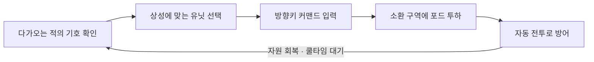
제한 시간(180초) 동안 베이스(체력 400)가 무너지지 않으면 승리, 그 전에 베이스 체력이 0이 되면 패배입니다.
적은 12초마다 3마리씩, 기호(세모·네모·동그라미)가 무작위로 정해져 몰려옵니다.

### 조작법
| 입력 | 동작 |
|---|---|
| 마우스 좌클릭 (유닛 버튼) | 소환할 유닛 선택 → 조건 검사 후 커맨드 표시 |
| 방향키 ↑ ↓ ← → | 화면에 나온 커맨드를 순서대로 입력 (틀리면 처음부터) |
| 마우스 좌클릭 (전장) | 소환 구역 안에 유닛 투하, 지원 폭격은 커서에 반경 표시 |

### 원작(헬다이버즈 2 스트라타젬)과 다른 점
- **커맨드가 유일한 조작입니다.** 원작에서 스트라타젬은 3인칭 슈팅 도중 장비를 부르는 보조 수단이지만, 이 게임에서는 캐릭터를 직접 움직이지 않고
  커맨드 입력과 투하 위치 지정만으로 전투를 이끕니다.
- **커맨드 길이가 유닛의 강함에 비례합니다.** 강한 유닛일수록 비용·쿨타임뿐 아니라 입력해야 할 방향키 수(5 → 12개)도 늘어나서,
  급할 때는 약하지만 빨리 부를 수 있는 유닛을 고르는 판단이 생깁니다.
- **고정 커맨드가 아닌 무작위 커맨드입니다.** 소환할 때마다 새 조합이 나오기 때문에 외워서 치는 것이 아니라 매번 화면을 읽고 입력해야 합니다.
- **기호 상성과 사기 시스템을 더했습니다.** 적의 기호에 맞는 유닛을 고르는 판단과, 아군이 죽으면 주변 사기가 떨어지는 배치 판단이 추가됩니다.

> 이 문서는 0장 기획, 1장 커맨드 입력 소환, 2장 기호 상성 자동 전투, 3장 자원·인구수·쿨타임 관리, 4장 AI 활용 방식, 5장 회고 순서로 다룹니다.

## 0. 기획

### 0.1 기획안 선정
2D 프로젝트를 시작하기 전(2026.06.08) 두 개의 기획서를 작성했습니다.

| 첫 번째 안 |
|------|
| 콘셉트 | 전술 스크린의 기호를 보고 방향키 커맨드로 지원을 투하하는 실시간 디펜스 |
| 핵심 재미 | 압박 속 정확한 입력 + 상성 배치 |
| 필요한 시스템 | 커맨드 입력, 자동 전투, 자원·인구·쿨타임 |

두 번째 안은 기획 단계부터 **8일 개발 범위**를 전제로 연출 항목까지 정리했고, 코어 루프가 "커맨드 입력 → 투하 → 자동 전투" 하나로 설명되어 1인 개발로
끝까지 완성할 수 있다고 판단해 채택했습니다.

### 0.2 기획을 코드로 옮긴 과정
기획서를 바로 코드로 옮기지 않고, **규칙 문서 → 의사코드 → C#** 순서로 세 번 다듬었습니다.

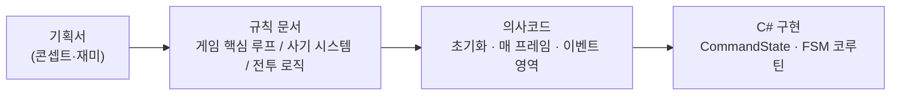

규칙 문서에서는 게임을 **초기화 영역(시작 시 1회) / 실시간 업데이트 영역(매 프레임) / 유저 입력 이벤트 영역**으로 나눠 적었고,
이벤트 영역의 의사코드가 그대로 커맨드 시스템의 상태 머신이 되었습니다.

| 의사코드 (기획 단계) | 구현 |
|---|---|
| `유저 상태 = 대기` → 포드 선택 시 자원·인구수 검사 | `CommandState.Idle` → `CheckCondition()` |
| `유저 상태 = 입력 대기` → 오입력 시 "입력했던 텍스트만 초기화" | `CommandState.Commanding` → `CheckCommand()` |
| `유저 상태 = 클릭 대기` → 배치 가능 위치면 자원 감소 | `CommandState.Spawning` → `SetSpawnPosition()` |

### 0.3 상성과 수치 설계
**상성 순환** : 세 기호가 서로 물고 물리도록 하나의 순환으로 정했습니다. 유리한 상대에게는 2배, 불리한 상대에게는 0.5배 피해를 줍니다.

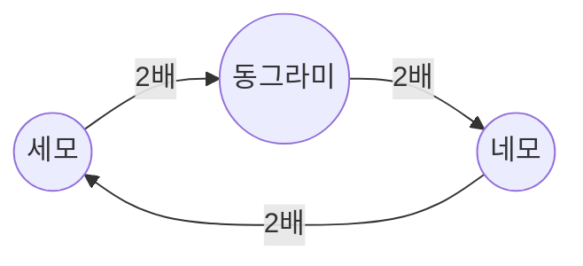

아군과 적은 **같은 기호가 같은 역할**을 맡는 거울 구조라서, 적의 모양만 보고 역할(원거리·공격형·탱커)과 카운터 유닛을 함께 읽을 수 있습니다.

| 기호 | 역할 | 아군 (체력 / 공격 / 사거리) | 적 (체력 / 공격 / 사거리) |
|---|---|---|---|
| 세모 | 원거리 딜러 | 70 / 7 / 2.8 | 60 / 6 / 2.0 |
| 동그라미 | 근거리 공격형 | 100 / 8 / 1.8 | 90 / 8 / 1.3 |
| 네모 | 근거리 탱커 | 150 / 7 / 1.4 | 130 / 7 / 1.0 |

아군은 적보다 체력과 사거리가 조금씩 높아 먼저 공격을 시작합니다. 대신 제자리에 고정되므로, 어디에 놓느냐가 성능을 결정합니다.

**소환 비용** : 강한 유닛일수록 네 가지 비용(자원·인구수·커맨드 길이·쿨타임)이 함께 올라가도록 맞췄습니다.

| 유닛 | 자원 | 인구수 | 커맨드 길이 | 쿨타임 |
|---|---|---|---|---|
| 세모 (원거리, `RangeUnit`) | 10 | 2 | 5 | 5초 |
| 동그라미 (근거리, `MeleeUnit`) | 15 | 4 | 7 | 7초 |
| 네모 (근거리, `MeleeUnit`) | 20 | 6 | 9 | 9초 |
| 지원 폭격 (`SupportUnit`) | 25 | 0 | 12 | 15초 |

**경제** : 자원은 최대 50, 초당 1 회복, 적 처치 시 5를 얻습니다. 인구수는 최대 20입니다.
- 180초 동안 적은 15번(2초, 14초, … 170초)에 걸쳐 총 45마리가 나옵니다. 모두 처치하면 처치 보상만 225, 자연 회복 180으로 이론상 약 400의 자원이 들어옵니다.
- 자원 상한 50은 "지원 폭격 두 번" 분량입니다. 상한에 닿으면 회복분이 버려지므로, 모아 두기보다 계속 소환하는 쪽이 유리합니다.
- 인구수 20은 세모 10기, 또는 네모 3기 + 세모 1기 정도입니다. 유닛이 죽어야 인구수가 돌아오므로, 같은 유닛만 쌓는 플레이를 막습니다.

### 0.4 기획 대비 조정한 규칙
규칙 문서(2026.06.21)에 적은 규칙과 실제 구현이 달라진 부분입니다.

| 항목 | 기획 (규칙 문서) | 구현 |
|---|---|---|
| 자원 차감 시점 | 유닛 선택 시 선점 | 투하(클릭) 시 차감. 커맨드 입력 중 다른 유닛을 고르면 환불 처리가 필요했기 때문입니다|
| 적이 멈추는 조건 | 근거리 아군이 길을 막을 때만 | 전방 시야각 안의 아군(근거리·원거리) 또는 베이스 |
| 피격 시 사기 감소 | 일반 1, 천적 10 | 5 × 상성 배율 (2.5 / 5 / 10), 근거리 아군만 |
| 주변 아군 사망 | 남은 사기의 절반 | 반경 2 안의 아군 사기 -5 |
| 사기 회복 | 충원·처치 시 +20 | 투하 시 소환 구역 아군 +10, 적을 처치한 유닛 +10 |
| 사기 0 | 2초간 흐려지며 소멸, 주변 페널티 없음 | 체력 0과 같은 사망 처리 |

## 1. 커맨드 시스템
방향키 커맨드 입력 기반 소환 시스템의 핵심 기능과 작동 방식에 대해 설명하겠습니다.
이 시스템은 사용자의 입력을 처리하는 CommandSystem과 인구수, 자원 및 쿨타임을 관리하는 PlayerManager 클래스의 상호작용으로 구현되었습니다.

### 1.1 핵심 기능 개요

#### 1. 소환 조건 확인
- 플레이어가 UI에서 유닛을 클릭하면 먼저 PlayerManager를 통해 해당 유닛의 재사용 대기시간이 끝났는지, 소모할 자원과 남은 인구수가 충분한지 검사합니다.
#### 2. 무작위 커맨드 생성 및 입력 검사
- 조건이 충족되면 CommandSystem에서 유닛의 등급에 비례하는 길이의 무작위 방향키 조합을 생성합니다.
  플레이어의 키보드 입력이 들어올 때마다 정답을 확인하며, 오입력이 발생하면 같은 커맨드를 처음부터 다시 입력해야 합니다.
#### 3. 위치 지정 및 소환
- 커맨드를 모두 올바르게 입력하면 디스플레이를 클릭하여 유닛을 투하할 수 있는 상태가 됩니다.
  이때 정해진 소환 구역 안에서만 클릭이 유효하며, 지원 폭격의 경우 마우스 위치를 따라 별도의 반경 범위가 표시됩니다.
#### 4. 자원 소모 및 사기 부여
- 마우스 클릭으로 배치가 완료되면 유닛의 비용만큼 자원이 감소하고 현재 인구수가 증가하고 쿨타임이 시작됩니다.
  또한 소환 구역 안에 있는 아군 유닛들의 사기를 10 회복시켜, "지원이 도착했다"는 느낌을 수치로 표현했습니다.
> 이 시스템을 제작하게 된 이유는 단순히 유닛을 클릭하면 유닛이 즉시 소환되는 일반적인 방식보다 적들이 실시간으로 몰려오는 상황 속에서도,
플레이어는 자원과 쿨타임을 계산하고 오타 없이 조작해 내는 긴장감과 성취감을 주기 위해서입니다.

### 1.2 시스템 구조
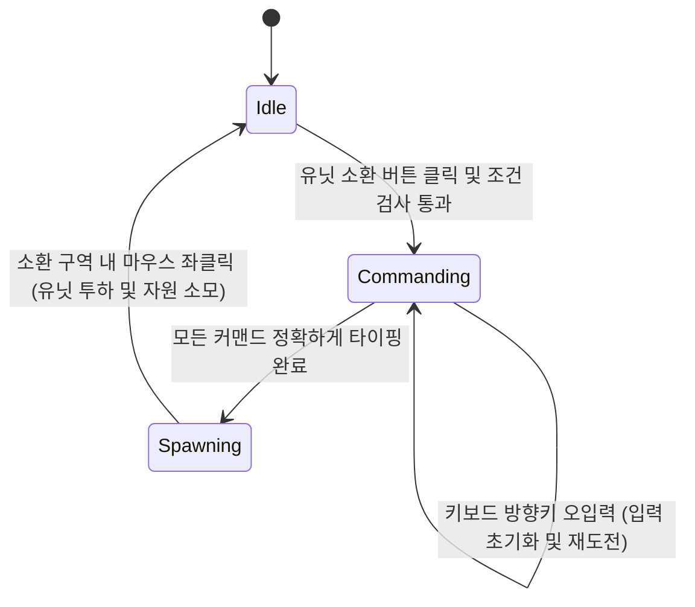
- **Idle(대기 상태)** : 플레이어가 UI에서 특정 유닛의 소환 버튼을 클릭했을 때, 자원과 쿨타임 조건이 충족되었다면 초기 커맨드를 생성하고 Commanding 상태로 전환합니다.

- **Commanding(커맨드 대기 및 입력 상태)** : 화면에 무작위 방향키 커맨드가 출력되고 플레이어의 키보드 입력을 실시간으로 검사하는 상태입니다.
  플레이어가 방향키를 하나라도 틀리게 입력하면 입력 기록과 화살표 색이 초기화되지만, 정답 커맨드와 상태는 그대로 유지되어 바로 재도전할 수 있습니다.

- **Spawning(소환 위치 지정 상태)** : 유닛을 전장에 투하하기 위해 마우스로 위치를 지정하는 상태입니다. 지원 폭격일 경우 마우스 커서를 따라 반경이 표시되며,
  유효한 소환 구역 내에서 마우스 좌클릭을 하면 유닛이 생성됨과 동시에 시스템은 다시 Idle 상태로 돌아갑니다.

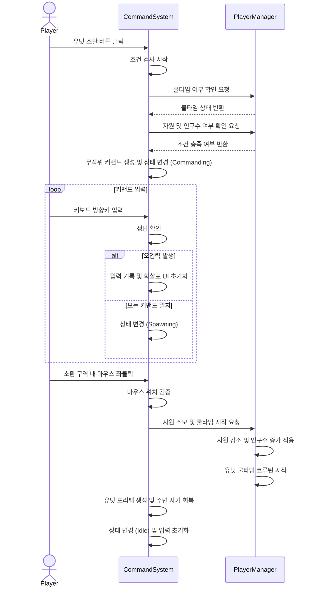

#### 1. 소환 요청 및 검증 단계
플레이어가 UI에서 특정 유닛의 소환 버튼을 누르면, 데이터를 관리하는 PlayerManager로 부터 쿨타임과 자원 및 인구수 확인을 요청하고 결과를 반환하면 다음 단계로 넘어갑니다.

#### 2. 커맨드 생성 및 확인 루프 단계
조건이 충족됐다는 결과를 받으면 CommandSystem 내부에서 유닛 등급에 맞는 무작위 방향키 커맨드를 생성합니다. 이후 플레이어의 키보드 입력이 들어올 때마다 정답과
대조하여 확인하는 루프가 실행되며, 틀리면 입력 기록과 UI를 초기화하여 처음부터 다시 입력받도록 처리합니다.

#### 3. 유닛 투하 및 데이터 갱신 단계
커맨드를 모두 맞춘 플레이어가 화면을 클릭하면, CommandSystem은 마우스 좌표가 유효한 소환 구역인지 확인합니다. 구역이 맞다면 유닛 프리팹을 생성하기 전에
PlayerManager가 자원 차감과 쿨타임을 시작합니다. 유닛이 전장에 생성되며 주변 아군의 사기를 회복시키고, 시스템은 다시 초기 대기 상태로 돌아갑니다.

### 1.3 핵심 기능 및 사용법

- **사용법** :
  외부(UI 버튼)에서는 시스템의 내부 상태를 알 필요가 없습니다. 각 유닛 버튼의 `OnClick` 이벤트에 `OnTriangleClick()`, `OnCircleClick()` 같은
  유닛 지정 함수만 연결하면, CommandSystem이 스스로 PlayerManager에게 자원과 쿨타임을 묻고, 조건이 맞으면 무작위 커맨드를 생성한 뒤
  Commanding 상태로 전환하여 키보드 입력을 기다립니다.

- **핵심 동작 1** : 유닛 등급이 곧 커맨드 길이입니다. `UnitType`의 값(5·7·9·12)을 그대로 반복 횟수로 사용합니다.
```csharp
private void InitialCommand(PlayerManager.UnitType type)
{
    commandList.Clear();
    InputCommand.Clear();
    count = 0;

    // 세모 5개, 동그라미 7개, 네모 9개, 지원 폭격 12개의 무작위 방향키
    for (int i = 0; i < (int)type; ++i)
    {
        commandList.Add(arrows[Random.Range(0, 4)]);
    }
    DrawCommad(); // 화살표 이미지를 UI에 생성
}
```

- **핵심 동작 2** : 플레이어의 키보드 입력을 한 키마다 확인하는 CheckCommand 함수입니다.
```csharp
private void CheckCommand()
{
    // 입력한 방향키가 현재 순서(count)의 정답과 일치하는지 확인합니다.
    if (commandList[count] == InputCommand[count])
    {
        spawnedArrowImages[count].color = Color.green; // 정답 시 UI를 녹색으로 변경하여 시각적 피드백 제공
        count++;
        // 모든 커맨드를 오타 없이 맞췄을 경우
        if (count == commandList.Count)
        {
            count = 0;
            currentState = CommandState.Spawning; // 소환 위치 지정 상태로 전환
        }
    }
    else
    {
        // 오입력: 정답 커맨드(commandList)는 유지하고 입력 기록과 화살표 색만 되돌립니다.
        // commandList까지 비우면 다음 입력에서 commandList[count] 접근이 범위를 벗어납니다.
        InputCommand.Clear();
        count = 0;
        DrawCommad();
    }
}
```

### 1.4 실시간 커맨드 검증 및 실패 처리 방식
> 사용자의 키보드 입력을 어느 타이밍에 검증하고, 오타가 발생했을 때 어떻게 처리할 것인가?

#### [대안 A] 입력 완료 후 일괄 검증
- **장점** : 사용자가 입력한 커맨드를 하나의 문자열이나 리스트로 모아두었다가, 마지막 키를 눌렀을 때 한 번만 정답 리스트와 비교하면 되므로 로직이 단순합니다
- **단점**: 플레이어의 피드백이 늦습니다. 중간에 오타를 내더라도 끝까지 입력한 뒤에야 실패를 알게 되어 유저가 상황 판단 할 시간이 줄어듭니다.
#### [대안 B] 매 커맨드 입력 시 실시간 인덱스 확인 및 즉시 초기화
- **장점** : 입력이 들어올 때마다 CheckCommand 함수를 호출하여 현재 인덱스(count)를 확인하므로 즉각적인 시각적 피드백이 가능합니다.
  틀렸을 경우 시스템 상태는 Commanding으로 유지한 채 입력 기록과 UI만 되돌립니다.
- **단점** : Update 루프 안에서 매 입력마다 검증 로직이 돌아야 합니다.
#### [최종 결정 및 이유]
> 대안 B를 선택했습니다. 플레이어의 빠른 판단이 중요한 게임에서 모든 입력을 하고 나서 피드백이 오는 것은 유저가 납득 하지 못하는 시스템입니다.
> 또한 틀렸을 때 **유닛 선택을 취소하지 않고 같은 커맨드를 다시 치게 한 것**은 기획 단계의 규칙("선택이 취소되지 않고 입력했던 텍스트만 초기화")을 따른 것으로,
> 실패의 대가를 "시간 손실"로만 한정해 조작 실수가 곧바로 전선 붕괴로 이어지지 않게 했습니다.

## 2. 기호 상성 기반 자동 전투 시스템

아군의 제자리 고정 방어와 적군의 베이스 돌격이라는 비대칭적 구도 속에서, 기호 간의 상성에 따라 데미지가 달라지는 자동
전투 시스템에 대해 설명하겠습니다. 이 시스템은 공통 데이터를 가진 PlayerUnit과 EnemyUnit 부모 클래스를 기반으로,
타겟팅 로직과 상성 연산을 구현한 Melee, Range 자식 클래스들의 다형성을 통해 작동합니다.

### 2.1 핵심 기능 개요

#### 1. 진영별로 차별화된 타겟 탐색 및 행동 상태(FSM)
- **적 유닛(EnemyUnit)** : 목표인 베이스를 향해 지속적으로 전진하다가, 자신의 전방 시야각과 사거리 내에
  플레이어 유닛이 감지되어 길이 막히면 전진을 멈추고 해당 적을 공격합니다.

- **플레이어 유닛(PlayerUnit)** : 투하된 제자리에 고정되어 주변을 탐색합니다. 근거리 유닛(MeleeUnit)은 사거리 내
  가장 가까운 적을, 원거리 유닛(RangeUnit)은 체력이 가장 낮은 적을 우선적으로 타겟팅하여 공격합니다.

#### 2. 상성 관계에 따른 데미지 증감 연산
- 세모 > 동그라미 > 네모 > 세모의 순환 상성(0.3)에 따라 데미지가 다르게 적용됩니다. 유리한 상대에게는 2배의 피해를 주고,
  불리한 상대에게는 0.5배의 피해만 줍니다. 근거리 아군은 피격 시 같은 배율로 사기도 함께 깎입니다.

> 적들은 베이스를 향해 밀려오는데, 플레이어가 배치한 유닛은 후퇴할 수 없도록 강제하기 위해서입니다.
> 실시간으로 다가오는 적들의 기호를 빠르게 파악하고, 그에 맞는 카운터 상성의 유닛을 적재적소에 배치하여 적의 진격을
> 가로막는 전략적인 판단의 재미를 극대화하기 위해서입니다.

### 2.2 시스템 구조

전투 시스템은 유닛들의 공통 속성을 묶은 부모 클래스와, 탐색 및 상성 로직을 각기 다르게 구현한 자식 클래스 간의 상속 및 다형성을 활용하여 설계되었습니다.
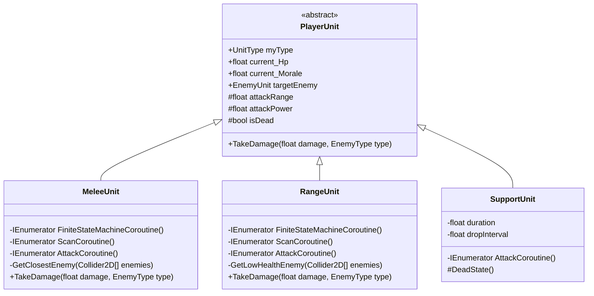
- **PlayerUnit(추상 부모 클래스)** : 모든 플레이어 유닛이 공유하는 체력, 사기(Morale), 사거리, 공격력 등의 기본 데이터를 정의합니다. Update 함수를 통해
  매 프레임 체력 또는 사기 두 수치 중 하나라도 0 이하로 떨어지면 DeadState를 호출하는 공통 생존 관리 로직과 체력·사기 바 갱신을 수행합니다.

- **MeleeUnit(근거리 아군 유닛)** : GetClosestEnemy 메서드를 통해 사거리 내에서 가장 가까운 적을 탐색하여 타겟팅합니다.
  적의 기호(동그라미 ,네모, 세모)에 따라 데미지가 다르게 들어가는 TakeDamage를 오버라이딩합니다.

- **RangeUnit(원거리 아군 유닛)** : GetLowHealthEnemy 메서드를 사용하여 사거리 내의 적들 중 체력이 가장 낮은 대상을 식별하고 죽을 때까지 점사합니다.
  적의 기호(동그라미 ,네모, 세모)에 따라 데미지가 다르게 들어가는 TakeDamage를 오버라이딩합니다.

- **SupportUnit(지원 폭격 유닛)** : 일반적인 유닛들과 달리 탐색(Scan) 코루틴을 거치지 않고, 설정된 지속 시간(duration) 동안 사거리 내에
  데미지를 줍니다. `HashSet`으로 이미 맞은 적을 기록해 한 번의 폭격이 같은 적에게 중복 피해를 주지 않게 했습니다.
  지속 시간이 만료되면 전투 루프를 종료하고 스스로 파괴되도록 DeadState를 오버라이딩하여 별도의 생존 주기를 가집니다.

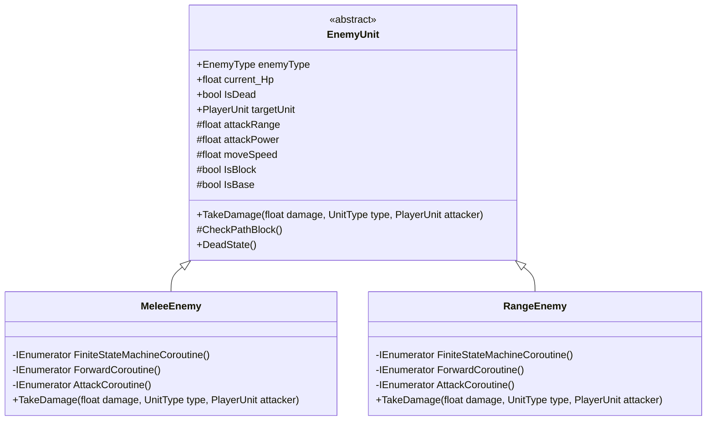
- **EnemyUnit(추상 부모 클래스)** : 모든 적 유닛이 공유하는 체력, 이동 속도, 공격력, 사거리 등의 기본 데이터를 정의합니다. 또한, 매 프레임 전방에
  장애물(플레이어 유닛이나 베이스)이 있는지 확인하는 CheckPathBlock() 공통 기능을 제공합니다.

- **MeleeEnemy(근거리 적 유닛 - 동그라미·네모)** : 타겟에게 직접 데미지를 입히는 AttackCoroutine()을 가집니다.
  공격한 아군의 기호에 따라 데미지가 다르게 들어가는 TakeDamage를 오버라이딩하고, 자신을 처치한 아군의 사기를 10 회복시킵니다.

- **RangeEnemy(원거리 적 유닛 - 세모)** : 투사체를 발사하는 방식의 AttackCoroutine()을 가집니다.
  공격한 아군의 기호에 따라 데미지가 다르게 들어가는 TakeDamage를 오버라이딩합니다.

### 상태 머신 흐름도 : PlayerUnit
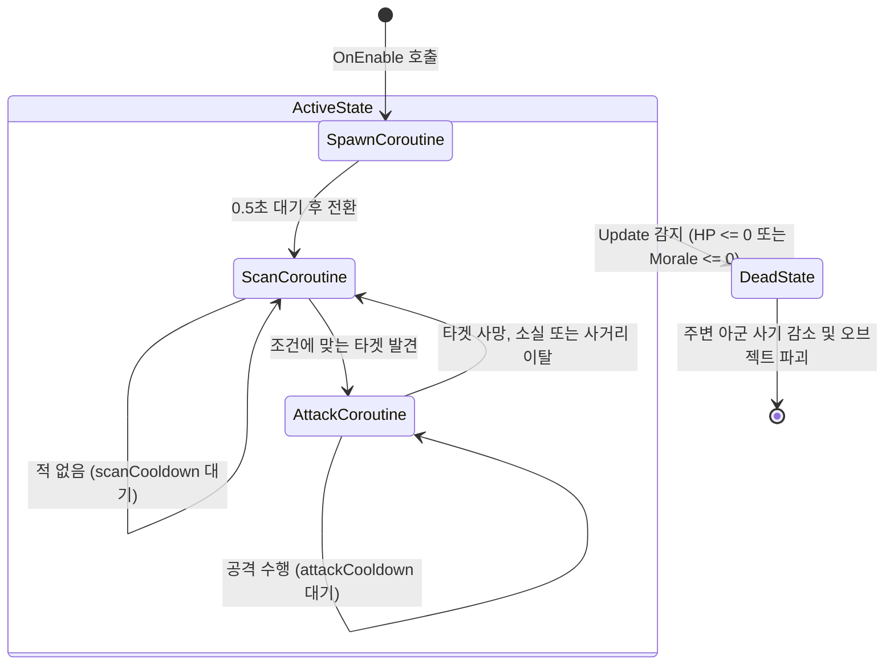
- **SpawnCoroutine(소환 대기 상태)** : 유닛이 활성화(OnEnable)될 때 먼저 진입하는 상태입니다. 0.5초 동안 대기한 후 포드 이미지를 끄고 유닛의 실제 렌더러를 켠 뒤,
  탐색 상태인 ScanCoroutine으로 전환합니다.

- **ScanCoroutine(탐색 상태)** : Physics2D.OverlapCircleAll을 이용해 사거리(attackRange) 내의 적을 탐색하는 상태입니다. MeleeUnit은
  거리가 가장 가까운 적을, RangeUnit은 체력이 가장 낮은 적을 타겟으로 지정한 후 AttackCoroutine으로 넘어갑니다. 적이 발견되지 않으면 scanCooldown
  시간만큼 대기한 후 탐색을 다시 반복합니다.

- **AttackCoroutine(공격 상태)** : 타겟이 유효한지 지속적으로 검증하며 공격을 수행합니다. 타겟이 파괴되었거나, 사거리를 벗어났거나, 체력이 0 이하가 되면
  즉시 공격 루프를 빠져나와 ScanCoroutine으로 되돌아갑니다. 타겟이 유효하다면 설정된 딜레이와 쿨타임에 맞춰 타겟에게 데미지를 가합니다.

- **DeadState(사망 상태)** : 유닛이 어떤 코루틴 상태에 있든 상관없이, PlayerUnit의 Update 함수에서 체력(current_Hp)이나
  사기(current_Morale)가 0 이하로 떨어지면 작동중인 모든 코루틴을 정지시키고 진입합니다. 진입 후 0.3초 대기 후 반경 2f 내에 있는 다른 아군
  유닛들의 사기를 감소시키고, PlayerManager의 Dead 함수를 호출하여 인구수를 반환하고 자신을 파괴합니다.
  SupportUnit의 경우 전투 루프 없이 지정된 시간(duration)이 만료되면 스스로 사망 상태로 전환됩니다.

### 상태 머신 흐름도 : EnemyUnit
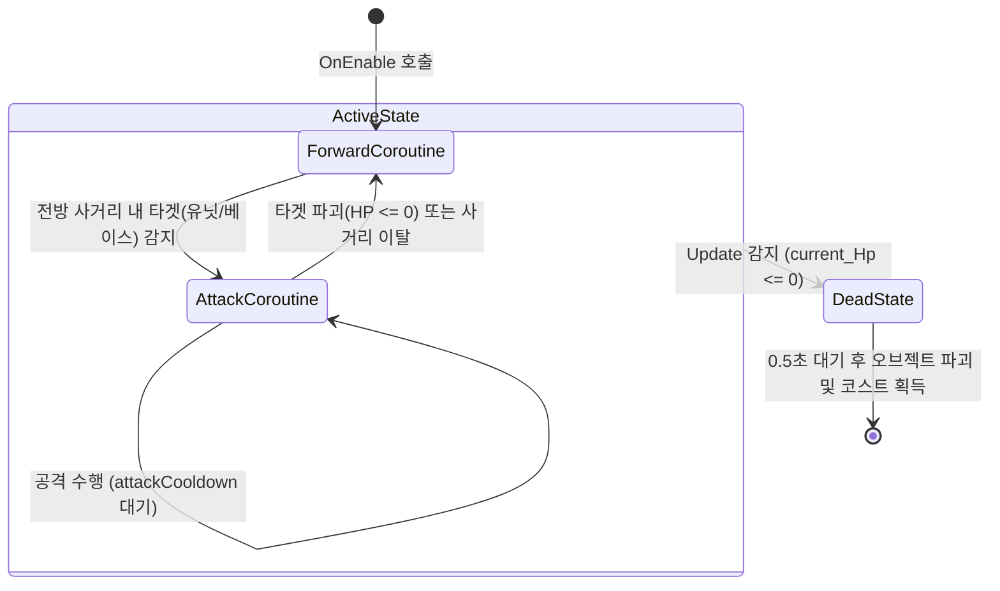
- **ForwardCoroutine(전진 상태)** : 적 유닛이 활성화(OnEnable)될 때 먼저 진입하는 기본 상태입니다. 플레이어의 베이스(playerBase)
  위치를 향해 설정된 이동 속도(moveSpeed)로 지속해서 전진합니다. 이동하는 동안 매 프레임 CheckPathBlock 함수를 호출하여 전방 시야각(viewAngle)과
  사거리(attackRange) 내에 플레이어 유닛이나 베이스가 있는지 탐색합니다. 타겟이 감지되어 IsBlock 또는 IsBase가 참(true)이 되면 즉시 전진을 멈추고
  AttackCoroutine으로 전환합니다.

- **AttackCoroutine(공격 상태)** :전진을 가로막는 타겟(유닛 또는 베이스)이 유효한지 지속해서 검증하며 공격을 수행하는 상태입니다.
  타겟의 체력이 0 이하가 되어 파괴되었거나, 유닛의 사거리 밖으로 벗어났을 경우 즉시 공격 루프를 빠져나와 ForwardCoroutine으로 되돌아가 다시 전진을 시작합니다.
  타겟이 유효하다면 설정된 딜레이(attackDelay)와 쿨타임(attackCooldown)에 맞춰 데미지를 가합니다.

- **DeadState(사망 상태)** : 유닛이 전진이나 공격 코루틴을 수행하는 중이더라도, Update 함수에서 체력(current_Hp)이 0 이하로 떨어지면
  즉시 코루틴을 정지(StopAllCoroutines)하고 진입합니다. 사망 시 플레이어에게 정해진 보상(reward)을 지급하고, 유닛의 렌더러를 투명하게 만든 뒤
  사망 이펙트용 오브젝트(deadState)를 활성화합니다. 이후 EnemyDeadState 스크립트에서 0.5초를 대기한 후 PlayerManager의 Dead 함수를 호출하여
  최종적으로 유닛을 파괴합니다.

### 2.3 핵심 기능 및 사용법 (PlayerUnit)

- **사용법** : PlayerUnit은 전장에 소환되는 즉시 내부의 코루틴 상태 머신에 의해 자율적으로 주변을 탐색하고 전투를 수행합니다.
  따라서 외부 시스템(예: CommandSystem)에서 유닛의 행동을 일일이 제어하는 메서드는 존재하지 않으며, 오직 적 유닛(EnemyUnit)이
  아군을 타격할 때 호출하는 `TakeDamage(float damage, EnemyType type)`만이 외부와 연결됩니다. 상성 연산은 자식 클래스가 각자 처리합니다.

- **핵심 동작 1** : 코루틴 기반 상태 머신
  각 상태를 하나의 코루틴으로 만들고, 상태가 끝날 때 **다음에 실행할 코루틴을 `nextStateCoroutine`에 넣어두면** 바깥 루프가 그것을 이어서 실행합니다.
  `Update`에 `switch`를 두는 방식보다 "0.5초 대기 후 전환", "공격 딜레이 후 피해" 같은 시간 흐름을 `WaitForSeconds`로 자연스럽게 쓸 수 있고,
  사망 시에는 `StopAllCoroutines()` 한 번으로 어떤 상태든 끊을 수 있습니다. 같은 구조를 아군·적 유닛 모두에 사용했습니다.

```csharp
private IEnumerator FiniteStateMachineCoroutine()
{
    nextStateCoroutine = SpawnCoroutine(); // 첫 상태

    while (gameObject.activeInHierarchy)
    {
        // 현재 상태 코루틴이 끝날 때까지 기다린 뒤, 그 상태가 지정한 다음 상태를 실행
        yield return StartCoroutine(nextStateCoroutine);
    }
}

private IEnumerator SpawnCoroutine()
{
    yield return new WaitForSeconds(0.5f); // 포드 낙하 연출 시간
    unitRenderer.enabled = true;
    fordRenderer.enabled = false;
    nextStateCoroutine = ScanCoroutine();  // 다음 상태 지정 후 종료
}
```

- **핵심 동작 2** : 다형성을 활용한 차별화된 타겟팅 로직
  근거리 유닛과 원거리 유닛은 동일한 탐색 주기(ScanCoroutine)를 가지지만, 타겟을 선정하는 기준이 다릅니다.
  다음은 근거리 유닛(MeleeUnit)이 사거리 내에서 자신과 가장 가까운 적을 찾아내는 핵심 알고리즘입니다.

```csharp
private EnemyUnit GetClosestEnemy(Collider2D[] enemies)
{
    Transform closestEnemy = null;
    float closestDistance = Mathf.Infinity;
    Vector3 currentPosition = transform.position;

    foreach (Collider2D enemy in enemies)
    {
        EnemyUnit enemyComponent = enemy.GetComponent<EnemyUnit>();

        // 체력이 0보다 큰 살아있는 적만 탐색 대상으로 한정
        if(enemyComponent != null && enemyComponent.current_Hp > 0)
        {
            // 핵심 설계: 중심점이 아닌, 유닛의 가장 외곽(Edge)을 기준으로 거리를 측정
            Vector3 closet = enemy.ClosestPoint(currentPosition);
            float distanceTo = Vector3.Distance(currentPosition, closet);

            if(distanceTo < closestDistance)
            {
                closestDistance = distanceTo;
                closestEnemy = enemy.transform;
            }
        }
    }
    return closestEnemy != null ? closestEnemy.GetComponent<EnemyUnit>() : null;
}
```

- **핵심 동작 3** : 기호 상성에 따른 데미지 연산
  0.3의 순환(세모 > 동그라미 > 네모 > 세모)을 피격 측에서 판정합니다. 다음은 동그라미와 네모 기호를 담당하는 MeleeUnit의 피격 로직입니다.

```csharp
public override void TakeDamage(float damage, EnemyUnit.EnemyType type)
{
    float addDamage = 1.0f;
    float moraleDamage = 5.0f;
    
    if (myType == PlayerManager.UnitType.Circle)
    {
        if (type == EnemyType.Square) addDamage = 0.5f;        // 동그라미 > 네모
        else if (type == EnemyType.Triangle) addDamage = 2.0f; // 세모 > 동그라미
    }
    else if (myType == PlayerManager.UnitType.Square)
    {
        if (type == EnemyType.Circle) addDamage = 2.0f;        // 동그라미 > 네모
        else if (type == EnemyType.Triangle) addDamage = 0.5f; // 네모 > 세모
    }
    
    current_Hp -= damage * addDamage;
    current_Morale -= moraleDamage * addDamage; // 천적에게 맞을수록 사기도 크게 깎임
}
```

### 2.4 핵심 기능 및 사용법 (EnemyUnit)

- **사용법** :적 유닛은 전장에 생성(OnEnable)됨과 동시에 내부의 코루틴 상태 머신으로 스스로 움직입니다.

- **핵심 동작 1** : 적 유닛의 기본 행동인 전진 로직입니다. 매 프레임 플레이어의 베이스 위치를 향해 이동하며, 이동과 동시에 전방에 방해물이 있는지 지속해서 검사합니다.

```csharp
// 매 프레임 전방에 타겟이 있는지 검사합니다.
CheckPathBlock();
        
// 방해물(유닛 또는 베이스)이 감지되면 전진을 멈추고 공격 코루틴으로 상태를 전환합니다.
if (IsBlock || IsBase)
{
    nextStateCoroutine = AttackCoroutine();
    yield break;
}
```

- **핵심 동작 2** : 부모 클래스인 EnemyUnit에 구현된 공통 탐색 기능입니다. 단순히 사거리 안에 들어왔다고 무조건
  공격하는 것이 아니라, 유닛이 바라보는 전방 시야각(viewAngle) 내에 있는 대상만을 필터링하여 타겟팅합니다.
  이미 지나친 아군에게 뒤돌아 공격하지 않고 베이스만 보고 돌진하는 "밀려오는 적"의 느낌을 만들기 위한 장치입니다.

```csharp
protected void CheckPathBlock()
{
    if (IsBlock == true || IsBase == true) return;
    
    // 1. 사거리(attackRange) 반경 내의 모든 콜라이더를 수집합니다.
    Collider2D[] hits = Physics2D.OverlapCircleAll(transform.position, attackRange);
    Vector3 forwardDir = (playerBase.transform.position - transform.position).normalized;

    foreach (Collider2D hit in hits)
    {
        // 다른 적 유닛은 탐색 대상에서 제외합니다.
        if (hit.GetComponent<EnemyUnit>()) continue;
        
        Vector3 dirToTarget = (hit.transform.position - transform.position).normalized;
        
        // 2. 핵심 설계: 사거리 안에 있더라도, 전방 시야각(viewAngle) 내에 위치하는지 각도를 계산하여 판별합니다.
        if (Vector3.Angle(forwardDir, dirToTarget) < viewAngle / 2)
        {
            if (hit.GetComponent<PlayerUnit>())
            {
                IsBlock = true;
                targetUnit = hit.GetComponent<PlayerUnit>();
                return;
            }
            else if (hit.GetComponent<Base>())
            {
                IsBase = true;
                return;
            }
        }
    }
}
```
### 2.5 거리 계산과 탐지 영역의 기준 불일치 문제 해결
> 유닛이 주변의 적을 탐색하고 공격 가능 여부를 판단할 때, 어떤 연산을 사용할 것인가?

- **[문제 상황]**
  초기 개발 단계에서는 적을 탐지할 때는 `Physics2D.OverlapCircleAll`을 사용하고, 실제 공격이 가능한 거리인지 판단할 때는 타겟과의 중심점 거리를 수학적으로 계산하는
  `Vector3.Distance`를 사용했습니다. 이로 인해 큰 유닛의 경우, 외곽(Collider)은 탐지 영역(`OverlapCircleAll`) 안에 들어왔음에도
  불구하고 두 유닛의 중심점 간의 거리(`Vector3.Distance`)는 공격 사거리보다 멀게 계산되어, 적을 인지해 놓고도 공격은 하지 않고 가만히 서 있는 버그가 발생했습니다.

#### [대안 A] 모든 유닛을 순회하며 순수 수학 연산(Vector3.Distance)만으로 거리 계산
- **장점** : 물리 엔진을 호출하지 않으므로, 유닛의 수가 적을 때는 직관적이고 연산이 가벼울 수 있습니다.
- **단점** : 씬에 존재하는 모든 유닛을 매 프레임 혹은 매 스캔 주기마다 하나씩 `for`문으로 돌며 거리를 재야 합니다.
  또한 중심점 기준이므로 유닛의 크기(Scale)가 커질수록 실제 타격 판정(눈에 보이는 모델링 끝부분)과 괴리가 생깁니다.

#### [대안 B] Physics2D.OverlapCircleAll과 Collider.ClosestPoint 조합

- **장점** : `OverlapCircleAll`에 `LayerMask`를 적용하면 탐지 범위 내의 적(또는 아군)만 걸러냅니다. `ClosestPoint`를 함께 쓰면 중심점이 아닌 유닛의
  실제 외곽선(Edge)을 기준으로 정확하게 거리를 잴 수 있습니다.
- **단점** : 유닛마다 반드시 `Collider2D` 컴포넌트가 부착되어 있어야 하며, 물리 연산을 사용하므로 연산이 무거울수 있습니다.

#### [최종 결정 및 이유]
- 대안 B를 선택했습니다. 매번 `Vector3.Distance`로 모든 객체를 순회하는 방식은 비효율적인 방식이라고 생각을 했습니다. 유니티가 제공하는 `OverlapCircleAll`와
  `LayerMask`를 활용하고, 공격 사거리 판정 역시 `Collider2D.ClosestPoint`를 도입하여 '외곽선 기준'으로 통일함으로써,
  눈에 보이는 거리와 실제 판정이 어긋나는 버그를 해결했습니다.

`LayerMask`는 아군 유닛(`MeleeUnit`, `RangeUnit`)의 탐색에 적용했습니다. `PlayerUnit`에 둔 `targetLayer`로 적 레이어만 수집한 뒤,
`GetClosestEnemy`에서 `ClosestPoint`로 외곽선 기준 거리를 잽니다.

```csharp
// MeleeUnit.ScanCoroutine : 적 레이어(targetLayer)만 탐지
Collider2D[] hitEnemies = Physics2D.OverlapCircleAll(transform.position, attackRange, targetLayer);
targetEnemy = GetClosestEnemy(hitEnemies);
```
반면 적 유닛의 `CheckPathBlock`(2.4)은 아군 유닛과 베이스를 모두 찾아야 하므로 `LayerMask` 없이 수집하고, `GetComponent`로 대상을 구분합니다.

#### [결과]

| | 수정 전 | 수정 후 |
|---|---|---|
| 공격 가능 거리 판정 | 두 유닛 **중심점** 사이 거리 (`Vector3.Distance`) | 적 콜라이더의 **가장 가까운 외곽점**까지 거리 (`ClosestPoint`) |
| 가장 가까운 적 찾기 | 중심점 거리의 제곱 (`sqrMagnitude`) | 외곽점 거리, 체력이 0보다 큰 적만 |
| 타겟을 못 찾았을 때 | 그대로 공격 상태로 넘어감 | 탐색 상태에 머물며 다시 탐색 |
| 결과 | 크기가 큰 적이 탐지 범위 안에 들어와도 공격하지 않고 서 있음 | 탐지 범위에 들어온 적을 바로 공격 |

함께 사거리 기즈모를 선택했을 때만이 아니라 항상 그리도록(`OnDrawGizmos`) 바꿔, 탐지 원과 실제 공격 판정이 맞는지 씬 뷰에서 바로 확인할 수 있게 했습니다.

당시에는 `MeleeUnit`, `MeleeEnemy`, `RangeEnemy`에만 외곽선 기준을 적용했고, 원거리 아군(`RangeUnit`)의 공격 상태에는 중심점 거리가 남아 있었습니다.
이후 문서와 코드를 대조하며 이 누락을 발견해 `RangeUnit`도 같은 기준으로 맞췄습니다(4.4).

## 3. 자원, 인구수 쿨타임 시스템
플레이어의 유닛 소환을 통제하는 자원(Cost), 인구수(Supply), 재사용 대기시간(Cooldown) 통합 관리 시스템에 대해 설명하겠습니다.
PlayerManager 클래스를 싱글톤 패턴으로 구현하여 게임 내 경제와 제약 조건을 중앙에서 통제합니다.

### 3.1 핵심 기능 개요
#### 1. 소환 검증 및 자원 소모
- 소환 요청 시 현재 자원과 남은 인구수가 해당 유닛의 요구치 이상인지 판별하고, 소환이 확정되면 비용만큼 자원을 차감한 뒤 인구수를 증가시킵니다.
#### 2. 개별 재사용 대기시간 제어
- 유닛이 전장에 배치되면 코루틴을 통해 해당 병종 전용 쿨타임을 작동시키며, 타이머가 끝날 때까지 동일 유닛의 연속 소환을 차단합니다.
#### 3. 자원 자동 회복 및 인구수 반환
- 1초마다 일정량의 자원이 자동으로 충전되며, 전장의 아군 유닛이 파괴될 경우 해당 유닛이 차지하던 인구수를 즉각 반환하여
  다음 소환을 준비할 수 있게 합니다.

> 자원, 인구수, 쿨타임이 결합된 다중 제한 시스템을 기획했습니다. 특정 유닛 하나만 소환하는 단순한 물량 공세를 시스템적으로 차단하기 위해서입니다.
> 한정된 용량과 천천히 차오르는 자원 속에서, 지금 당장 어떤 상성의 유닛이 필요한지 우선순위를 정하고 쿨타임을 계산하여
> 최적의 타이밍에 배치하는 자원 관리의 전술적 재미를 플레이어에게 제공하기 위해서입니다.

### 3.2 시스템 구조

PlayerManager는 게임 내 경제와 제약 조건을 총괄하는 싱글톤(Singleton) 객체로 설계되었습니다.
다른 클래스(예: CommandSystem, PlayerUnit)들은 PlayerManager의 인스턴스를 통해 자원 상태를 묻거나 갱신을 요청합니다.

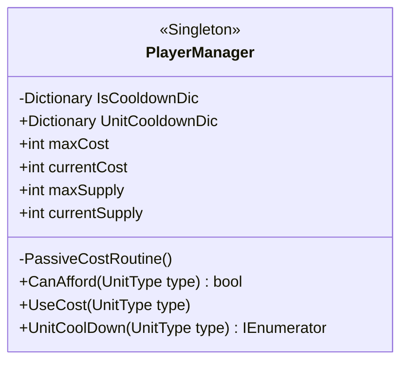
- **데이터 보관**: 최대/현재 자원 및 인구수 데이터를 `{ get; private set; }` 속성으로 캡슐화하고 `[field: SerializeField]`로 인스펙터에서만 조절합니다.
  각 유닛 타입별 쿨타임 진행 상태는 `Dictionary`를 활용해 개별적으로 확인합니다.
- **중앙 통제**: 외부에서 자원을 깎을 수 없으며, `CanAfford`로 허가를 받고 `UseCost`를 호출해야만 자원 차감과 쿨타임 시작이
  동시에 처리되도록 구조화했습니다.

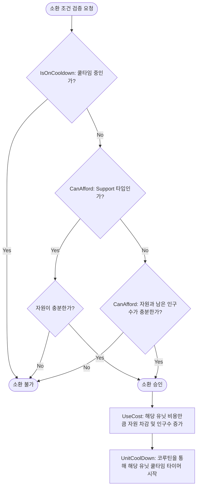
- **1단계 (쿨타임 검사)**: 가장 먼저 딕셔너리에 저장된 해당 유닛의 쿨타임 상태(`IsCooldownDic`)를 확인하여, 대기 시간 중이면 거부합니다.
- **2단계 (예외 및 자원/인구 검사)**: 쿨타임이 돌고 있지 않다면 `CanAfford`를 호출합니다. 이때 `Support` 유닛은 인구수를 차지하지 않으므로
  자원만 검사하고, 일반 유닛은 현재 자원(`currentCost`)과 남은 인구수(`maxSupply - currentSupply`)가 요구량을 모두 충족해야만 통과됩니다.
- **3단계 (소모 및 갱신)**: 모든 검증을 통과해 배치가 확정되면 `UseCost`가 호출되어 자원과 인구수를 갱신하고,
  해당 유닛의 쿨타임 코루틴(`UnitCoolDown`)을 독립적으로 실행시킵니다.

### 3.3 핵심 기능 및 사용법

- **사용법** : PlayerManager는 싱글톤 패턴으로 구현되어 있어 외부 시스템에서 전역적으로 접근할 수 있습니다. 입력을 담당하는 CommandSystem 등
  외부 클래스는 내부 자원 계산식을 알 필요 없이, 검증 함수와 소비 함수만 호출하여 시스템을 제어합니다.

```csharp
// 소환 버튼 클릭 시: 쿨타임과 자원 여부만 먼저 확인
if (playerManager.IsOnCooldown(type)) return false;
if (playerManager.CanAfford(type) == false) return false;

// ... 플레이어의 커맨드 타이핑 및 위치 지정 완료 후 ...

// 최종 소환 시: 자원 차감 및 쿨타임 시작 요청
playerManager.UseCost(unitType);
```

- **핵심 동작 1** : 이 시스템은 자원이 충분한지 묻는 로직(CanAfford)과 실제로 자원을 깎는 로직(UseCost)을 나누어 설계했습니다.
  버튼을 누른 시점과 투하하는 시점 사이에 자원이 변할 수 있으므로, `UseCost`가 차감 직전에 한 번 더 `CanAfford`로 확인합니다.

```csharp
public bool CanAfford(UnitType type)
{
    // 지원 폭격은 인구수를 차지하지 않으므로 자원만 검사합니다.
    if (type == UnitType.Support) return currentCost >= GetCost(type);
    
    // 현재 자원과 남은 인구수(최대 인구수 - 현재 인구수)가 모두 요구치 이상인지 검사
    if (currentCost >= GetCost(type) && (maxSupply - currentSupply) >= GetSupply(type)) return true;
    return false;
}

public void UseCost(UnitType type)
{
    if (CanAfford(type))
    {
        currentSupply += GetSupply(type);
        currentCost -= GetCost(type);
        StartCoroutine(UnitCoolDown(type));
    }
}
```
- **핵심 동작 2** : 유닛별 쿨타임을 관리하기 위해 상태 제어용 딕셔너리와 UI 연동용 딕셔너리 두 개를 활용했습니다.

```csharp
public IEnumerator UnitCoolDown(UnitType type)
{
    IsCooldownDic[type] = true; // 해당 유닛의 소환 잠금
    float cooldownSec = ... // 유닛별 쿨타임 시간 할당
    float currentTime = 0f;

    while (true)
    {
        if (currentTime >= cooldownSec) break;
        currentTime += Time.deltaTime;
        
        // 외부 UI에서 진행률을 그릴 수 있도록 0~1 사이의 값으로 정규화하여 갱신
        UnitCooldownDic[type] = currentTime / cooldownSec; 
        yield return null;
    }
    IsCooldownDic[type] = false; // 쿨타임 종료 및 잠금 해제
    UnitCooldownDic[type] = 1f;
}
```
### 3.4 개별 쿨타임 관리 및 확인
- **[문제 상황]** CommandSystem에서 유닛 소환을 요청할 때 해당 유닛의 쿨타임이 다 찼는지 아닌지 판단하는 로직을 어떻게 구현할 것이고, 쿨타임 진행 상황을
  UI로 어떻게 내보낼 것인지 고민을 했습니다.

#### [대안 A] 유닛마다 변수를 따로 두기
- **방식** : `isTriangleCooldown`, `isCircleCooldown`처럼 유닛 수만큼 bool·float 변수를 만들고, `switch`로 골라 씁니다.
- **장점** : 구조가 가장 단순하고, 인스펙터에서 값을 바로 볼 수 있습니다.
- **단점** : 유닛이 늘 때마다 변수와 `switch` 분기를 함께 늘려야 하고, UI도 변수 이름을 하나하나 알아야 합니다.

#### [대안 B] 쿨타임을 유닛·버튼 쪽에 두기
- **방식** : 소환 버튼(또는 유닛 데이터)이 자기 쿨타임 타이머를 직접 들고 있습니다.
- **장점** : 버튼이 자기 진행률을 바로 그릴 수 있어 UI 연결이 쉽습니다.
- **단점** : 소환 가능 여부를 판단하는 곳이 `PlayerManager`(자원·인구수)와 버튼(쿨타임) 두 군데로 나뉩니다. 자원과 쿨타임을 함께 확인해야 하는
  `CommandSystem`이 두 곳을 모두 알아야 합니다.

#### [대안 C] PlayerManager에 `UnitType`을 Key로 하는 Dictionary 두기
- **방식** : 잠금 여부(`Dictionary<UnitType, bool>`)와 진행률(`Dictionary<UnitType, float>`)을 `PlayerManager`가 함께 관리합니다.
- **장점** : 소환 조건(자원·인구수·쿨타임)이 한 클래스에 모입니다. 유닛이 늘어도 Key만 늘어나고, UI는 `UnitType`으로 조회만 하면 됩니다.
- **단점** : Key가 아직 없을 때(한 번도 소환하지 않은 유닛)를 따로 처리해야 합니다. `TryGetValue`로 확인합니다.

#### [최종 결정 및 이유]
대안 C를 선택했습니다. 유닛 종류가 4가지로 고정적이라 메모리보다는 코드의 직관성과 유지보수성이 중요하다고 판단했고,
무엇보다 소환 조건 검사를 `PlayerManager` 한 곳에 모으는 것이 목표였습니다.

첫 작업에는 잠금용 `IsCooldownDic`(bool)만 두었다가, 쿨타임 UI를 만들 때 진행률용 `UnitCooldownDic`(float)을 따로 추가했습니다.
잠금 판단과 UI 표시를 나눴기 때문에, UI 스크립트는 `UnitCooldownDic`에서 필요한 유닛의 Key값만 조회해 슬라이더를 그리고 잠금 상태는 건드릴 수 없습니다.

다만 유닛별 쿨타임 시간은 아직 `switch`로 고르고 있어, 유닛이 늘어나면 이 부분도 함께 고쳐야 합니다. 5.3의 유닛 데이터 분리와 함께 개선할 부분입니다.

## 4. AI 활용 방식

### 4.1 원칙
AI는 **선택지를 넓히고 반복을 줄이는 도구**로 쓰고, **무엇을 고를지는 게임의 재미 기준으로 직접 정한다**는 원칙을 세웠습니다.

| 구분 | 내가 맡은 것 | AI에게 맡긴 것 |
|---|---|---|
| 기획 | 콘셉트, 재미 목표, 규칙과 수치 | - |
| 설계 고민 | 판단 기준 설정, 최종 선택 | 대안과 장단점 정리 |
| 구현 | 핵심 로직(커맨드 검증, FSM, 타겟팅, 상성) | 형태가 반복되는 코드 |
| 디버깅 | 현상 재현, 씬에서 검증 | 원인 후보 분석 |

### 4.2 고민되는 부분을 AI와 해결한 방법
각 고민마다 **상황을 설명하고 대안과 장단점을 받은 뒤, 내가 정한 기준으로 고르는** 방식으로 진행했습니다. 이 문서의 [대안 A/B/C] 형식이 그 과정의 기록입니다.

| 고민 | AI에게 요청한 것 | 내가 정한 판단 기준 | 결론 |
|---|---|---|---|
| 자원 차감 시점 (0.4) | 선택 시 선점 / 투하 시 차감 방식의 처리 흐름 비교 | 커맨드 입력 중 다른 유닛으로 바꿔도 예외 처리가 없어야 한다 | 선택 시에는 확인만, 투하 시 차감. 환불 로직 자체가 필요 없어짐 |
| 사거리 판정 버그 (2.5) | "탐지는 되는데 공격을 안 한다"는 현상의 원인 후보 | 눈에 보이는 거리와 판정이 같아야 한다 | 탐지와 판정의 기준 불일치로 결론, 기즈모로 씬에서 직접 확인 후 `ClosestPoint`로 통일 |
| 쿨타임 구조 (3.4) | 변수 / 버튼 / Dictionary 세 가지 구조의 장단점 | 소환 조건 검사를 한 곳에 모은다 | `PlayerManager`에 잠금·진행률 Dictionary 두 개 |

### 4.3 반복되는 부분을 맡긴 방법
- **반복 코드** : 쿨타임 슬라이더 4개를 `TryGetValue`로 갱신하는 `UIManager` 코드, `GetCost`·`GetSupply`의 `switch` 분기처럼 **패턴은 정해져 있고
  대상만 바뀌는 코드**를 맡겼습니다. 대신 이렇게 반복이 눈에 보이는 부분은 "데이터로 뺄 신호"로 기록해 두었고, 5.3의 ScriptableObject 분리 계획으로 이어졌습니다.
- **버그 원인 분석** : 현상과 관련 코드를 주고 원인 후보를 받은 뒤, 실제 원인은 씬 뷰 기즈모와 `Debug.Log`로 직접 확인했습니다.

### 4.4 AI 결과를 검증하며 찾은 문제
포트폴리오용으로 이 문서를 다시 정리하면서, 문서 초안이 **"의도한 동작"을 설명하고 있을 뿐 실제 코드와 다른 부분**이 있는지 코드를 한 줄씩 대조했습니다.
그 결과 문서에는 맞게 적혀 있지만 코드는 다르게 동작하는 곳을 찾아 수정했습니다.

| 위치 | 문서에 적힌 동작 | 실제 코드 | 수정 |
|---|---|---|---|
| `CommandSystem.CheckCommand` | 오입력 시 처음부터 다시 입력 | 정답 리스트까지 비워, 다음 키 입력에서 인덱스 범위 초과 예외 | 정답은 유지하고 입력 기록·화살표 색만 초기화 (1.3) |
| `PlayerManager.CanAfford` | 지원 폭격은 인구수 검사만 제외 | 자원 검사까지 건너뛰어 자원이 음수가 될 수 있음 | 지원 폭격도 자원은 검사 (3.3) |
| `MeleeUnit`·`MeleeEnemy.TakeDamage` | 가위바위보 순환 상성 | 네모의 배율이 반대로 들어가 동그라미·네모가 서로에게 강한 상태 | 세모 > 동그라미 > 네모 > 세모로 통일 (2.3) |
| `RangeUnit.AttackCoroutine` | 사거리 판정을 외곽선 기준으로 통일 | 원거리 아군만 중심점 거리 사용 | `ClosestPoint` 기준으로 통일 (2.5) |

AI가 만든 문서와 코드는 **그럴듯하게 읽히는 것과 실제로 맞는 것이 다를 수 있다**는 점을 배웠고, 앞으로는 AI 결과물을 코드와 대조하는 검수 단계를 작업 순서에 넣기로 했습니다.

## 5. 결과 및 배운 점 (프로젝트 회고)

### 5.1 결과

> 스트라타젬 기반의 타이핑 시스템, 기호 상성에 따른 자동 전투, 그리고 이를 제한하는 자원, 인구, 쿨타임 체계를 결합하여 게임의 코어 루프를 완성했습니다.
> 단순히 클릭하여 유닛을 소환하는 방식에서 벗어나, 실시간으로 다가오는 적의 상성을 파악하고 한정된 자원 속에서 오타 없이 커맨드를 입력해야하는
> '전술적 판단과 조작의 긴장감'이라는 초기 기획 의도를 시스템적으로 구현했습니다.

| 항목 | 내용 |
|---|---|
| 개발 기간 | 약 2주 (2026.06.24 첫 커밋 → 2026.07.06 빌드 → 2026.07.07 밸런스 수정), 기획 단계 목표는 8일 |
| 구현 규모 | C# 스크립트 18개, 약 1,800줄 |
| 아군 유닛 | 4종 (세모·동그라미·네모·지원 폭격) |
| 적 유닛 | 3종 (근거리 동그라미·네모, 원거리 세모) |
| 한 판 | 180초 생존, 적 12초마다 3마리씩 등장 |
| 화면 | 메인 메뉴, 게임, 정보 화면, 클리어·실패 창 |

#### 개발 순서
**코어 루프를 가장 먼저 끝까지 연결하고, 그 위에 규칙 → UI → 연출 → 빌드 → 밸런스 순으로 쌓았습니다.**
기능을 하나씩 완벽하게 만들기보다, 매 단계마다 "한 판이 시작되고 끝나는" 상태를 유지하는 데 집중했습니다.

| 날짜 | 단계 | 작업 |
|---|---|---|
| 06.24 ~ 06.25 | 핵심 조작 | 커맨드 입력 확인 시스템, 커맨드 창 UI, 데미지 |
| 06.26 ~ 06.28 | 자동 전투 | 아군·적 전투, 코루틴 FSM |
| 06.29 | 제약 규칙 | 사거리 버그 수정, 자원·인구수·쿨타임 |
| 06.30 | 콘텐츠 | 궤도 폭격(지원 유닛) |
| 07.01 ~ 07.02 | 게임 흐름 | 클리어·게임 오버, 쿨타임 UI, 메인 메뉴 |
| 07.03 ~ 07.05 | 연출 | 전투 이펙트, 클리어·실패 창, 지원 폭격 이펙트 |
| 07.06 | 마감 | 정보 화면, 폭격 범위 커서, 사기 시각화, **빌드** |
| 07.07 | 밸런스 | 빌드 플레이 후 버그·수치 수정 |

#### 기획 대비 구현
처음 기획서에 적은 항목과 실제 구현을 비교했습니다. 코어 루프를 먼저 완성하는 데 집중하고, 변수 요소와 연출은 다음 단계로 미뤘습니다.

| 기획 항목 | 결과 | 비고 |
|---|---|---|
| 방향키 커맨드 소환 (등급별 길이, 오입력 시 처음부터) | ✅ 구현 | 커맨드 길이 5 / 7 / 9 / 12 |
| 코스트 하이브리드 충전 (자연 회복 + 적 처치) | ✅ 구현 | 초당 1, 처치 시 5 |
| 인구수 제한 · 병종별 쿨타임 | ✅ 구현 | |
| 기호 상성 자동 전투 · 미니 체력바 | ✅ 구현 | 아군·적·베이스 모두 체력바, 아군은 사기 바 추가 |
| 자원을 **선택 시점에 선점** | 🔄 변경 | 선택 시점에는 확인만 하고, **투하 시점에 차감**하도록 바꿨습니다 (0.4, 4.2) |
| 승리 조건 (제한 시간 생존 또는 웨이브 전멸) | 🔄 일부 | 제한 시간(180초) 생존만 구현 |
| 다중 구역 전술 스크린 전환 | ❌ 미구현 | 한 화면 전장으로 단순화 |
| 해킹 유닛 (경고 알람, 커맨드로 해킹 해제) | ❌ 미구현 | 업데이트 기획의 신규 적으로 이동 |
| 카메라 셰이크 · 글리치 · 사운드 | ❌ 미구현 | 전투·폭격 이펙트만 구현, 5.3 개선 계획으로 이동 |

빌드 후 직접 플레이해 보니, 핵심 루프 중 **적이 등장해 아군 유닛과 싸우는 부분은 의도대로 동작**했습니다.
커맨드를 치는 동안에도 적이 계속 다가오기 때문에, 비싼 유닛(커맨드 9~12개)과 싼 유닛(커맨드 5개) 사이에서 고르는 긴장감이 생겼습니다.

반면 플레이 측면에서 다음 문제를 확인했습니다.
- 전장이 작아 플레이가 단조롭게 느껴집니다.
- 아군·적 유닛 종류가 적어 상성이나 전략을 고민할 여지가 부족합니다.
- 아군 유닛이 투하된 자리에 고정되어 있어 배치 이후에 할 수 있는 판단이 적습니다.
- 사운드가 없고 전투·소환 이펙트가 약해 조작에 대한 피드백이 부족합니다.

### 5.2 아쉬운 점

세부적인 기능 구현과 연동에 집중하다 보니, 프로젝트 전반에 걸쳐 클래스 간의 결합도가 높아지고 단일 책임 원칙이 지켜지지 않은 아쉬운점이 생겼습니다.

- **한 클래스의 책임 위임** : `CommandSystem`이 커맨드 입력 검증뿐만 아니라 유닛 프리팹 직접 생성, 주변 아군 사기 회복 로직까지 모두 처리하고 있어 역할이 과중되었습니다.
- **상태 머신 코드의 중복** : `MeleeUnit`과 `RangeUnit`의 코루틴 흐름(Spawn → Scan → Attack)이 유사함에도,
  타겟을 찾는 기준(`GetClosestEnemy` vs `GetLowHealthEnemy`)이 다르다는 이유만으로 각 클래스에 동일한 구조의 코드가 중복 작성되었습니다.
- **분산된 전투 연산 로직** : 데미지 증감이나 사기 감소 등의 판정이 개별 유닛 내부에 흩어져 있습니다. 상성 배율이 네 클래스에 `if`문으로 나뉘어 있었기 때문에
  한쪽만 잘못 적혀도 알아채기 어려웠고, 실제로 4.4의 상성 오류가 이 구조에서 생겼습니다.

### 5.3 향후 개선 계획 (리팩토링)

- **CombatManager(전투 매니저) 생성 및 역할 분리**: 개별 유닛은 '타겟 지정 및 타격' 행위에만 집중하고, 실제 상성 데미지 계산, 광역 피해 판정,
  사망 시 보상 지급 등의 연산은 새로 만들 `CombatManager`에 책임을 분리할 것 입니다. 상성은 `if`문 대신 3×3 배율 표 하나로 관리해,
  4.4 같은 불일치가 구조적으로 생기지 않게 하겠습니다. `CommandSystem`의 소환 로직은 `UnitSpawner`로 분리할 것 입니다.
- **중복 코드 제거** : 유닛들의 중복된 상태 머신(FSM) 코드를 부모 클래스인 `PlayerUnit`으로 통합하고, 타겟팅 알고리즘(`Scan` 로직)만
  인터페이스화하는 방식으로 다형성을 개선하겠습니다.
- **DoTween을 활용한 연출 구현**: 현재 `WaitForSeconds`를 사용하여 단순히 오브젝트를 끄고 켜는 연출을 개편할 것입니다. 새로 학습한 `DoTween`
  에셋을 적극 도입하여 포드의 낙하 텐션, 타격 피드백, 유닛 파괴 효과 등을 구현해 시각적인 타격감을 개선하겠습니다.
- **유닛 데이터 분리** : 지금은 `UnitType` enum의 값(5·7·9·12)이 커맨드 길이를 겸하고, 비용·인구수·쿨타임은 `switch`와 별도 enum에 흩어져 있습니다.
  유닛 하나의 데이터를 ScriptableObject로 묶어, 유닛을 추가할 때 코드를 고치지 않고 데이터만 추가하도록 바꾸겠습니다.
- **콘텐츠 확장** : 5.1에서 확인한 단조로움을 풀기 위해 튜토리얼, 스테이지 확장과 신규 적(해킹·은신 유닛), 스테이지 클리어 보상으로 얻은 유닛을 바꿔 끼우는
  유닛 덱 설정 단계를 기획했습니다. 함께 커맨드 입력·포드 낙하 효과음과 카메라 쉐이크를 넣어 피드백을 보강하겠습니다.
