# Geometry Commander

> 헬다이버즈 2의 스트라타젬 시스템에서 영감을 받은 미니멀리즘 전략 디펜스

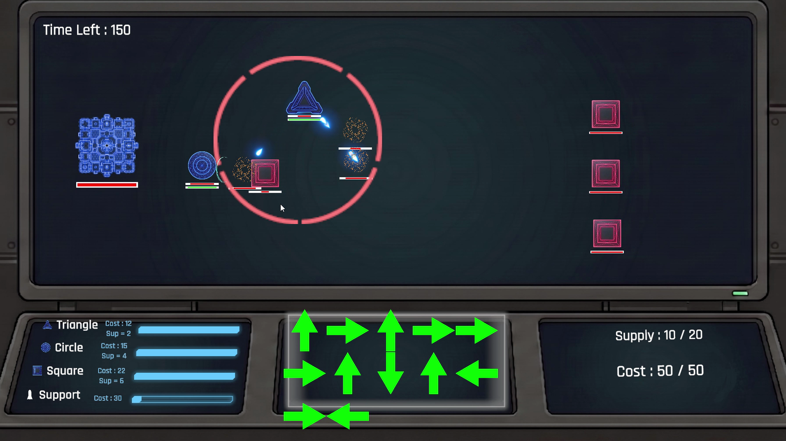

## 프로젝트 개요

| 항목 | 내용 |
|---|---|
| 장르 | 2D 전략 디펜스 |
| 개발 기간 | 2026.06.24 ~ 2026.07.07 (약 2주) |
| 개발 인원 | 1인 기획 및 개발 |
| 개발 환경 | Unity 6000.3.15f1, New Input System |
| GitHub | https://github.com/KooHoo-Dev/3rd-2D-Project-Gryphon34 |
| 시연 영상 | https://youtu.be/6Be4_zasaZc |

기호(세모, 네모, 동그라미) 기반의 1인 개발 전략 디펜스 게임입니다. 플레이어는 우주선 내부의 전술 스크린을 통제하는 사령관이 되어,
끊임없이 밀려오는 적의 상성을 파악하고 최적의 위치에 아군 유닛을 투하하여 방어선을 구축해야 합니다.

헬다이버즈 2의 스트라타젬(방향키 커맨드) 시스템을 인상 깊게 플레이했고, 워해머 스타일의 끝없이 밀려오는 외계인 앞에서 느끼는 막막함을 표현해 보고 싶어 기획했습니다.
노린 재미는 두 가지이고, 각각을 아래 장치로 만들었습니다.

| 노린 재미 | 만든 장치 | 본문 |
|---|---|---|
| **피지컬**: 급박한 전황 속에서 정확한 방향키를 입력 | 클릭 즉시 소환 대신, 방향키 커맨드를 오타 없이 입력해야 병력이 투하됨 | 1장 |
| **전략**: 상성을 고려해 병력을 배치 | 세 기호의 상성 순환, 투하된 자리에 고정되는 아군 | 0.3 · 2장 |

### 핵심 루프
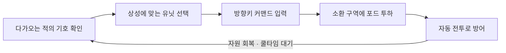
| 승리 | 패배 | 적 |
|---|---|---|
| 제한 시간(180초) 동안 베이스(체력 400)를 지켜 냄 | 그 전에 베이스 체력이 0 | 12초마다 3마리씩, 기호(세모·네모·동그라미)는 무작위 |

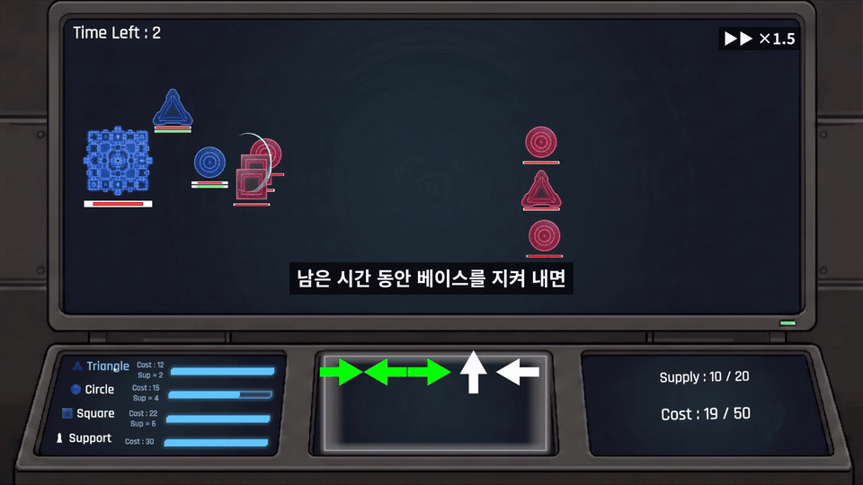

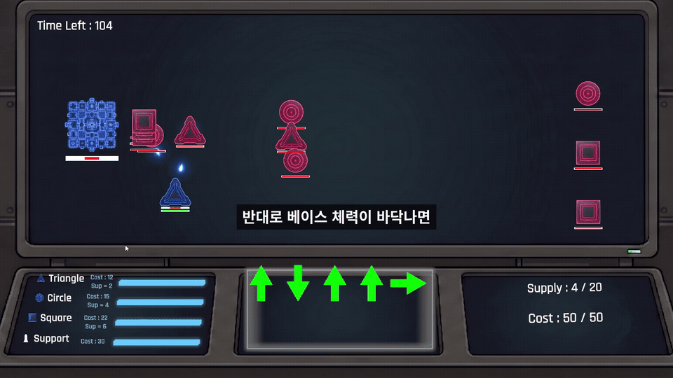

### 조작법
| 입력 | 동작 |
|---|---|
| 마우스 좌클릭 (유닛 버튼) | 소환할 유닛 선택 → 조건 검사 후 커맨드 표시 |
| 방향키 ↑ ↓ ← → | 화면에 나온 커맨드를 순서대로 입력 (틀리면 처음부터) |
| 마우스 좌클릭 (전장) | 소환 구역 안에 유닛 투하, 지원 폭격은 커서에 반경 표시 |

### 원작(헬다이버즈 2 스트라타젬)과 다른 점

| 항목 | 헬다이버즈 2 | Geometry Commander | 생기는 판단 |
|---|---|---|---|
| 커맨드의 위치 | 3인칭 슈팅 중 장비를 부르는 보조 수단 | **유일한 조작** (캐릭터 조작 없음) | 입력과 투하 위치만으로 전투를 이끔 |
| 커맨드 길이 | 장비마다 고정 | **유닛이 강할수록 김** (5 → 12개) | 급할 때 약하지만 빨리 부를 유닛을 고름 |
| 커맨드 조합 | 고정 (외워서 입력) | **소환마다 무작위** | 매번 화면을 읽고 입력 |
| 추가 규칙 | - | **기호 상성 · 사기** | 적 기호에 맞는 유닛, 아군이 죽으면 주변 사기 하락 |

> 이 문서는 0장 기획, 1장 커맨드 입력 소환, 2장 기호 상성 자동 전투, 3장 자원·인구수·쿨타임 관리, 4장 AI 활용 방식, 5장 회고 순서로 다룹니다.

## 0. 기획

### 0.1 기획안 선정
2D 프로젝트를 시작하기 전(2026.06.08) 두 개의 기획서를 작성했습니다.

| 항목 | 채택한 안 |
|---|---|
| 콘셉트 | 전술 스크린의 기호를 보고 방향키 커맨드로 지원을 투하하는 실시간 디펜스 |
| 핵심 재미 | 압박 속 정확한 입력 + 상성 배치 |
| 필요한 시스템 | 커맨드 입력, 자동 전투, 자원·인구·쿨타임 |
| 개발 범위 | 8일 (연출 항목까지 기획 단계에서 정리) |

이 안은 기획 단계부터 **8일 개발 범위**를 전제로 연출 항목까지 정리했고, 코어 루프가 "커맨드 입력 → 투하 → 자동 전투" 하나로 설명되어 1인 개발로
끝까지 완성할 수 있다고 판단해 채택했습니다.

### 0.2 기획을 코드로 옮긴 과정
기획서를 바로 코드로 옮기지 않고, **규칙 문서 → 의사코드 → C#** 순서로 세 번 다듬었습니다.

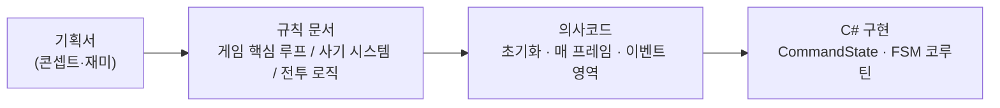

규칙 문서에서는 게임을 **초기화 영역(시작 시 1회) / 실시간 업데이트 영역(매 프레임) / 유저 입력 이벤트 영역**으로 나눠 적었고,
이벤트 영역의 의사코드가 그대로 커맨드 시스템의 상태 머신이 되었습니다.

| 의사코드 (기획 단계) | 구현 |
|---|---|
| `유저 상태 = 대기` → 포드 선택 시 자원·인구수 검사 | `CommandState.Idle` → `CheckCondition()` |
| `유저 상태 = 입력 대기` → 오입력 시 "입력했던 텍스트만 초기화" | `CommandState.Commanding` → `CheckCommand()` |
| `유저 상태 = 클릭 대기` → 배치 가능 위치면 자원 감소 | `CommandState.Spawning` → `SetSpawnPosition()` |

### 0.3 상성과 수치 설계
**상성 순환** : 세 기호가 서로 물고 물리도록 하나의 순환으로 정했습니다. 유리한 상대에게는 2배, 불리한 상대에게는 0.5배 피해를 줍니다.

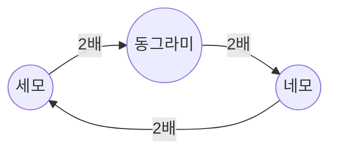

아군과 적은 **같은 기호가 같은 역할**을 맡는 거울 구조라서, 적의 모양만 보고 역할(원거리·공격형·탱커)과 카운터 유닛을 함께 읽을 수 있습니다.

| 기호 | 역할 | 아군 (체력 / 공격 / 사거리) | 적 (체력 / 공격 / 사거리) |
|---|---|---|---|
| 세모 | 원거리 딜러 | 70 / 7 / 2.8 | 60 / 6 / 2.0 |
| 동그라미 | 근거리 공격형 | 100 / 8 / 1.8 | 90 / 8 / 1.3 |
| 네모 | 근거리 탱커 | 150 / 7 / 1.4 | 130 / 7 / 1.0 |

아군은 적보다 체력과 사거리가 조금씩 높아 먼저 공격을 시작합니다. 대신 제자리에 고정되므로, 어디에 놓느냐가 성능을 결정합니다.

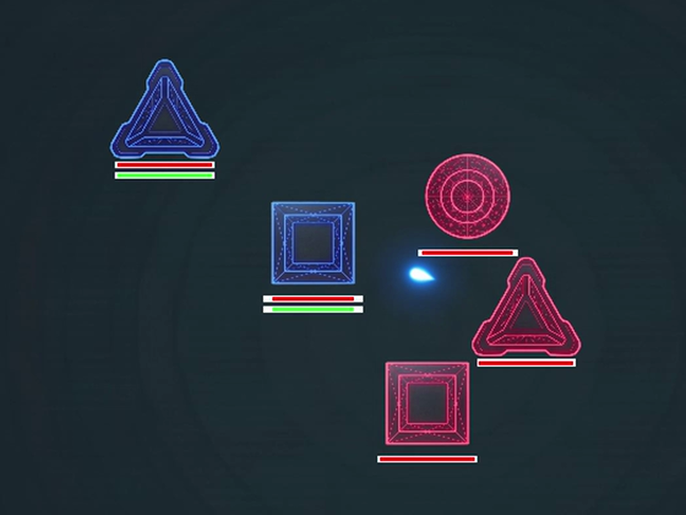

**소환 비용** : 강한 유닛일수록 네 가지 비용(자원·인구수·커맨드 길이·쿨타임)이 함께 올라가도록 맞췄습니다.

| 유닛 | 자원 | 인구수 | 커맨드 길이 | 쿨타임 |
|---|---|---|---|---|
| 세모 (원거리, `RangeUnit`) | 12 | 4 | 5 | 5초 |
| 동그라미 (근거리, `MeleeUnit`) | 15 | 6 | 7 | 7초 |
| 네모 (근거리, `MeleeUnit`) | 22 | 8 | 9 | 9초 |
| 지원 폭격 (`SupportUnit`) | 30 | 0 | 12 | 15초 |

> 자원·인구수는 빌드 후 플레이한 뒤 밸런스 수정(07.07)에서 올린 게임 씬(인스펙터) 값입니다. 코드의 기본값(자원 10 / 15 / 20 / 25, 인구수 2 / 4 / 6)은 그 전 값입니다.

**경제** : 자원은 최대 50, 초당 1 회복, 적 처치 시 5를 얻습니다. 인구수는 최대 20입니다.
- 180초 동안 적은 15번(2초, 14초, … 170초)에 걸쳐 총 45마리가 나옵니다. 모두 처치하면 처치 보상만 225, 자연 회복 180으로 이론상 약 400의 자원이 들어옵니다.
- 자원 상한 50으로는 지원 폭격(30)을 한 번만 모아 둘 수 있습니다. 상한에 닿으면 회복분이 버려지므로, 모아 두기보다 계속 소환하는 쪽이 유리합니다.
- 인구수 20은 세모 5기, 또는 네모 2기 + 세모 1기 정도입니다. 유닛이 죽어야 인구수가 돌아오므로, 같은 유닛만 쌓는 플레이를 막습니다.

### 0.4 기획 대비 조정한 규칙
규칙 문서(2026.06.21)에 적은 규칙과 실제 구현이 달라진 부분입니다.

| 항목 | 기획 (규칙 문서) | 구현 |
|---|---|---|
| 자원 차감 시점 | 유닛 선택 시 선점 | 투하(클릭) 시 차감. 커맨드 입력 중 다른 유닛을 고르면 환불 처리가 필요했기 때문입니다|
| 적이 멈추는 조건 | 근거리 아군이 길을 막을 때만 | 전방 시야각 안의 아군(근거리·원거리) 또는 베이스 |
| 피격 시 사기 감소 | 일반 1, 천적 10 | 5 × 상성 배율 (2.5 / 5 / 10), 근거리 아군만 |
| 주변 아군 사망 | 남은 사기의 절반 | 반경 2 안의 아군 사기 -5 |
| 사기 회복 | 충원·처치 시 +20 | 투하 시 소환 구역 아군 +10, 적을 처치한 유닛 +10 |
| 사기 0 | 2초간 흐려지며 소멸, 주변 페널티 없음 | 체력 0과 같은 사망 처리 |

## 1. 커맨드 입력 소환
입력을 처리하는 `CommandSystem`과 자원·인구수·쿨타임을 관리하는 `PlayerManager`(3장)가 주고받으며 동작합니다.

### 1.1 버튼 클릭에서 투하까지 세 상태

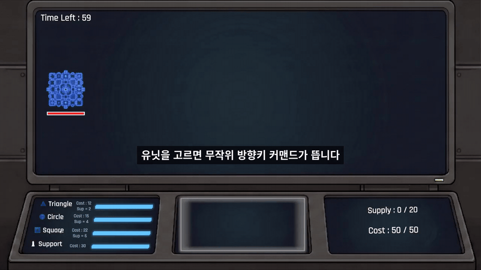

| 상태 | 플레이어가 하는 일 | 시스템이 하는 일 | 다음 상태 |
|---|---|---|---|
| `Idle` | 유닛 버튼 클릭 | `PlayerManager`에 쿨타임·자원·인구수 확인 → 통과하면 등급 길이의 무작위 커맨드 생성 | `Commanding` |
| `Commanding` | 방향키 입력 | 키마다 정답 확인 → 맞으면 화살표 녹색, 틀리면 입력 기록만 초기화(정답 유지) | 모두 맞추면 `Spawning` |
| `Spawning` | 소환 구역 클릭 (지원 폭격은 커서에 반경 표시) | 자원 차감 · 인구수 증가 · 쿨타임 시작 · 유닛 생성 · 소환 구역 아군 사기 +10 | `Idle` |

> 클릭 즉시 소환되는 방식 대신, 적이 몰려오는 중에 자원·쿨타임을 계산하고 오타 없이 입력해야 하는 긴장감을 주려고 만든 시스템입니다.
> 투하 시 사기 +10은 "지원이 도착했다"는 느낌을 수치로 표현한 것입니다.

### 1.2 소환 한 번에 오가는 확인과 요청
CommandSystem(입력·상태)과 PlayerManager(자원·인구수·쿨타임)가 주고받는 순서입니다.

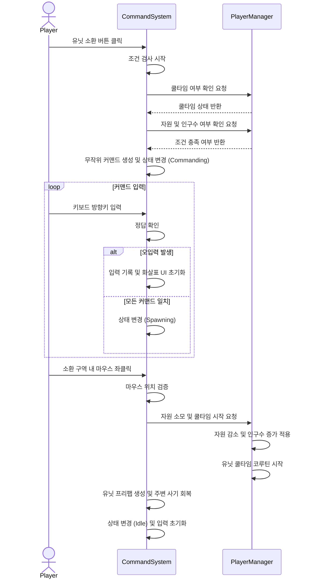

자원은 버튼을 누를 때 **확인만** 하고, 투하할 때 **차감**합니다(0.4). 커맨드 입력 중 다른 유닛으로 바꿔도 환불 처리가 필요 없습니다.

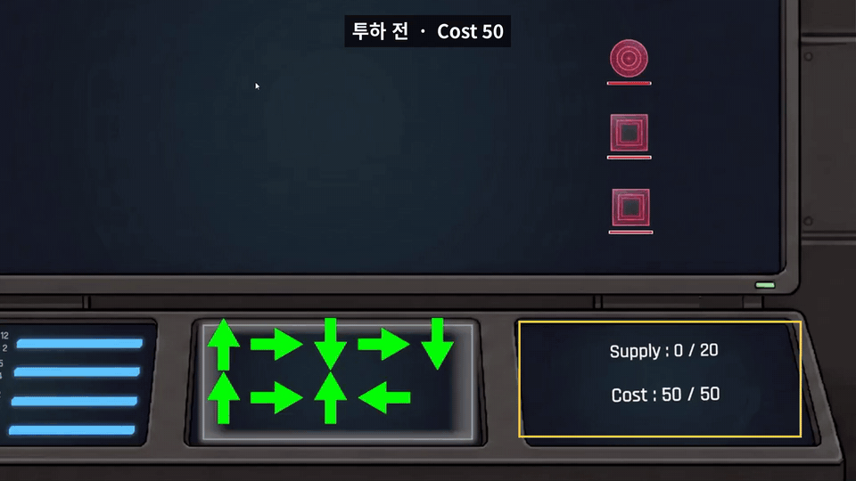

### 1.3 유닛 등급이 곧 커맨드 길이

UI 버튼은 시스템의 내부 상태를 알 필요가 없습니다.

| UI 버튼이 하는 일 | CommandSystem이 스스로 하는 일 |
|---|---|
| 유닛 버튼의 `OnClick`에 `OnTriangleClick()`, `OnCircleClick()` 같은 유닛 지정 함수만 연결 | PlayerManager에 자원·쿨타임 확인 → 무작위 커맨드 생성 → `Commanding`으로 바꾸고 키 입력을 기다림 |

**커맨드 생성** : `UnitType`의 값(5·7·9·12)을 그대로 반복 횟수로 사용합니다.
```csharp
private void InitialCommand(PlayerManager.UnitType type)
{
    commandList.Clear();
    InputCommand.Clear();
    count = 0;

    // 세모 5개, 동그라미 7개, 네모 9개, 지원 폭격 12개의 무작위 방향키
    for (int i = 0; i < (int)type; ++i)
    {
        commandList.Add(arrows[Random.Range(0, 4)]);
    }
    DrawCommad(); // 화살표 이미지를 UI에 생성
}
```

**입력 확인** : 방향키 하나가 들어올 때마다 `CheckCommand`가 그 칸의 정답과 비교합니다.
```csharp
private void CheckCommand()
{
    // 입력한 방향키가 현재 순서(count)의 정답과 일치하는지 확인합니다.
    if (commandList[count] == InputCommand[count])
    {
        spawnedArrowImages[count].color = Color.green; // 정답 시 UI를 녹색으로 변경하여 시각적 피드백 제공
        count++;
        // 모든 커맨드를 오타 없이 맞췄을 경우
        if (count == commandList.Count)
        {
            count = 0;
            currentState = CommandState.Spawning; // 소환 위치 지정 상태로 전환
        }
    }
    else
    {
        // 오입력: 정답 커맨드(commandList)는 유지하고 입력 기록과 화살표 색만 되돌립니다.
        // commandList까지 비우면 다음 입력에서 commandList[count] 접근이 범위를 벗어납니다.
        InputCommand.Clear();
        count = 0;
        DrawCommad();
    }
}
```

### 1.4 커맨드를 언제 확인하고, 틀리면 무엇을 잃게 할까
> 입력을 언제 검증하고, 틀렸을 때 플레이어에게 어떤 대가를 줄 것인가?

**① 검증 시점**

| 대안 | 방식 | 장점 | 단점 | 선택 |
|---|---|---|---|---|
| A. 입력 완료 후 일괄 검증 | 마지막 키에서 정답 리스트와 한 번 비교 | 로직이 단순 | 중간에 틀려도 끝까지 친 뒤에야 알게 되어 피드백이 늦음 | |
| B. 키마다 즉시 검증 | 키 입력마다 현재 인덱스(`count`)만 비교 | 맞은 칸이 바로 녹색 → 즉각 피드백 | 키마다 화살표 UI를 갱신해야 함 | ✅ |

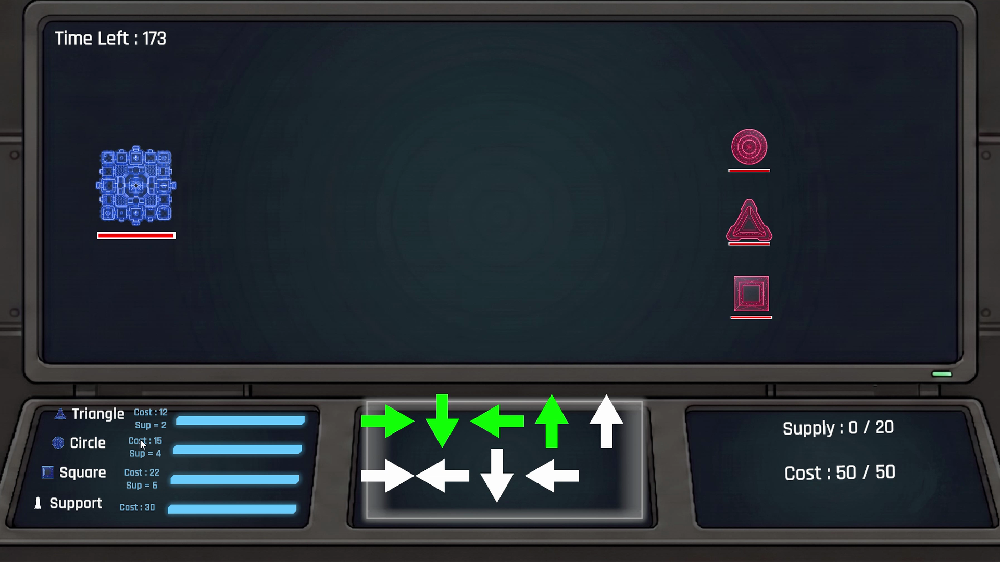

**② 틀렸을 때의 대가**

| 대안 | 틀리면 | 플레이어가 잃는 것 | 선택 |
|---|---|---|---|
| 선택 취소 | `Idle`로 돌아가 버튼부터 다시 | 시간 + 다시 고르는 수고, 새 커맨드를 다시 읽어야 함 | |
| 틀린 칸만 다시 | 맞은 칸은 유지 | 거의 없음 → 긴장감이 사라짐 | |
| 같은 커맨드를 처음부터 | 입력 기록·화살표 색만 초기화, 정답과 상태 유지 | **시간만** | ✅ |

**결정** : 빠른 판단이 중요한 게임이라 피드백은 즉시(B) 주고, 실패의 대가는 **"시간 손실"로만 한정**했습니다.
기획 단계 규칙("선택이 취소되지 않고 입력했던 텍스트만 초기화")을 따른 것으로, 오타가 긴장감은 주되 곧바로 전선 붕괴로 이어지지는 않게 했습니다.

## 2. 기호 상성 자동 전투

적은 베이스로 밀려오고 아군은 투하된 자리에서 버티는 구도에서, 기호 상성에 따라 피해가 달라지는 자동 전투입니다.
공통 값을 가진 부모 클래스(`PlayerUnit` · `EnemyUnit`) 아래에서, 자식 클래스가 타겟 고르기와 상성 계산을 각자 맡습니다(2.2).

### 2.1 유닛마다 다른 이동과 타겟

| 유닛 | 이동 | 타겟 기준 | 피격 시 |
|---|---|---|---|
| 아군 근거리 (`MeleeUnit`, 동그라미·네모) | 투하된 자리에 고정 | 사거리 안 **가장 가까운** 적 | 체력 · 사기가 상성 배율만큼 감소 |
| 아군 원거리 (`RangeUnit`, 세모) | 투하된 자리에 고정 | 사거리 안 **체력이 가장 낮은** 적 | 체력만 감소 |
| 아군 지원 폭격 (`SupportUnit`) | 투하 지점 | 탐색 없이 지속 시간 동안 범위 피해 | - |
| 적 (`EnemyUnit`) | 베이스를 향해 전진 | **전방 시야각** 안의 아군 또는 베이스 | 체력이 상성 배율만큼 감소 |

상성은 0.3의 순환(세모 > 동그라미 > 네모 > 세모)을 따라 유리하면 2배, 불리하면 0.5배입니다.

> 적은 밀려오고 아군은 물러설 수 없게 만들어, 적의 기호를 보고 카운터 유닛을 **어디에** 놓을지가 전략의 핵심이 되도록 했습니다.

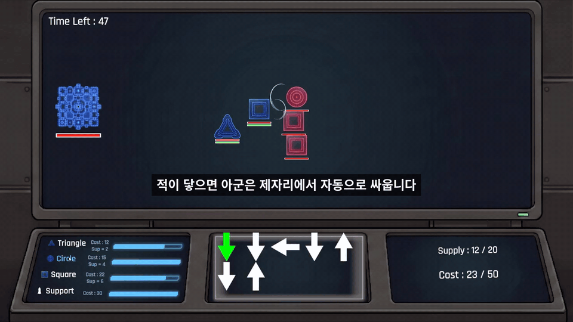

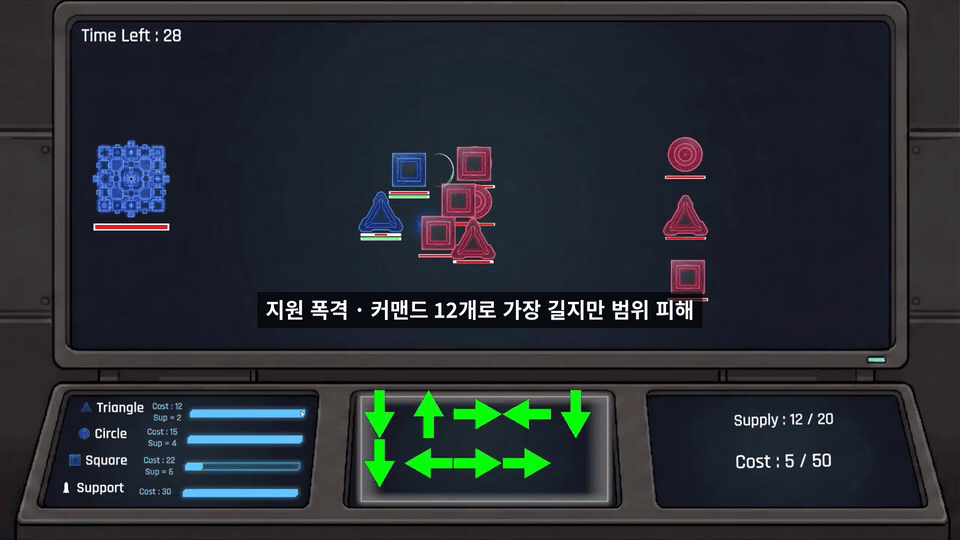

### 2.2 부모 클래스는 값, 자식 클래스는 타겟과 상성

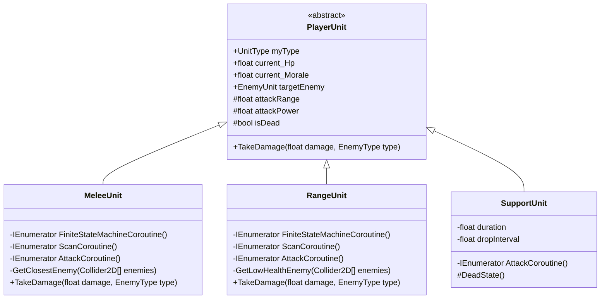

| 클래스 | 맡은 일 |
|---|---|
| `PlayerUnit` (추상) | 체력·사기·사거리·공격력 보관. `Update`에서 체력 **또는 사기**가 0 이하이면 `DeadState` 호출, 체력·사기 바 갱신 |
| `MeleeUnit` | `GetClosestEnemy`로 타겟 선정, 상성 배율로 체력·사기를 깎는 `TakeDamage` |
| `RangeUnit` | `GetLowHealthEnemy`로 체력이 가장 낮은 적을 죽을 때까지 점사, 상성 배율 `TakeDamage` |
| `SupportUnit` | 탐색 없이 `duration` 동안 범위 피해. `HashSet`으로 이미 맞은 적을 기록해 중복 피해 방지, 시간이 끝나면 스스로 `DeadState` |

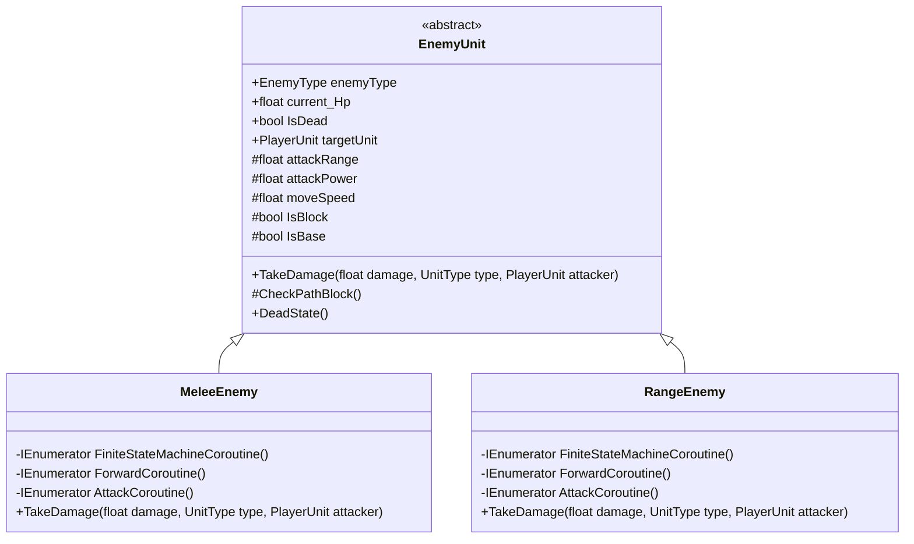

| 클래스 | 맡은 일 |
|---|---|
| `EnemyUnit` (추상) | 체력·이동 속도·공격력·사거리 보관, 전방의 아군·베이스를 찾는 공통 `CheckPathBlock()` |
| `MeleeEnemy` (동그라미·네모) | 타겟에 직접 피해. 상성 배율 `TakeDamage`, 자신을 처치한 아군 사기 +10 |
| `RangeEnemy` (세모) | 투사체 발사. 상성 배율 `TakeDamage` |

#### 아군 유닛의 상태 흐름
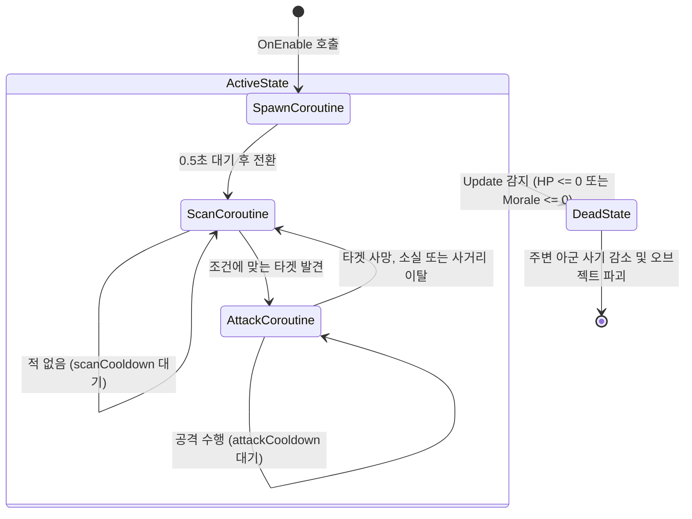
| 상태 | 다이어그램에 없는 세부 사항 |
|---|---|
| Spawn | 0.5초는 포드 낙하 연출 시간. 끝나면 포드 이미지를 끄고 유닛 렌더러를 켬 |
| Scan | `OverlapCircleAll`로 사거리 안의 적만 모음(2.5). 타겟 기준은 2.1 표 |
| Dead | `StopAllCoroutines()`로 어떤 상태든 끊고 들어옴. 0.3초 뒤 반경 2 안의 아군 사기 -5, `PlayerManager.Dead`로 인구수 반환 후 파괴 |

#### 적 유닛의 상태 흐름
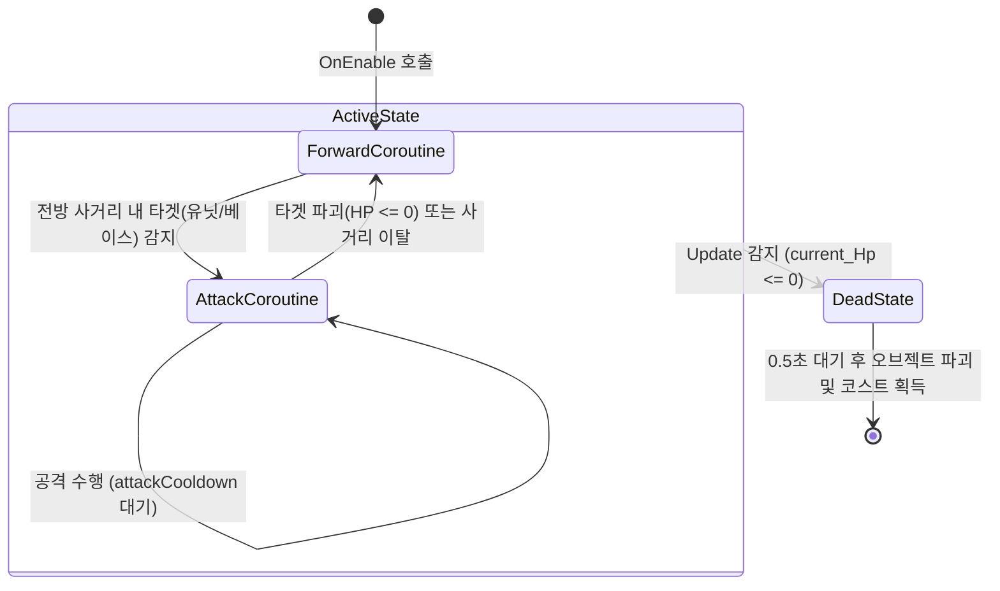
| 상태 | 다이어그램에 없는 세부 사항 |
|---|---|
| Forward | 매 프레임 `CheckPathBlock`(2.4)으로 전방 시야각 안을 검사하고, `IsBlock` 또는 `IsBase`가 켜지면 멈춤 |
| Dead | 보상(자원 +5)을 지급하고 렌더러를 숨긴 뒤 사망 이펙트를 켬. 0.5초 대기와 파괴는 `EnemyDeadState` 스크립트가 맡음 |

### 2.3 아군 유닛: 코루틴 상태 머신 · 타겟 고르기 · 상성 피해

아군 유닛은 소환되는 즉시 스스로 탐색하고 싸웁니다. 바깥(`CommandSystem` 등)에서 행동을 제어하는 메서드는 없고,
바깥과 이어지는 것은 적이 아군을 때릴 때 부르는 `TakeDamage(float damage, EnemyType type)` 하나뿐입니다.

**코루틴 상태 머신** : 상태 하나를 코루틴 하나로 만들었습니다. 같은 구조를 아군·적 유닛 모두에 썼습니다.

| 필요한 것 | 코루틴 상태 머신에서는 |
|---|---|
| 다음 상태로 넘어가기 | 상태 코루틴이 끝나기 전에 **`nextStateCoroutine`에 다음 상태를 넣어 두면** 바깥 루프가 이어서 실행 |
| "0.5초 대기 후 전환", "공격 딜레이 후 피해" 같은 시간 흐름 | `WaitForSeconds`로 그대로 씀. `Update`에 `switch`를 두는 방식보다 자연스러움 |
| 죽으면 어떤 상태든 끊기 | `StopAllCoroutines()` 한 번 |

```csharp
private IEnumerator FiniteStateMachineCoroutine()
{
    nextStateCoroutine = SpawnCoroutine(); // 첫 상태

    while (gameObject.activeInHierarchy)
    {
        // 현재 상태 코루틴이 끝날 때까지 기다린 뒤, 그 상태가 지정한 다음 상태를 실행
        yield return StartCoroutine(nextStateCoroutine);
    }
}

private IEnumerator SpawnCoroutine()
{
    yield return new WaitForSeconds(0.5f); // 포드 낙하 연출 시간
    unitRenderer.enabled = true;
    fordRenderer.enabled = false;
    nextStateCoroutine = ScanCoroutine();  // 다음 상태 지정 후 종료
}
```

**타겟 고르기** : 근거리와 원거리는 같은 탐색 주기(`ScanCoroutine`)를 쓰고, 타겟을 고르는 기준(2.1)만 자식 클래스가 각자 정합니다.
아래는 근거리(`MeleeUnit`)가 사거리 안에서 가장 가까운 적을 찾는 코드입니다.

```csharp
private EnemyUnit GetClosestEnemy(Collider2D[] enemies)
{
    Transform closestEnemy = null;
    float closestDistance = Mathf.Infinity;
    Vector3 currentPosition = transform.position;

    foreach (Collider2D enemy in enemies)
    {
        EnemyUnit enemyComponent = enemy.GetComponent<EnemyUnit>();

        // 체력이 0보다 큰 살아있는 적만 탐색 대상으로 한정
        if(enemyComponent != null && enemyComponent.current_Hp > 0)
        {
            // 핵심 설계: 중심점이 아닌, 유닛의 가장 외곽(Edge)을 기준으로 거리를 측정
            Vector3 closet = enemy.ClosestPoint(currentPosition);
            float distanceTo = Vector3.Distance(currentPosition, closet);

            if(distanceTo < closestDistance)
            {
                closestDistance = distanceTo;
                closestEnemy = enemy.transform;
            }
        }
    }
    return closestEnemy != null ? closestEnemy.GetComponent<EnemyUnit>() : null;
}
```

**상성 피해** : 0.3의 순환(세모 > 동그라미 > 네모 > 세모)을 맞는 쪽에서 판정합니다. 근거리 아군은 같은 배율로 사기(기본 5)도 깎입니다.

| 공격 ↓ / 피격 → | 세모 | 동그라미 | 네모 |
|---|---|---|---|
| **세모** | 1 | **2** | 0.5 |
| **동그라미** | 0.5 | 1 | **2** |
| **네모** | **2** | 0.5 | 1 |

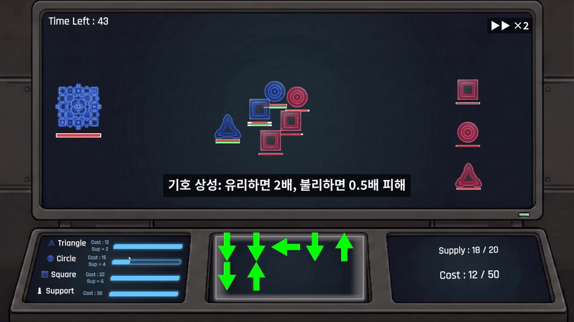

아래는 동그라미와 네모를 맡는 `MeleeUnit`의 피격 코드입니다.

```csharp
public override void TakeDamage(float damage, EnemyUnit.EnemyType type)
{
    float addDamage = 1.0f;
    float moraleDamage = 5.0f;
    
    if (myType == PlayerManager.UnitType.Circle)
    {
        if (type == EnemyType.Square) addDamage = 0.5f;        // 동그라미 > 네모
        else if (type == EnemyType.Triangle) addDamage = 2.0f; // 세모 > 동그라미
    }
    else if (myType == PlayerManager.UnitType.Square)
    {
        if (type == EnemyType.Circle) addDamage = 2.0f;        // 동그라미 > 네모
        else if (type == EnemyType.Triangle) addDamage = 0.5f; // 네모 > 세모
    }
    
    current_Hp -= damage * addDamage;
    current_Morale -= moraleDamage * addDamage; // 천적에게 맞을수록 사기도 크게 깎임
}
```

### 2.4 적 유닛: 전진하다 앞이 막히면 공격

적 유닛도 생성(`OnEnable`)되자마자 같은 코루틴 상태 머신으로 스스로 움직입니다.

**전진** : 매 프레임 베이스 쪽으로 이동하면서, 앞을 막는 것이 있는지 검사합니다.

```csharp
// 매 프레임 전방에 타겟이 있는지 검사합니다.
CheckPathBlock();
        
// 방해물(유닛 또는 베이스)이 감지되면 전진을 멈추고 공격 코루틴으로 상태를 전환합니다.
if (IsBlock || IsBase)
{
    nextStateCoroutine = AttackCoroutine();
    yield break;
}
```

**앞을 막는 것 찾기** (`CheckPathBlock`, 부모 `EnemyUnit`에 있는 공통 기능) : 사거리 안에 들어왔다고 다 공격하지 않고,
베이스 쪽 **전방 시야각(`viewAngle`) 안**에 있는 것만 타겟으로 삼습니다. 이미 지나친 아군에게 뒤돌아 공격하지 않고 베이스만 보고 돌진하는 "밀려오는 적"의 느낌을 만들기 위한 장치입니다.

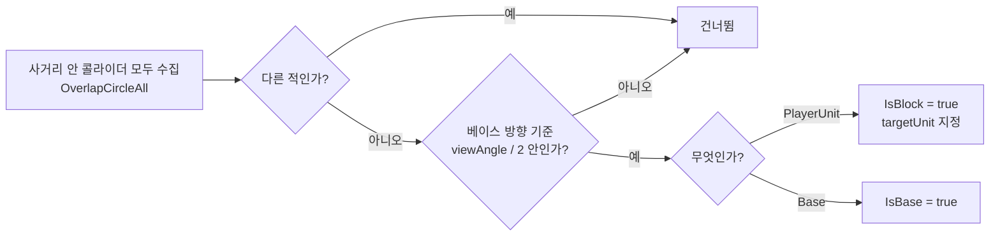

```csharp
protected void CheckPathBlock()
{
    if (IsBlock == true || IsBase == true) return;
    
    // 1. 사거리(attackRange) 반경 내의 모든 콜라이더를 수집합니다.
    Collider2D[] hits = Physics2D.OverlapCircleAll(transform.position, attackRange);
    Vector3 forwardDir = (playerBase.transform.position - transform.position).normalized;

    foreach (Collider2D hit in hits)
    {
        // 다른 적 유닛은 탐색 대상에서 제외합니다.
        if (hit.GetComponent<EnemyUnit>()) continue;
        
        Vector3 dirToTarget = (hit.transform.position - transform.position).normalized;
        
        // 2. 핵심 설계: 사거리 안에 있더라도, 전방 시야각(viewAngle) 내에 위치하는지 각도를 계산하여 판별합니다.
        if (Vector3.Angle(forwardDir, dirToTarget) < viewAngle / 2)
        {
            if (hit.GetComponent<PlayerUnit>())
            {
                IsBlock = true;
                targetUnit = hit.GetComponent<PlayerUnit>();
                return;
            }
            else if (hit.GetComponent<Base>())
            {
                IsBase = true;
                return;
            }
        }
    }
}
```
### 2.5 거리 계산과 탐지 영역의 기준 불일치 문제 해결

**[문제]** 크기가 큰 적이 탐지 원 안에 들어왔는데도, 아군이 공격하지 않고 가만히 서 있었습니다.

**[원인]** 탐지와 공격 판정이 **서로 다른 기준**으로 거리를 쟀습니다.

| 단계 | 사용한 연산 | 거리 기준 |
|---|---|---|
| 탐지 | `Physics2D.OverlapCircleAll` | 원이 적 콜라이더의 **외곽**에 닿으면 감지 |
| 공격 판정 | `Vector3.Distance` | 두 유닛의 **중심점** 사이 거리 |

큰 적은 외곽이 탐지 원에 닿아도 중심점은 사거리 밖에 있어서, "탐지는 됐는데 공격 범위는 아닌" 상태에 머물렀습니다.

**[대안 비교]** 두 기준 중 하나로 통일해야 했습니다.

| 대안 | 방식 | 장점 | 단점 | 선택 |
|---|---|---|---|---|
| A. 중심점으로 통일 | 탐지도 중심점 거리로 하거나, 탐지 반경을 줄여 맞춤 | 계산이 단순 | 적이 클수록 눈에 보이는 거리와 판정이 어긋남. 유닛 크기마다 반경을 따로 조정해야 함 | |
| B. 외곽선으로 통일 | 공격 판정도 `Collider2D.ClosestPoint`로 외곽까지 거리를 잼 | 크기와 상관없이 눈에 보이는 거리 = 판정 | 모든 유닛에 `Collider2D` 필요 | ✅ |

**[결정]** 대안 B를 선택했습니다. 판단 기준은 "플레이어 눈에 닿아 보이면 공격해야 한다"였습니다.
`OverlapCircleAll`이 이미 외곽 기준이므로, 공격 판정을 같은 기준으로 맞추면 탐지된 적은 언제나 공격 범위 안에 있게 됩니다.

`LayerMask`는 아군 유닛(`MeleeUnit`, `RangeUnit`)의 탐색에 적용했습니다. `PlayerUnit`에 둔 `targetLayer`로 적 레이어만 수집한 뒤,
`GetClosestEnemy`에서 `ClosestPoint`로 외곽선 기준 거리를 잽니다.

```csharp
// MeleeUnit.ScanCoroutine : 적 레이어(targetLayer)만 탐지
Collider2D[] hitEnemies = Physics2D.OverlapCircleAll(transform.position, attackRange, targetLayer);
targetEnemy = GetClosestEnemy(hitEnemies);
```
반면 적 유닛의 `CheckPathBlock`(2.4)은 아군 유닛과 베이스를 모두 찾아야 하므로 `LayerMask` 없이 수집하고, `GetComponent`로 대상을 구분합니다.

#### [결과]

| | 수정 전 | 수정 후 |
|---|---|---|
| 공격 가능 거리 판정 | 두 유닛 **중심점** 사이 거리 (`Vector3.Distance`) | 적 콜라이더의 **가장 가까운 외곽점**까지 거리 (`ClosestPoint`) |
| 가장 가까운 적 찾기 | 중심점 거리의 제곱 (`sqrMagnitude`) | 외곽점 거리, 체력이 0보다 큰 적만 |
| 타겟을 못 찾았을 때 | 그대로 공격 상태로 넘어감 | 탐색 상태에 머물며 다시 탐색 |
| 결과 | 크기가 큰 적이 탐지 범위 안에 들어와도 공격하지 않고 서 있음 | 탐지 범위에 들어온 적을 바로 공격 |

함께 사거리 기즈모를 선택했을 때만이 아니라 항상 그리도록(`OnDrawGizmos`) 바꿔, 탐지 원과 실제 공격 판정이 맞는지 씬 뷰에서 바로 확인할 수 있게 했습니다.

당시에는 `MeleeUnit`, `MeleeEnemy`, `RangeEnemy`에만 외곽선 기준을 적용했고, 원거리 아군(`RangeUnit`)의 공격 상태에는 중심점 거리가 남아 있었습니다.
이후 문서와 코드를 대조하며 이 누락을 발견해 `RangeUnit`도 같은 기준으로 맞췄습니다(4.4).

## 3. 자원·인구수·쿨타임 시스템
소환을 제한하는 자원(Cost)·인구수(Supply)·쿨타임(Cooldown)을 싱글톤 `PlayerManager` 한 곳에서 관리합니다. 수치는 0.3의 비용 표를 따릅니다.

### 3.1 소환을 막는 세 가지 제한

| 제한 | 줄어드는 때 | 돌아오는 때 | 막는 플레이 |
|---|---|---|---|
| 자원 (최대 50) | 투하 시 유닛 비용만큼 | 초당 +1, 적 처치 시 +5 | 비싼 유닛 연속 소환 |
| 인구수 (최대 20) | 투하 시 유닛 인구수만큼 | 그 유닛이 죽을 때 | 한 종류만 쌓아 두기 |
| 쿨타임 (유닛별) | 투하 시 시작 | 5~15초 뒤 | 같은 유닛 연속 소환 |

> 세 제한이 겹쳐 있어서, 지금 어떤 상성의 유닛이 필요한지 우선순위를 정하고 쿨타임을 계산해 배치하는 판단이 생깁니다.

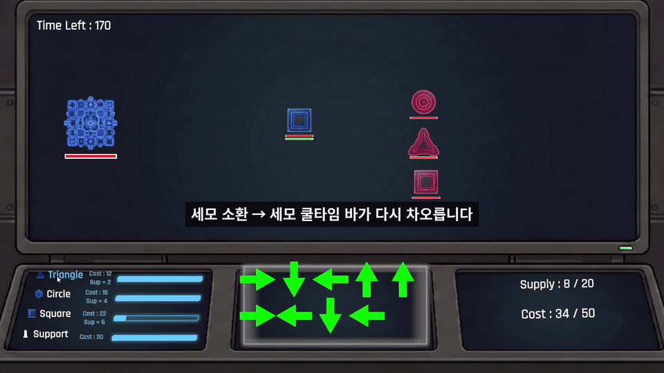

### 3.2 다른 클래스는 묻기만 하고 값을 바꾸지 못한다

다른 클래스(`CommandSystem`, `PlayerUnit`)는 `PlayerManager`에 묻거나 요청만 하고, 값을 직접 바꾸지 않습니다.

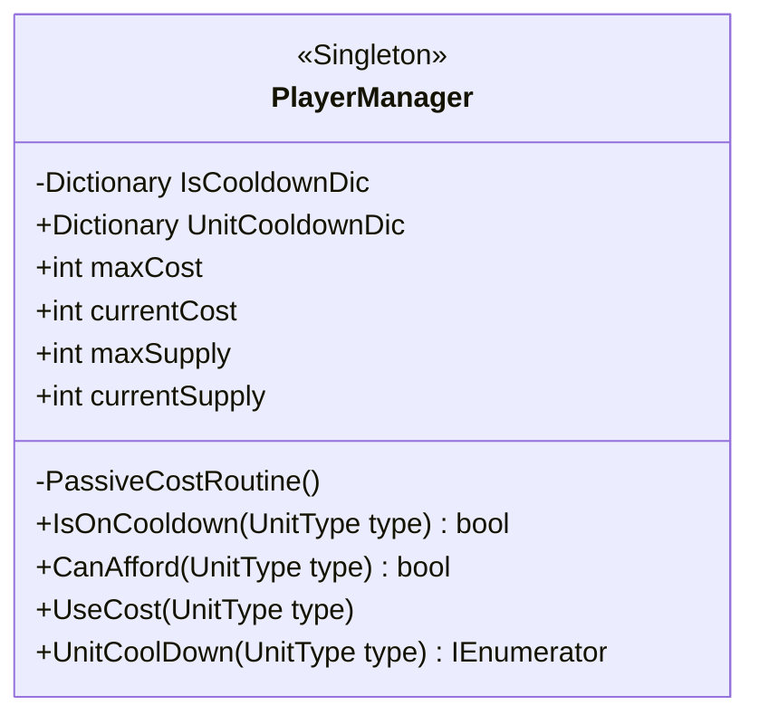

| 설계 | 방법 | 그래서 |
|---|---|---|
| 값 보호 | 최대·현재 자원과 인구수를 `{ get; private set; }` 속성으로 두고, `[field: SerializeField]`로 인스펙터에서만 조절 | 바깥에서 값을 직접 바꿀 수 없음 |
| 허가 후 소비 | `CanAfford`로 확인을 받은 뒤 `UseCost`를 불러야만 차감 | 자원 차감과 쿨타임 시작이 늘 함께 처리됨 |
| 유닛별 쿨타임 | `UnitType`을 Key로 하는 `Dictionary` (3.4) | 유닛마다 따로 잠그고 진행률을 냄 |

| 순서 | 검사 | 통과 조건 |
|---|---|---|
| 1 | `IsOnCooldown` | 그 유닛의 쿨타임이 끝났을 것 |
| 2 | `CanAfford` | 자원 ≥ 비용, 그리고 남은 인구수 ≥ 요구량 (지원 폭격은 인구수 검사 제외) |
| 3 | `UseCost` (투하 시) | 2를 한 번 더 확인한 뒤 자원 차감 · 인구수 증가 · `UnitCoolDown` 코루틴 시작 |

### 3.3 버튼을 누를 때 확인하고, 투하할 때 한 번 더 확인한다

`PlayerManager`는 싱글톤이라 어디서든 부를 수 있고, `CommandSystem` 같은 바깥 클래스는 자원 계산식을 모른 채 확인 함수와 소비 함수만 부릅니다.

```csharp
// 소환 버튼 클릭 시: 쿨타임과 자원 여부만 먼저 확인
if (playerManager.IsOnCooldown(type)) return false;
if (playerManager.CanAfford(type) == false) return false;

// ... 플레이어의 커맨드 타이핑 및 위치 지정 완료 후 ...

// 최종 소환 시: 자원 차감 및 쿨타임 시작 요청
playerManager.UseCost(unitType);
```

자원이 충분한지 묻는 함수(`CanAfford`)와 실제로 깎는 함수(`UseCost`)를 나눴습니다.
버튼을 누른 때와 투하하는 때 사이에 자원이 변할 수 있으므로, `UseCost`가 차감 직전에 `CanAfford`로 한 번 더 확인합니다.

```csharp
public bool CanAfford(UnitType type)
{
    // 지원 폭격은 인구수를 차지하지 않으므로 자원만 검사합니다.
    if (type == UnitType.Support) return currentCost >= GetCost(type);
    
    // 현재 자원과 남은 인구수(최대 인구수 - 현재 인구수)가 모두 요구치 이상인지 검사
    if (currentCost >= GetCost(type) && (maxSupply - currentSupply) >= GetSupply(type)) return true;
    return false;
}

public void UseCost(UnitType type)
{
    if (CanAfford(type))
    {
        currentSupply += GetSupply(type);
        currentCost -= GetCost(type);
        StartCoroutine(UnitCoolDown(type));
    }
}
```
유닛별 쿨타임은 잠금용과 UI 진행률용 Dictionary 두 개로 관리합니다(나눈 이유는 3.4).

```csharp
public IEnumerator UnitCoolDown(UnitType type)
{
    IsCooldownDic[type] = true; // 해당 유닛의 소환 잠금
    float cooldownSec = 0f;
    // (생략) switch (type)로 유닛별 쿨타임(CoolDown enum)을 고름 — 3.4 참고
    float currentTime = 0f;

    while (true)
    {
        if (currentTime >= cooldownSec) break;
        currentTime += Time.deltaTime;
        
        // 외부 UI에서 진행률을 그릴 수 있도록 0~1 사이의 값으로 정규화하여 갱신
        UnitCooldownDic[type] = currentTime / cooldownSec; 
        yield return null;
    }
    IsCooldownDic[type] = false; // 쿨타임 종료 및 잠금 해제
    UnitCooldownDic[type] = 1f;
}
```
### 3.4 유닛별 쿨타임을 어디에 둘까
> 소환을 요청할 때 그 유닛의 쿨타임이 끝났는지 어디서 판단하고, 쿨타임 진행 상황을 UI로 어떻게 내보낼 것인가?

| 대안 | 방식 | 장점 | 단점 | 선택 |
|---|---|---|---|---|
| A. 유닛마다 변수 | `isTriangleCooldown` 같은 변수를 유닛 수만큼 두고 `switch`로 고름 | 가장 단순, 인스펙터에서 바로 보임 | 유닛이 늘 때마다 변수와 분기를 함께 늘려야 하고, UI도 변수 이름을 하나하나 알아야 함 | |
| B. 버튼이 타이머 보유 | 소환 버튼이 자기 쿨타임을 직접 관리 | 버튼이 진행률을 바로 그림 | 소환 가능 판단이 `PlayerManager`(자원·인구수)와 버튼(쿨타임) 두 곳으로 나뉨 | |
| C. `UnitType` Key Dictionary | `PlayerManager`가 잠금(`bool`)·진행률(`float`) Dictionary를 관리 | 소환 조건이 한 클래스에 모임. 유닛이 늘어도 Key만 추가 | 한 번도 소환하지 않은 유닛은 Key가 없어 `TryGetValue`로 확인 | ✅ |

**[결정]** 대안 C를 선택했습니다. 유닛 종류가 4가지로 고정적이라 메모리보다는 코드의 직관성과 유지보수성이 중요하다고 판단했고,
무엇보다 소환 조건 검사를 `PlayerManager` 한 곳에 모으는 것이 목표였습니다.

첫 작업에는 잠금용 `IsCooldownDic`만 두었다가, 쿨타임 UI를 만들 때 진행률용 `UnitCooldownDic`을 따로 추가했습니다.

| Dictionary | 값 | 읽는 쪽 | 하는 일 |
|---|---|---|---|
| `IsCooldownDic` (private) | `bool` | `PlayerManager.IsOnCooldown` | 소환 잠금 |
| `UnitCooldownDic` (public) | `float` 0~1 | UI 스크립트 | 쿨타임 바(슬라이더) 그리기 |

잠금 판단과 UI 표시를 나눴기 때문에, UI 스크립트는 필요한 유닛의 Key로 진행률만 읽어 슬라이더를 그리고 잠금 상태는 건드릴 수 없습니다.

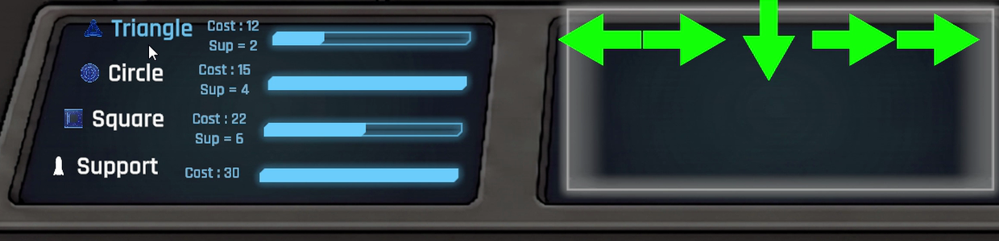

다만 유닛별 쿨타임 시간은 아직 `switch`로 고르고 있어, 유닛이 늘어나면 이 부분도 함께 고쳐야 합니다. 5.2의 유닛 데이터 분리와 함께 개선할 부분입니다.

## 4. AI 활용 방식

### 4.1 원칙
AI는 **선택지를 넓히고 반복을 줄이는 도구**로 쓰고, **무엇을 고를지는 게임의 재미 기준으로 직접 정한다**는 원칙을 세웠습니다.

| 구분 | 내가 맡은 것 | AI에게 맡긴 것 |
|---|---|---|
| 기획 | 콘셉트, 재미 목표, 규칙과 수치 | - |
| 설계 고민 | 판단 기준 설정, 최종 선택 | 대안과 장단점 정리 |
| 구현 | 핵심 로직(커맨드 검증, FSM, 타겟팅, 상성) | 형태가 반복되는 코드 |
| 디버깅 | 현상 재현, 씬에서 검증 | 원인 후보 분석 |

### 4.2 고민되는 부분을 AI와 해결한 방법
각 고민마다 **상황을 설명하고 대안과 장단점을 받은 뒤, 내가 정한 기준으로 고르는** 방식으로 진행했습니다. 이 문서의 [대안 A/B/C] 형식이 그 과정의 기록입니다.

| 고민 | AI에게 요청한 것 | 내가 정한 판단 기준 | 결론 |
|---|---|---|---|
| 자원 차감 시점 (0.4) | 선택 시 선점 / 투하 시 차감 방식의 처리 흐름 비교 | 커맨드 입력 중 다른 유닛으로 바꿔도 예외 처리가 없어야 한다 | 선택 시에는 확인만, 투하 시 차감. 환불 로직 자체가 필요 없어짐 |
| 사거리 판정 버그 (2.5) | "탐지는 되는데 공격을 안 한다"는 현상의 원인 후보 | 눈에 보이는 거리와 판정이 같아야 한다 | 탐지와 판정의 기준 불일치로 결론, 기즈모로 씬에서 직접 확인 후 `ClosestPoint`로 통일 |
| 쿨타임 구조 (3.4) | 변수 / 버튼 / Dictionary 세 가지 구조의 장단점 | 소환 조건 검사를 한 곳에 모은다 | `PlayerManager`에 잠금·진행률 Dictionary 두 개 |

### 4.3 반복되는 부분을 맡긴 방법
- **반복 코드** : 쿨타임 슬라이더 4개를 `TryGetValue`로 갱신하는 `UIManager` 코드, `GetCost`·`GetSupply`의 `switch` 분기처럼 **패턴은 정해져 있고
  대상만 바뀌는 코드**를 맡겼습니다. 대신 이렇게 반복이 눈에 보이는 부분은 "데이터로 뺄 신호"로 기록해 두었고, 5.2의 ScriptableObject 분리 계획으로 이어졌습니다.
- **버그 원인 분석** : 현상과 관련 코드를 주고 원인 후보를 받은 뒤, 실제 원인은 씬 뷰 기즈모와 `Debug.Log`로 직접 확인했습니다.

### 4.4 AI 결과를 검증하며 찾은 문제
포트폴리오용으로 이 문서를 다시 정리하면서, 문서 초안이 **"의도한 동작"을 설명하고 있을 뿐 실제 코드와 다른 부분**이 있는지 코드를 한 줄씩 대조했습니다.
그 결과 문서에는 맞게 적혀 있지만 코드는 다르게 동작하는 곳을 찾아 수정했습니다.

| 위치 | 문서에 적힌 동작 | 실제 코드 | 수정 |
|---|---|---|---|
| `CommandSystem.CheckCommand` | 오입력 시 처음부터 다시 입력 | 정답 리스트까지 비워, 다음 키 입력에서 인덱스 범위 초과 예외 | 정답은 유지하고 입력 기록·화살표 색만 초기화 (1.3) |
| `PlayerManager.CanAfford` | 지원 폭격은 인구수 검사만 제외 | 자원 검사까지 건너뛰어 자원이 음수가 될 수 있음 | 지원 폭격도 자원은 검사 (3.3) |
| `MeleeUnit`·`MeleeEnemy.TakeDamage` | 가위바위보 순환 상성 | 네모의 배율이 반대로 들어가 동그라미·네모가 서로에게 강한 상태 | 세모 > 동그라미 > 네모 > 세모로 통일 (2.3) |
| `RangeUnit.AttackCoroutine` | 사거리 판정을 외곽선 기준으로 통일 | 원거리 아군만 중심점 거리 사용 | `ClosestPoint` 기준으로 통일 (2.5) |

AI가 만든 문서와 코드는 **그럴듯하게 읽히는 것과 실제로 맞는 것이 다를 수 있다**는 점을 배웠고, 앞으로는 AI 결과물을 코드와 대조하는 검수 단계를 작업 순서에 넣기로 했습니다.

## 5. 결과 및 배운 점 (프로젝트 회고)

### 5.1 결과

> 커맨드 입력(1장) · 기호 상성 자동 전투(2장) · 자원·인구수·쿨타임 제한(3장)을 묶어 코어 루프를 완성했고,
> '전술적 판단과 조작의 긴장감'이라는 처음 기획 의도를 시스템으로 구현했습니다.

| 항목 | 내용 |
|---|---|
| 개발 기간 | 약 2주 (2026.06.24 첫 커밋 → 2026.07.06 빌드 → 2026.07.07 밸런스 수정), 기획 단계 목표는 8일 |
| 구현 규모 | C# 스크립트 18개, 약 1,800줄 |
| 아군 유닛 | 4종 (세모·동그라미·네모·지원 폭격) |
| 적 유닛 | 3종 (근거리 동그라미·네모, 원거리 세모) |
| 한 판 | 180초 생존, 적 12초마다 3마리씩 등장 |
| 화면 | 메인 메뉴, 게임, 정보 화면, 클리어·실패 창 |

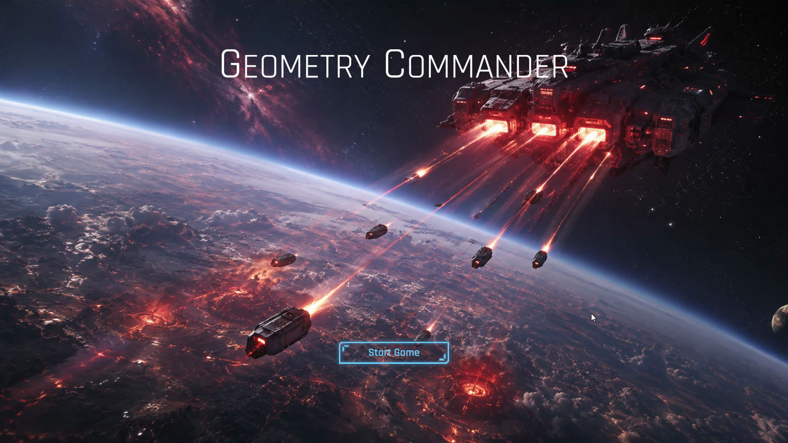

#### 개발 순서
**코어 루프를 가장 먼저 끝까지 연결하고, 그 위에 규칙 → UI → 연출 → 빌드 → 밸런스 순으로 쌓았습니다.**
기능을 하나씩 완벽하게 만들기보다, 매 단계마다 "한 판이 시작되고 끝나는" 상태를 유지하는 데 집중했습니다.

| 날짜 | 단계 | 작업 |
|---|---|---|
| 06.24 ~ 06.25 | 핵심 조작 | 커맨드 입력 확인 시스템, 커맨드 창 UI, 데미지 |
| 06.26 ~ 06.28 | 자동 전투 | 아군·적 전투, 코루틴 FSM |
| 06.29 | 제약 규칙 | 사거리 버그 수정, 자원·인구수·쿨타임 |
| 06.30 | 콘텐츠 | 궤도 폭격(지원 유닛) |
| 07.01 ~ 07.02 | 게임 흐름 | 클리어·게임 오버, 쿨타임 UI, 메인 메뉴 |
| 07.03 ~ 07.05 | 연출 | 전투 이펙트, 클리어·실패 창, 지원 폭격 이펙트 |
| 07.06 | 마감 | 정보 화면, 폭격 범위 커서, 사기 시각화, **빌드** |
| 07.07 | 밸런스 | 빌드 플레이 후 버그·수치 수정 |

#### 기획 대비 구현
처음 기획서에 적은 항목과 실제 구현을 비교했습니다. 코어 루프를 먼저 완성하는 데 집중하고, 변수 요소와 연출은 다음 단계로 미뤘습니다.

| 기획 항목 | 결과 | 비고 |
|---|---|---|
| 방향키 커맨드 소환 (등급별 길이, 오입력 시 처음부터) | ✅ 구현 | 커맨드 길이 5 / 7 / 9 / 12 |
| 코스트 하이브리드 충전 (자연 회복 + 적 처치) | ✅ 구현 | 초당 1, 처치 시 5 |
| 인구수 제한 · 병종별 쿨타임 | ✅ 구현 | |
| 기호 상성 자동 전투 · 미니 체력바 | ✅ 구현 | 아군·적·베이스 모두 체력바, 아군은 사기 바 추가 |
| 자원을 **선택 시점에 선점** | 🔄 변경 | 선택 시점에는 확인만 하고, **투하 시점에 차감**하도록 바꿨습니다 (0.4, 4.2) |
| 승리 조건 (제한 시간 생존 또는 웨이브 전멸) | 🔄 일부 | 제한 시간(180초) 생존만 구현 |
| 다중 구역 전술 스크린 전환 | ❌ 미구현 | 한 화면 전장으로 단순화 |
| 해킹 유닛 (경고 알람, 커맨드로 해킹 해제) | ❌ 미구현 | 업데이트 기획의 신규 적으로 이동 |
| 카메라 셰이크 · 글리치 · 사운드 | ❌ 미구현 | 전투·폭격 이펙트만 구현, 5.3 개선 계획으로 이동 |

#### 빌드를 직접 플레이해 보니

| | 확인한 것 |
|---|---|
| ✅ 의도대로 | 적이 등장해 아군 유닛과 싸우는 핵심 루프가 동작. 커맨드를 치는 동안에도 적이 다가오므로, 비싼 유닛(커맨드 9~12개)과 싼 유닛(커맨드 5개) 사이에서 고르는 긴장감이 생김 |
| ⚠️ 문제 | 전장이 작아 플레이가 단조로움 |
| ⚠️ 문제 | 아군·적 유닛 종류가 적어 상성이나 전략을 고민할 여지가 부족 |
| ⚠️ 문제 | 아군이 투하된 자리에 고정되어 배치 이후에 할 수 있는 판단이 적음 |
| ⚠️ 문제 | 사운드가 없고 전투·소환 이펙트가 약해 조작 피드백이 부족 |

### 5.2 아쉬운 점

기능 구현과 연동에 집중하다 보니 클래스 간 결합도가 높아지고 단일 책임 원칙이 지켜지지 않았습니다. 아래 표는 문제마다 개선 계획을 한 줄씩 짝지은 것입니다.

| 아쉬운 점 | 지금 상태 | 생긴 문제 | 개선 계획 |
|---|---|---|---|
| 한 클래스에 몰린 책임 | `CommandSystem`이 입력 검증 + 프리팹 생성 + 사기 회복까지 처리 | 소환 방식을 바꾸려면 입력 코드를 건드려야 함 | 소환은 `UnitSpawner`로 분리 |
| 상태 머신 코드 중복 | `MeleeUnit`·`RangeUnit`이 타겟 기준만 다르고 Spawn → Scan → Attack 흐름은 같음 | 같은 수정을 두 번 해야 함 | FSM은 `PlayerUnit`으로 올리고 타겟 선정만 인터페이스로 |
| 흩어진 전투 연산 | 상성 배율이 네 클래스에 `if`로 나뉨 | 한쪽만 틀려도 알아채기 어려움. **4.4의 상성 오류가 실제로 여기서 생김** | `CombatManager`가 3×3 배율 표 하나로 계산 |
| 흩어진 유닛 데이터 | 커맨드 길이는 `UnitType` 값, 비용·인구수·쿨타임은 `switch`와 별도 enum | 유닛 하나를 추가하려면 여러 파일을 고쳐야 함 | 유닛 데이터를 ScriptableObject로 묶기 |

### 5.3 향후 개선 계획

5.2 표의 리팩토링에 더해, 플레이에서 확인한 문제(5.1)를 이렇게 풀 계획입니다.

| 확인한 문제 | 계획 |
|---|---|
| 조작 피드백이 약함 (사운드 없음, 이펙트 약함) | `DoTween`으로 포드 낙하·타격·파괴 연출, 커맨드 입력·낙하 효과음, 카메라 셰이크 |
| 전장이 작고 단조로움 | 튜토리얼, 스테이지 확장, 신규 적(해킹·은신 유닛) |
| 유닛 종류가 적어 상성·전략을 고민할 여지가 부족 | 스테이지 클리어 보상 유닛을 바꿔 끼우는 유닛 덱 설정 단계 |
