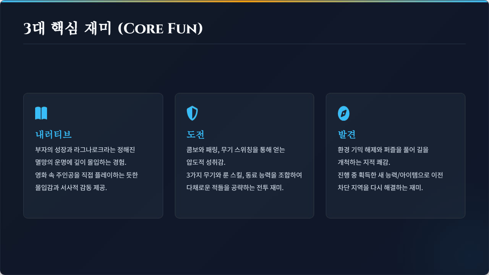
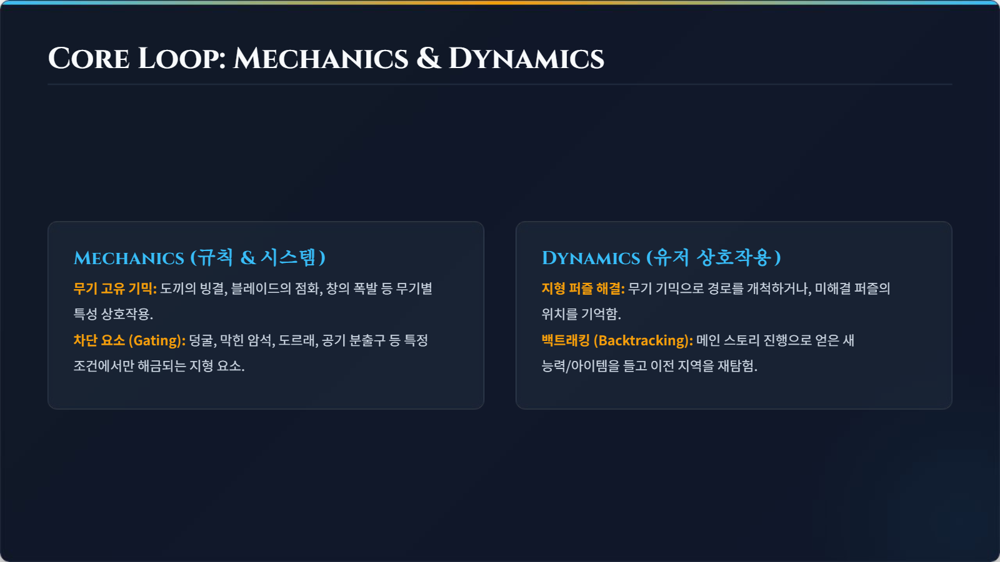
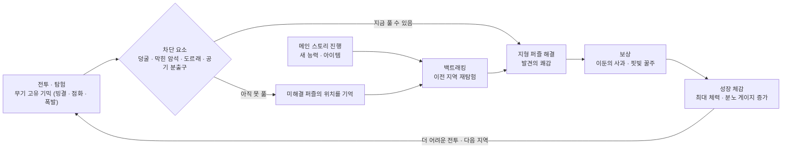
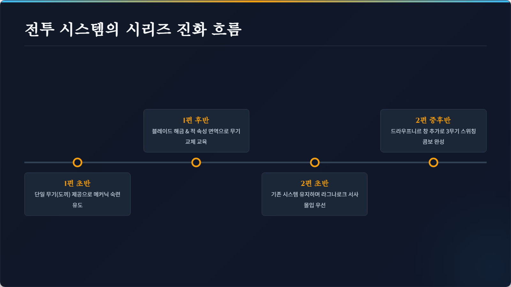

# 갓 오브 워 라그나로크 기획 분석

## 1. 개요

| 항목 | 내용 |
|---|---|
| 구분 | 기획 분석 |
| 대상 게임 | 갓 오브 워 라그나로크 |
| 분석 범위 | Core Fun · Core Loop · 시리즈에 걸친 전투(도전) 설계 |
| 참고 영상 | https://youtu.be/crQ5pazN840 · https://youtu.be/D7Enav00Lp8 |

기획 스터디에 참가해 **"인상적인 게임을 기획자의 시선에서 분석하기"**라는 주제로 고른 게임입니다.
첫 PS4 Pro를 사고 처음 한 게임이 갓 오브 워였고, 트리플 A 게임을 이렇게 열심히 해 본 것은 처음이었습니다. 전투의 깊이, 탐험의 맛, 내러티브 모든 것이 좋았습니다.
이 세 가지는 2장에서 정리한 세 핵심 재미(도전 · 발견 · 내러티브)와 같습니다. 플레이어로서 좋았던 것이 왜 좋았는지를 기획자의 시선으로 풀어 보는 것이 이 분석의 출발점입니다.

갓 오브 워 라그나로크의 핵심 재미(Core Fun)와 핵심 루프(Core Loop)를 정리하고, 그중 **도전**이 1편부터 2편까지 무기 체계를 넓혀 가며 어떻게 설계되었는지를 분석했습니다.

분석은 세 단계로 나눴습니다. 먼저 플레이어가 느끼는 핵심 재미를 세 가지로 정리하고(2장), 그 재미가 어떤 규칙과 행동의 반복에서 나오는지를 Core Loop로 풀었습니다(3장).
Core Loop는 **MDA**(Mechanics · Dynamics · Aesthetics) 틀로 나눠 봤습니다. 게임이 정한 규칙(Mechanics)이 플레이어의 행동(Dynamics)을 만들고, 그 행동이 플레이어가 느끼는 경험(Aesthetics)으로 이어진다는 관점입니다.
마지막으로 세 재미 중 **도전**을 골라, 시리즈 두 편에 걸쳐 무기를 어떤 순서로 주며 플레이어를 가르치는지 깊게 살펴봤습니다(4장).

---

## 2. Core Fun: 유저가 느끼는 3가지 핵심 경험

**내러티브.** 부자의 성장과 라그나로크라는 정해진 멸망의 운명에 깊이 몰입하는 경험입니다. 영화 속 주인공을 직접 플레이하는 듯한 몰입감과 서사적 감동을 줍니다.

**도전.** 콤보와 패링, 무기 스위칭을 통해 얻는 압도적 성취감입니다. 3가지 무기와 룬 스킬, 동료 능력을 조합하여 다채로운 적들을 공략하는 전투 재미가 있습니다.

**발견.** 환경 기믹 해제와 퍼즐을 풀어 길을 개척하는 지적 쾌감입니다. 진행 중 획득한 새 능력/아이템으로 이전 차단 지역을 다시 해결하는 재미가 있습니다.

세 재미는 따로 노는 것이 아니라, 이 문서에서 살펴본 장치들이 각각을 받치고 있습니다.

| 핵심 재미 | 받치는 장치 | 다루는 곳 |
|---|---|---|
| 내러티브 | 2편 초반에 새 메커닉을 던지지 않고 서사에 먼저 몰입시킴, 동료의 대화로 주는 힌트 | 4.3 · 6장 |
| 도전 | 무기를 순서대로 주는 학습 곡선, 적의 속성 면역으로 강제하는 무기 스위칭 | 4장 · 5장 |
| 발견 | 차단 요소(Gating)와 백트래킹, 무기 기믹으로 푸는 지형 퍼즐 | 3장 |

---

## 3. Core Loop

### 3.1 Mechanics & Dynamics

| Mechanics (규칙 & 시스템) | Dynamics (유저 상호작용) |
|---|---|
| **무기 고유 기믹**: 도끼의 빙결, 블레이드의 점화, 창의 폭발 등 무기별 특성 상호작용 | **지형 퍼즐 해결**: 무기 기믹으로 경로를 개척하거나, 미해결 퍼즐의 위치를 기억함 |
| **차단 요소 (Gating)**: 덩굴, 막힌 암석, 도르래, 공기 분출구 등 특정 조건에서만 해금되는 지형 요소 | **백트래킹 (Backtracking)**: 메인 스토리 진행으로 얻은 새 능력/아이템을 들고 이전 지역을 재탐험 |

핵심은 **전투용 무기가 곧 탐험의 열쇠**라는 점입니다. 도끼의 빙결, 블레이드의 점화, 창의 폭발은 전투에서 쓰는 기믹이면서 동시에 차단 요소를 푸는 도구입니다.
그래서 새 무기를 얻는 순간 전투 방식이 넓어지는 동시에, 예전에 지나친 막힌 길이 "이제 풀 수 있는 퍼즐"로 바뀝니다. 이것이 플레이어를 이전 지역으로 되돌아가게 만드는 백트래킹의 동기가 됩니다.

### 3.2 발견과 성장의 환원 (Aesthetics & Growth Feedback)

- **발견의 쾌감**: 막혔던 길을 나의 힘과 아이템으로 풀어냈을 때의 지적 성취감을 줍니다.
- **성장 체감**: 퍼즐 및 탐험 보상(이둔의 사과, 핏빛 꿀주)을 통해 최대 체력 및 분노 게이지가 늘어납니다.
- **루프의 완성**: 강화된 스펙과 보상을 바탕으로 더 어려운 전투 및 다음 지역 탐험에 도전하는 선순환이 만들어집니다.

MDA로 이어 보면, 규칙 하나하나가 어떤 행동을 거쳐 어떤 경험으로 돌아오는지 보입니다.

| Mechanics (규칙) | → Dynamics (행동) | → Aesthetics (경험) |
|---|---|---|
| 무기 고유 기믹 (빙결 · 점화 · 폭발) | 무기 기믹으로 경로를 개척함 | 발견의 쾌감 |
| 차단 요소 (덩굴 · 막힌 암석 · 도르래 · 공기 분출구) | 미해결 퍼즐의 위치를 기억했다가, 새 능력을 얻으면 되돌아감 (백트래킹) | 발견의 쾌감 |
| 탐험 보상 (이둔의 사과 · 핏빛 꿀주) | 퍼즐과 탐험을 마저 풀어 보상을 모음 | 성장 체감 (최대 체력 · 분노 게이지 증가) |
| 강화된 스펙 | 더 어려운 전투와 다음 지역에 도전함 | 루프의 완성 (선순환) |

위 규칙과 상호작용을 한 바퀴로 이으면 아래와 같습니다.

---

## 4. 심층 분석: 도전

세 재미 중 도전을 골라, 시리즈에 걸쳐 무기 체계를 넓히며 플레이어의 학습 곡선을 설계한 방식을 살펴봤습니다.

### 4.1 전투 시스템의 시리즈 진화 흐름

| 단계 | 새로 주는 것 | 플레이어가 익히는 것 | 설계 |
|---|---|---|---|
| 1편 초반 | 리바이어던 도끼 (+ 아트레우스의 속성 화살) | 던지기/회수와 근접 기초 조작 | 단일 무기(도끼) 제공으로 메커닉 숙련 유도 |
| 1편 후반 | 혼돈의 블레이드 | 적 속성에 맞춘 무기 교체 | 블레이드 해금 & 적 속성 면역으로 무기 교체 교육 |
| 2편 초반 | 새 메커닉 없음 | (이미 익힌 조작으로) 라그나로크 서사 | 기존 시스템 유지하며 라그나로크 서사 몰입 우선 |
| 2편 중후반 | 드라우프니르 창 | 3무기 실시간 스위칭 콤보 | 드라우프니르 창 추가로 3무기 스위칭 콤보 완성 |

새 무기는 언제나 **이전 단계를 충분히 익힌 뒤**에 들어옵니다. 도끼 하나로 기초를 익힌 뒤에 블레이드가 오고, 두 무기의 스위칭이 익숙해진 2편에서는 한동안 아무것도 더하지 않다가, 전투가 반복되기 시작할 즈음에 창이 들어옵니다.

**직접 플레이하며 겪은 흐름.** 실제로 플레이할 때도 이 설계대로 움직였습니다. 좋아하는 무기가 어떤 적들에게는 먹히지 않아 무기를 바꿔 보게 되었고,
퍼즐을 풀 때는 다양한 무기가 필요해 쓰다 보니 다른 무기들에도 익숙해졌습니다. 나중에는 상황마다 맞는 스킬이 먼저 떠올라 쓰게 되었습니다.
돌아보면 적의 속성 면역(전투)과 무기로 푸는 퍼즐(탐험)이 둘 다 무기를 바꾸게 만들었고, 그렇게 바꿔 쓰는 사이에 학습 곡선을 따라 올라간 셈입니다.

### 4.2 1편: 무기 제한과 학습 곡선

1편은 무기를 일부러 제한하는 데서 시작합니다.

- **도끼 단일 제공**: 초반에는 '리바이어던 도끼'만 제공하여 던지기/회수 및 근접 기초 조작을 익히도록 유도합니다.
- **아트레우스의 속성 화살**: 단일 무기의 지루함을 막기 위해 동료의 속성 화살로 전투를 보완합니다.
- **블레이드 해금과 향수**: 후반부의 '혼돈의 블레이드'로 원작 팬에게는 향수를, 신규 유저에게는 신선함을 줍니다.
- **속성 교육**: 화염/빙결 면역 적을 교차 배치하여 속성 스위칭 전투를 학습시킵니다.

무기를 하나로 묶어 두면 단조로워질 수 있는데, 그 빈자리를 동료의 속성 화살이 메웁니다. 그리고 두 번째 무기를 줄 때는 무기만 주는 것이 아니라, 그 무기를 **써야만 하는 적**(속성 면역 적)을 함께 배치해 교체를 자연스럽게 가르칩니다.

### 4.3 2편: 서사 몰입과 콤보 확장

**초반부: 서사 집중 유도.** 1편 플레이어를 고려하여 복잡한 새 메커닉을 던지지 않습니다. 이미 익숙해진 기존 조작을 바탕으로 2편의 거대한 라그나로크 스토리라인에 우선 몰입하도록 설계했습니다.

**중반부: 드라우프니르 창 해금.** 전투 반복감이 시작될 수 있는 중반부에 3번째 무기 '드라우프니르 창'을 도입합니다.
[도끼(빙결)] - [블레이드(화염)] - [창(폭발/흡수)] 3무기를 실시간으로 스위칭하며 적을 압도하는 고난도 콤보가 완성됩니다.

2편은 새 무기를 **언제** 주는지가 1편과 다릅니다. 초반에는 내러티브(핵심 재미 ①)에 자리를 내주고, 도전(핵심 재미 ②)이 반복감으로 떨어질 수 있는 중반에 새 무기로 다시 끌어올립니다. 두 재미가 번갈아 앞에 서도록 배치한 것입니다.

---

## 5. 기획자 관점의 전투 설계

- **단계적 학습 곡선**: 플레이어에게 모든 무기를 한 번에 주지 않고 시리즈 전체에 걸쳐 순차 제공하여 몰입(Flow) 채널을 유지합니다.
- **속성 스위칭 강제**: 적의 속성 면역 디자인을 활용해 단조로운 원 패턴 스팸 공격을 차단하고 전략적 무기 교체를 유도합니다.
- **메커닉의 유기적 통일성**: 전투용 무기가 곧 탐험 기믹을 푸는 열쇠로 작동하도록 설계하여 전투와 탐험 시스템을 완벽히 결합했습니다.

세 원칙을 정리하면, **새 시스템을 하나씩 열고 → 그 시스템을 써야만 하는 상황을 만들고 → 그 시스템을 게임의 다른 부분(탐험)에도 쓰게 한다**는 흐름입니다.

---

## 6. 개인적으로 긍정적으로 평가하는 부분

- **대화를 통한 힌트**: 플레이어가 어려움을 겪을 때 몰입을 해치지 않으면서 동료의 대화로 힌트를 줍니다.
- **동료의 필요성**: 동료의 속성 무기가 아니면 파훼할 수 없는 패턴과 퍼즐들이 있습니다.

---

## 7. 내 프로젝트와 비교

분석한 원칙을 내 프로젝트에 놓고 보면, 같은 생각이 규모만 다르게 들어가 있는 곳이 있습니다.

| 분석한 원칙 | 갓 오브 워 라그나로크 | 내 프로젝트 |
|---|---|---|
| 단계적 학습 곡선 (새 시스템은 하나씩) | 도끼 → 블레이드 → 창을 시리즈에 걸쳐 순서대로 제공 | **Soul Knight**: 첫 판은 공격 · 구르기 · 회복약만으로 싸우고, 대장간은 첫 사망에, 2단계 문은 1단계 처치 뒤에, 꼬리 요리는 꼬리를 처음 잘랐을 때 열림 |
| 속성 스위칭 강제 (상성으로 선택을 만든다) | 화염/빙결 면역 적을 교차 배치해 무기 교체를 유도 | **Geometry Commander**: 세모 > 동그라미 > 네모 > 세모 상성 순환(유리 2배 · 불리 0.5배)으로, 적의 기호를 보고 카운터 유닛을 고르게 함 |
| 메커닉의 통일성 (한 장치가 두 시스템에) | 전투용 무기가 탐험 기믹을 푸는 열쇠 | **Soul Knight**: 부위 파괴가 소재 보상이면서, 날개를 깨면 비행 패턴이 사라져 싸움 자체를 쉽게 만듦 |

<!-- 보강할 곳: 이 분석을 한 뒤 내 프로젝트에서 실제로 바꾸거나 적용한 것이 있으면, 무엇을 왜 그렇게 했는지 -->

---

## 8. 참고 자료

- 참고 영상: https://youtu.be/crQ5pazN840 · https://youtu.be/D7Enav00Lp8
- 원본 발표 자료의 게임 그림 출처: wccftech.com, www.playstation.com (이 문서에는 싣지 않았습니다)
